# 附录概览

> Applies to: 7.x（Dawntrail） ｜ Last Updated: 2026-11-01

> 附录放的是「查得到、用得上」的速查内容。

正文按主题展开，附录按**用途**归类：查名词、查表格、查更新、查来源。

---

## 附录导航

- :material-book-alphabet:

    ### 术语表

    Shader、Material、Texture 相关的英文术语与中文对照。

    [:material-arrow-right: 查看术语表](glossary.md)

- :material-table:

    ### 着色器参考表

    各 Shader 的通道、Shader Key 与 Constant 对照，附 Penumbra / TexTools 名称映射。

    [:material-arrow-right: 查看参考表](materials-table.md)

- :material-history:

    ### 更新日志

    记录站点内容的增补与修订，标注每条变更的类型与日期。

    [:material-arrow-right: 查看更新日志](changelog.md)

- :material-link-variant:

    ### 参考资料

    文档站、工具仓库、渲染研究、官方文档的来源整理。

    [:material-arrow-right: 查看参考资料](references.md)

---

## 使用建议

| 你的问题 | 去哪里查 |
|---|---|
| 这个词什么意思 | [术语表](glossary.md) |
| 这个通道代表什么 | [着色器参考表](materials-table.md) |
| 这条结论是什么时候写的 | [更新日志](changelog.md) |
| 这个说法出自哪里 | [参考资料](references.md) |

!!! tip "先看日期"

    图形相关的结论会随游戏版本变化。
    引用任何参数前，先确认它对应当前版本（7.x）。

---

## 状态标记说明

本站内容使用四种状态标记，含义在 [参考资料 · 引用规范](references.md) 中有完整说明。

| 标记 | 含义 |
|---|---|
| ✅ Verified | 已通过实测或可靠来源确认 |
| 🟡 Researching | 有社区资料支持，仍在整理 |
| 🟠 Hypothesis | 推测，尚未验证 |
| 🔴 Unknown | 目前没有可用信息 |

---

## GRC Logo

站点 Logo 可用于引用本站的场合。

- PNG（透明背景）

[:material-download: 下载 Logo](../assets/images/icons.png){ .md-button }

---

## References

- [XIV Modding Wiki](https://xivmodding.com/)
- [TexTools](https://github.com/TexTools/FFXIV_TexTools_UI)
- [Penumbra](https://github.com/xivdev/Penumbra)
- [XIVLauncher](https://github.com/goatcorp/FFXIVQuickLauncher)
- [Blender](https://www.blender.org/)
