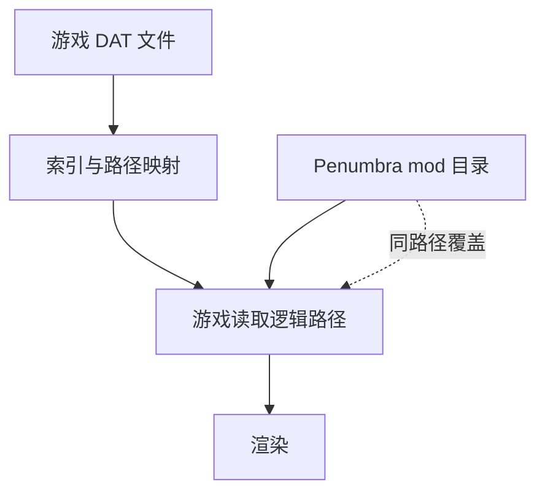

# FF14 的文件结构

> Applies to: 7.x（Dawntrail） ｜ Last Updated: 2026-11-01

## Overview

FFXIV 的游戏资源打包在 DAT 文件里，通过索引映射成逻辑路径。

Mod 工具（TexTools、Penumbra）操作的就是这套**逻辑路径**，而不是 DAT 本身。

!!! note "为什么路径很重要"
    Penumbra 的覆盖方式就是「在 mod 目录里放一个同路径文件」。路径写错，mod 就不会生效，而且往往没有任何报错。

## 资源类型

| 类型 | 扩展名 | 内容 |
|---|---|---|
| Model | `.mdl` | 几何、UV、骨骼绑定、材质引用 |
| Material | `.mtrl` | Shader、参数、贴图绑定 |
| Texture | `.tex` | 图像数据（DDS 的容器格式） |
| Animation | `.pap` | 动画 |
| Skeleton | `.sklb` | 骨骼 |
| VFX | `.avfx` | 特效 |
| ColorSet | `.atex` / 内嵌 | 染色数据 |
| IMC | `.imc` | 模型变体定义 |
| EQP | `.eqp` | 装备参数 |

## 顶层目录

| 目录 | 内容 |
|---|---|
| `chara/` | 角色、装备、武器、坐骑 |
| `common/` | 通用资源（UI、字体、公共贴图） |
| `bg/` | 场景与地形 |
| `vfx/` | 特效 |
| `ui/` | 界面 |
| `sound/` | 音频 |

## 角色资源结构

角色按「种族/部族 → 部位 → 编号 → 版本」组织：

```text
chara/human/c0101/
├── obj/
│   ├── body/b0001/
│   │   ├── model/c0101b0001_top.mdl
│   │   ├── material/v0001/mt_c0101b0001_top_a.mtrl
│   │   └── texture/v0001/c0101b0001_top_d.tex
│   ├── face/f0001/
│   ├── hair/h0001/
│   ├── tail/t0001/
│   └── ear/e0001/
└── skeleton/
```

| 片段 | 含义 | 可信度 |
|---|---|---|
| `c0101` | 种族 + 部族编号 | ✅ Verified |
| `b0001` / `f0001` / `h0001` | 部位 + 编号 | ✅ Verified |
| `v0001` | 资源版本目录 | ✅ Verified |
| `mt_..._a.mtrl` | 材质变体（a / b / c） | 🟡 Researching |

## 装备结构

装备按「部位 + 编号」组织，一个装备通常由模型、材质、贴图、ColorSet 组成：

```text
chara/equipment/e0001/
├── model/
│   └── c0201e0001_top.mdl
├── material/
│   └── v0001/mt_c0201e0001_top_a.mtrl
└── texture/
    └── v0001/c0201e0001_top_d.tex
```

同一件装备可能有多个材质变体，对应不同种族或不同外观分支。

## 贴图命名约定

命名是**社区约定**，不是引擎强制规则，但几乎所有资源都遵循：

| 后缀 | 常见含义 | 可信度 |
|---|---|---|
| `_d` | Base Color / Diffuse | 🟡 Researching |
| `_n` | Normal Map | 🟡 Researching |
| `_m` | Mask Map | 🟡 Researching |
| `_id` | 染色索引 | 🟡 Researching |
| `_s` | 部分资源使用，用途随 Shader 变化 | 🟠 Hypothesis |

!!! warning "不要只靠后缀判断用途"
    后缀只是线索。真正决定用途的是 Material 里的 Sampler 绑定，见 [Sampler](../materials/sampler.md)。

## 共享贴图

部分资源不放在每个装备目录下，而是集中存放：

```text
chara/common/texture/
├── skin/
├── eye/
└── ...
```

面部、眼睛、皮肤常常引用这里的公共贴图。这也是「改了公共贴图后，所有角色都变了」的原因。

## 加载流程



游戏中每次读取资源时，Penumbra 会先检查 mod 目录里有没有同路径文件：

- 有 → 使用 mod 文件
- 没有 → 回退到游戏原始资源

因此**路径完全一致**是 mod 生效的前提。

## Mod 的两种加载方式

| 方式 | 是否修改游戏文件 | 推荐度 | 说明 |
|---|---|---|---|
| TexTools 直接导入 | 是 | 不推荐 | 改的是游戏资源，难回滚 |
| Penumbra 覆盖 | 否 | 推荐 | 可开关、可叠加、可分享 |

TexTools 依然重要：它负责解包、预览、导出，以及生成 mod 所需的文件。

!!! tip "工作流建议"
    用 TexTools 导出 → 在外部编辑 → 把结果放进 Penumbra mod 目录。游戏原始文件始终保持干净。

## 常见问题

| 症状 | 可能原因 | 处理 |
|---|---|---|
| mod 不生效 | 路径大小写或目录层级不对 | 与导出路径逐字符比对 |
| 只有部分种族生效 | 只替换了一个种族目录 | 按目标种族分别放置 |
| 改了公共贴图导致全角色变化 | 覆盖了 `chara/common/` 下的共享资源 | 改为覆盖具体装备目录 |
| 模型显示但材质丢失 | 缺少 `.mtrl` 或贴图路径错误 | 同时提供材质与贴图 |

## 相关页面

- [安装环境](installation.md)
- [MTRL 格式](../materials/mtrl-format.md)
- [TexTools](../workflows/textools.md)
- [Penumbra](../workflows/penumbra.md)

## References

- XIV Modding Wiki — https://xivmodding.com/
- TexTools — https://github.com/TexTools/FFXIV_TexTools_UI
- Penumbra — https://github.com/xivdev/Penumbra
