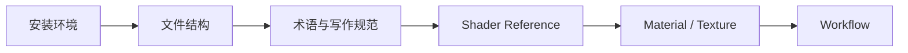

# 入门概览

> Applies to: 7.x（Dawntrail） ｜ Last Updated: 2026-11-01

## Overview

这一章解决「开始之前必须知道的事」：

- 需要装什么
- 游戏文件长什么样
- 文档里的术语怎么读

不需要先读完全部内容，按下面的顺序走一遍即可。

## 章节导航

- :material-download:

    ### [安装环境](installation.md)

    游戏本体、Penumbra / Dalamud、Blender、TexTools。

- :material-folder-tree:

    ### [FF14 的文件结构](folder-structure.md)

    `.mdl`、`.mtrl`、`.tex` 分别放在哪，怎么被加载。

- :material-format-letter-case:

    ### [术语与写作规范](glossary.md)

    Shader、Material、ColorSet 等术语的统一写法。

## 建议的阅读路线

| 阶段 | 目标 | 读完后你应该能… |
|---|---|---|
| 安装环境 | 工具能跑起来 | 打开 TexTools 并导出贴图 |
| 文件结构 | 知道资源在哪 | 说出某件装备的 `.mtrl` 路径 |
| 术语规范 | 读懂后续页面 | 区分 Shader Key 与 Material Constant |
| Shader | 理解渲染路径 | 判断某件装备用的是哪类 Shader |
| Material / Texture | 会改材质与贴图 | 完成一次换图并生效 |
| Workflow | 会打包发布 | 生成可分享的 Penumbra mod |

## 需要准备什么

| 类别 | 必备 | 可选 |
|---|---|---|
| 游戏 | 国际服或国服客户端 | 第二个测试用账号 |
| Mod 加载 | XIVLauncher + Dalamud + Penumbra | Glamourer 等外观插件 |
| 资源工具 | TexTools | VFXEditor |
| 模型 | Blender 4.x LTS | Substance 3D Painter |
| 贴图 | Photoshop 或 GIMP | 支持 DDS 的插件 |

!!! warning "版本一致性"
    工具版本与游戏版本不匹配，是「导入成功但游戏内不生效」最常见的原因。大版本更新后先更新 TexTools 与 Penumbra。

## 相关章节

- [Shader（着色器）概览](../shaders/index.md)
- [Material（材质）概览](../materials/index.md)
- [Texture（贴图）概览](../textures/index.md)
- [Workflow（工作流）概览](../workflows/index.md)

## References

- Penumbra — https://github.com/xivdev/Penumbra
- TexTools — https://github.com/TexTools/FFXIV_TexTools_UI
- XIVLauncher — https://github.com/goatcorp/FFXIVQuickLauncher
- XIV Modding Wiki — https://xivmodding.com/
