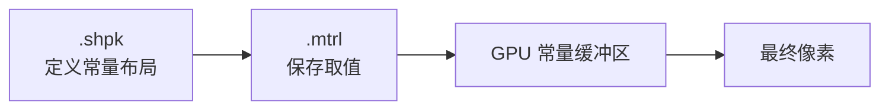
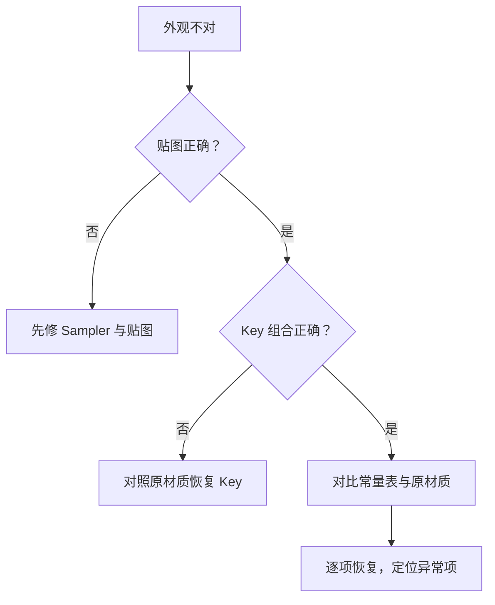

# Material Constants

> Applies to: 7.x（Dawntrail） ｜ Last Updated: 2026-11-01

## Overview

Material Constant（材质常量）是 Material 里给 Shader 的数值参数。

它回答「这个功能有多强」，而不是「有没有这个功能」：

- 颜色：Diffuse、Emissive 的基色
- 强度：高光强度、发光强度、效果不透明度
- 尺度：UV 平铺次数、噪声频率
- 速度：滚动、流动的速率
- 索引：切换 Shader 内置效果的分支编号（如 Effect ID）

!!! note "与 Shader Key 的分工"
    Key 决定分支走不走，Constant 决定走这条分支时的具体数值。

## 数据来源

Constant 的**定义**来自 `.shpk`，**取值**存在 `.mtrl` 里。

因此：

- 不同 `.shpk` 的常量表不同，名字相同的参数也可能量纲不同；
- 缺失的常量会使用 Shader 默认值还是 0，取决于实现 🟡 Researching；
- 直接照抄别的材质常量，可能出现数值溢出或完全无效果。

## 常见类型

| 类型 | 典型用途 | 示例 |
|---|---|---|
| float | 单一强度、速度 | 高光强度、滚动速度 |
| float2 | 平铺次数、偏移 | TileScale |
| float3 | 颜色（线性空间） | Emissive 颜色 |
| float4 | 颜色 + Alpha | Diffuse 颜色 |
| uint | 枚举/索引 | Effect ID |

!!! warning "颜色空间"
    Constant 里的颜色通常按线性空间参与计算，而贴图可能是 sRGB。直接照抄截图里拾取的颜色值，往往偏亮或偏暗。🟡 Researching

## 在工具中查看

| 工具 | 查看方式 | 说明 |
|---|---|---|
| TexTools | Material Editor 的参数列表 | 显示名称与当前值 |
| Penumbra | 覆盖整个 `.mtrl` | 不提供逐项编辑 UI |
| 自写解析器 | 按 `.shpk` 布局解析 | 适合批量研究 |

!!! tip "先记录，再修改"
    改动前把原始常量表导出或截图。绝大多数「改坏了」的情况，都是因为原始值没有留档。

## 典型参数类别

| 类别 | 影响 | 常见现象 |
|---|---|---|
| 颜色类 | 整体色调、发光色 | 改错后装备发灰或过饱和 |
| 强度类 | 高光、发光、透明度 | 常见「太白」「太亮」 |
| 尺度类 | 纹理平铺、噪声频率 | 贴图拉伸或细碎 |
| 速度类 | 滚动、飘动 | 静止或快到闪烁 |
| 索引类 | 内置效果切换 | 效果与预期完全不符 |

!!! note "Effect ID"
    Character Shader 支持的「效果 ID」属于索引类常量，需要配合「效果不透明度」使用：不透明度为 0 时没有效果，为 1 时是完整效果。详见 [Character Shader](../shaders/character-shaders.md) 与 [着色器参考表](../appendix/materials-table.md)。🟡 Researching

## 排查思路

| 症状 | 可能原因 | 处理 |
|---|---|---|
| 整体过亮/过暗 | 颜色或强度常量异常 | 与原始值逐项比对 |
| 高光消失 | 高光强度被设为 0 | 恢复默认值 |
| 贴图看起来被拉伸 | 平铺尺度常量异常 | 检查 float2 类参数 |
| 效果不出现 | 效果不透明度为 0 | 提高到 0.5 以上测试 🟡 |

## 相关页面

- [MTRL 格式](mtrl-format.md)
- [Shader Keys](shader-keys.md)
- [Sampler](sampler.md)
- [Character Shader](../shaders/character-shaders.md)
- [着色器参考表](../appendix/materials-table.md)

## References

- XIV Modding Wiki — https://xivmodding.com/
- TexTools — https://github.com/TexTools/FFXIV_TexTools_UI
- Penumbra — https://github.com/xivdev/Penumbra
