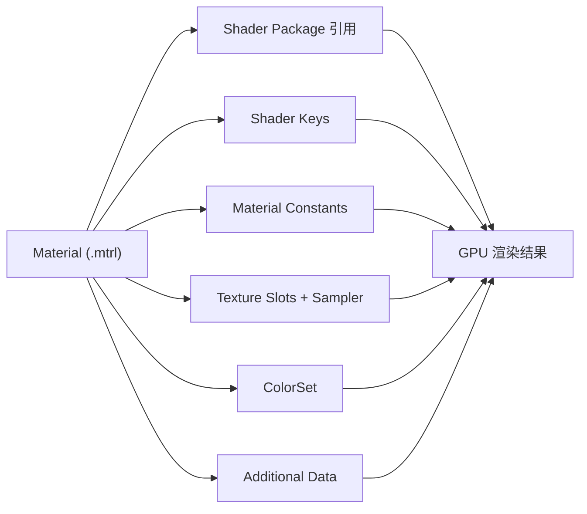

# Material（材质）概览

> Applies to: 7.x（Dawntrail） ｜ Last Updated: 2026-11-01

## Overview

Material（材质）在 FFXIV 中由 `.mtrl` 文件承载。

它本身不包含像素数据，也不包含渲染算法，而是回答三个问题：

1. 这个模型用哪个 Shader（着色器）渲染？
2. 这个 Shader 打开哪些开关、使用哪些数值参数？
3. 每个 Texture Slot 放哪张图，使用哪个 ColorSet？

!!! note "一句话理解"
    Shader 定义「怎么算」，Material 定义「用什么参数算」，Texture 提供「参与计算的图」。

## 章节导航

- :material-file-code:

    ### [MTRL 格式](mtrl-format.md)

    `.mtrl` 的头部、ShaderPackage、贴图条目、ColorSet 与附加数据。

- :material-palette-swatch-variant:

    ### [Material Constants](constants.md)

    浮点参数：颜色、强度、速度、效果 ID。

- :material-image-frame:

    ### [Sampler](sampler.md)

    Texture Slot 与采样状态，决定哪张图进入哪个通道。

- :material-key-variant:

    ### [Shader Keys](shader-keys.md)

    开关式的渲染分支，决定同一 Shader 走哪条路径。

## 一个 Material 里有什么

| 组成部分 | 作用 | 常见修改场景 |
|---|---|---|
| Shader Package | 指定 `.shpk`，决定渲染算法 | 换 Shader 类型（如 Character → Glass） |
| Shader Keys | 开关渲染分支 | 开关贴图、双面、染色、发光 |
| Material Constants | 数值参数 | 金属度补偿、滚动速度、效果强度 |
| Texture Slots | 贴图引用 | 换贴图、改通道用途 |
| ColorSet | 染色数据 | 自定义染色、装备改色 |
| Additional Data | 附加参数块 | 少数 Shader 专有数据 |

## 阅读顺序

1. 先读 [MTRL 格式](mtrl-format.md)，弄清文件里有哪些区块；
2. 再读 [Sampler](sampler.md)，分清「贴图槽」和「贴图」；
3. 然后读 [Shader Keys](shader-keys.md) 与 [Material Constants](constants.md)；
4. 最后结合具体 Shader 页面（如 [Character Shader](../shaders/character-shaders.md)）看实际参数表。

## 常见误解

!!! warning "三个常见误区"
    - **「换了贴图就会生效」**：只有 Shader 实际读取的 Slot，贴图才会影响画面。
    - **「Material 可以随便跨模型复制」**：Key 组合、ColorSet 数量与装备类型强相关，直接覆盖常导致染色错乱或发黑。
    - **「Constant 同名就通用」**：不同 `.shpk` 的常量布局不同，同名参数的量纲也可能不同。

## 研究与版本说明

本站的材质内容会标注可信度：

| 状态 | 含义 |
|---|---|
| ✅ Verified（已验证） | 经过实际修改与游戏内观察确认 |
| 🟡 Researching（研究中） | 有实验，但结论仍在补充 |
| 🟠 Hypothesis（推测） | 社区常见说法，尚未逐一验证 |
| 🔴 Unknown（未知） | 目前没有可靠结论 |

!!! note "版本基准"
    本页以 Dawntrail（7.x）的材质结构为基准。6.x 及更早版本的 Constant 与 Shader Key 布局存在差异，跨版本复制材质前请先确认版本。

## References

- XIV Modding Wiki — https://xivmodding.com/
- TexTools — https://github.com/TexTools/FFXIV_TexTools_UI
- Penumbra — https://github.com/xivdev/Penumbra
