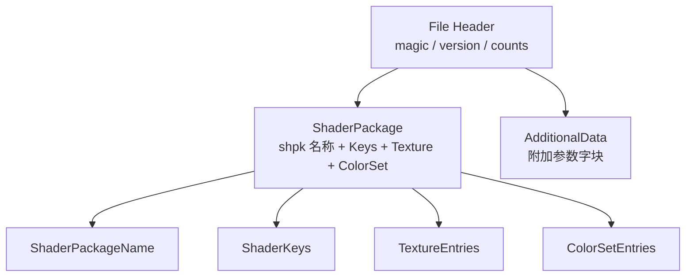

# MTRL 格式

> Applies to: 7.x（Dawntrail） ｜ Last Updated: 2026-11-01

## Overview

MTRL（`.mtrl`）是 FFXIV 的 Material（材质）文件。

它不保存贴图像素，也不保存渲染算法，只保存「引用与参数」：

- 用哪个 Shader Package（`.shpk`）
- 打开哪些 Shader Key
- 每个 Texture Slot 放哪张图
- 每个 ColorSet 行的颜色
- Shader 需要的 Material Constant 与附加数据

一个模型可以挂多个 Material，一个 Material 对应一份 `.mtrl`。

!!! note "先记住这句话"
    `.mtrl` 是**配置文件**，不是资源容器。贴图在 `.tex` 里，算法在 `.shpk` 里。

## 文件位置

材质通常与模型同目录，或位于同级 `material/` 目录下：

```text
chara/human/c0101/obj/body/b0001/
├── model/
│   └── c0101b0001_top.mdl
├── material/
│   └── v0001/mt_c0101b0001_top_a.mtrl
└── texture/
    └── v0001/c0101b0001_top_d.tex
```

!!! tip "如何确认路径"
    在 TexTools 中选中模型后查看 Material 列表，或在 Penumbra 的 mod 目录里按同样的相对路径放置文件。

## 整体结构

`.mtrl` 是一组「偏移 + 长度」包裹的区块。可以按下面的顺序理解：



| 区块 | 内容 | 说明 |
|---|---|---|
| File Header | 魔数、版本、区块数量 | 决定如何解析后续区块 |
| ShaderPackage | `.shpk` 引用、Shader Keys、贴图槽、ColorSet | 材质的主体 |
| AdditionalData | 额外参数块 | 只有部分 Shader 会使用 |

!!! warning "版本差异"
    DX9 与 DX11 的 `.mtrl` 版本号与字段宽度不同。当前游戏使用 DX11 版本（`0x0202`），旧版本的解析器直接读新文件会失败。🟡 Researching

## File Header

头部字段大致如下（字段名沿用社区解析器习惯）：

| 字段 | 类型 | 含义 | 可信度 |
|---|---|---|---|
| Magic | char[4] | 固定为 `MTRL` | ✅ Verified |
| Version | uint16 | 材质版本，DX11 为 `0x0202` | ✅ Verified |
| FileSize | uint32 | 文件总长度 | ✅ Verified |
| ShaderPackageCount | uint16 | Shader Package 数量，通常为 1 | 🟡 Researching |
| TextureCount | uint16 | 贴图条目数量 | 🟡 Researching |
| ColorSetCount | uint16 | ColorSet 数量 | 🟡 Researching |
| AdditionalDataCount | uint16 | 附加数据块数量 | 🟡 Researching |

!!! note "校验方式"
    用十六进制编辑器打开任意 `.mtrl`，前 4 字节应为 `4D 54 52 4C`，随后 2 字节为版本号。

## ShaderPackage

ShaderPackage 决定「这个材质走哪条渲染路径」。

### ShaderPackageName

`.shpk` 路径的 CRC32 值，而不是明文字符串。

因此仅凭材质文件看不到 `characters.shpk` 这样的名字，需要用工具反查 CRC。

| 字段 | 含义 | 可信度 |
|---|---|---|
| Name | `.shpk` 路径的 CRC32 | ✅ Verified |
| KeyCount | 后续 Shader Key 数量 | 🟡 Researching |

### ShaderKeys

每个 Shader Key 是「键 + 值」的组合，值通常只有 0 / 1，用来开关渲染分支。

| 字段 | 含义 |
|---|---|
| KeyId | Key 的编号，由 `.shpk` 定义 |
| Value | 取值，通常是 0 或 1 |

Shader Key 的具体语义见 [Shader Keys](shader-keys.md)。

### TextureEntries

每条贴图记录把「Texture Slot」和「贴图路径」绑定起来。

| 字段 | 含义 |
|---|---|
| SamplerId | Texture Slot 的编号，对应 `.shpk` 里的 Sampler |
| Flags | 采样相关标志位 🟡 |
| Path | `.tex` 的相对路径字符串 |
| ColorSetIndex | 该贴图使用的 ColorSet 行索引（多数贴图不走 ColorSet） |

!!! warning "Sampler 与贴图不是一回事"
    同一个 Sampler 在不同 Shader 里可能采样不同用途的纹理。换图前先确认 Slot 语义，见 [Sampler](sampler.md)。

### ColorSetEntries

ColorSet 是一组「行」，每行保存若干个 16 位颜色值，由 Shader 决定如何解读。

| 概念 | 含义 |
|---|---|
| ColorSet | 一组调色数据，通常对应一件装备 |
| Row | 一行颜色，例如 Diffuse 行、Specular 行 |
| Entry | 行内的一个颜色值 |

行与通道的具体含义随 Shader 变化，详见 [Color Set](../textures/color-set.md)。

## AdditionalData

附加数据是挂在材质末尾的独立数据块，用于存放 Shader 专有参数。

- 不是所有材质都有；
- 不同 Shader 的数据布局不同；
- 编辑器通常以十六进制或结构化视图展示。

细节见 [Additional Data](../shaders/additional-data.md)。

## 读取与编辑

| 方式 | 能做什么 | 适合 |
|---|---|---|
| TexTools Material Editor | 查看/修改 Shader、Keys、贴图、ColorSet | 日常改材质 |
| Penumbra | 覆盖整个 `.mtrl` 文件 | 分发 mod |
| 自写解析器 | 批量处理、自动化 | 研究与工具开发 |

!!! tip "改材质的顺序"
    先在 TexTools 里看清当前值，再决定改哪一项。直接拿别人的 `.mtrl` 覆盖，最常见的后果是染色错乱或材质发黑。

## 常见问题

| 症状 | 可能原因 | 处理 |
|---|---|---|
| 材质全黑 | `.shpk` 引用失效或 Key 组合不合法 | 换回原材质对比 |
| 贴图不生效 | Sampler 与文件不匹配 | 检查 Texture Slot 语义 |
| 染色异常 | ColorSet 行数或索引不对 | 复制原材质的 ColorSet |
| 游戏内报错/闪退 | 文件长度或版本号被破坏 | 用工具重新导出 |

## 相关页面

- [Material（材质）概览](index.md)
- [Shader Keys](shader-keys.md)
- [Material Constants](constants.md)
- [Sampler](sampler.md)
- [Color Set](../textures/color-set.md)

## References

- XIV Modding Wiki — https://xivmodding.com/
- TexTools 源码与文档 — https://github.com/TexTools/FFXIV_TexTools_UI
- Penumbra — https://github.com/xivdev/Penumbra
- 着色器参考表（站内）：[materials-table.md](../appendix/materials-table.md)
