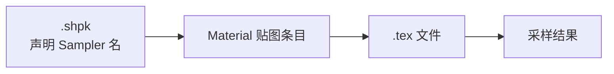

# Sampler

> Applies to: 7.x（Dawntrail） ｜ Last Updated: 2026-11-01

## Overview

Sampler（采样器）在 FFXIV 的 Material 里有两层含义，容易混淆：

1. **Texture Slot 绑定**：这个 Sampler 对应哪张 `.tex`
2. **采样状态**：过滤方式、寻址方式（wrap / clamp）

对 Mod 作者来说，绝大多数工作只涉及第 1 层：把正确的图放到正确的槽位。

!!! note "关键区别"
    「贴图」是文件，「Sampler」是 Shader 读取文件的方式。Shader 通过 Sampler 名去取图，而不是按文件路径取图。

## 数据结构

在 `.mtrl` 中，每条贴图记录是「Sampler 编号 + 路径 + 可选 ColorSet 索引」：

| 字段 | 含义 | 可信度 |
|---|---|---|
| SamplerId | 槽位编号，由 `.shpk` 定义 | ✅ Verified |
| Path | `.tex` 相对路径 | ✅ Verified |
| Flags | 采样相关标志 | 🟡 Researching |
| ColorSetIndex | 该贴图使用的 ColorSet 行 | 🟡 Researching |

## 常见槽位

不同 Shader 的槽位不同，但常见用途相对固定：

| 槽位用途 | 常见内容 | 详见 |
|---|---|---|
| Diffuse / Base Color | 颜色 | [Base Color](../textures/base-color.md) |
| Normal | 切线空间法线 | [Normal Map](../textures/normal-map.md) |
| Mask | 高光、粗糙度、AO 等标量打包 | [Mask Map](../textures/mask-map.md) |
| Multi | 多层控制图 | [Multi Map](../textures/multi-map.md) |
| Index | 染色索引 | [Color Set](../textures/color-set.md) |
| SphereMap | 环境反射 | 各 Shader 页面 |
| FlowMap | 流动方向 | 布料类 Shader |
| Catchlight | 眼睛高光 | [Eye Shader](../shaders/eye-shaders.md) |

!!! warning "不要按名字猜用途"
    槽位名在不同 `.shpk` 中可能相同，但通道含义会变。例如 Mask 的 R 通道在 Character Shader 与 Skin Shader 里承担的作用并不完全一致。

## 采样状态

采样状态决定「越界怎么办」「放大缩小怎么插值」。

| 参数 | 常见取值 | 影响 |
|---|---|---|
| Filter | Linear / Point | 平滑或像素化 |
| Address U/V | Wrap / Clamp / Mirror | 平铺、拉伸边缘、镜像 |
| Mip | 自动生成或指定 | 远处是否糊 |

!!! note "Mod 作者需要关心吗"
    通常不需要。游戏内的采样状态由 `.shpk` 与引擎控制，材质文件不提供逐项编辑。但在自写工具或 Shader 研究时，这些参数会影响观察结果。🟡 Researching

## 贴图路径规则

- 路径是相对游戏根目录的逻辑路径，例如 `chara/.../texture/xxx_d.tex`；
- 大小写敏感（Linux/服务器端与部分工具会区分）；
- 扩展名必须是 `.tex`，DDS 只是编辑中间格式；
- Penumbra 覆盖时按同样的相对路径替换。

!!! tip "改名验证法"
    如果怀疑某张贴图没有被读取，把文件改名后进游戏。如果画面没有变化，说明该槽位未被该 Shader 使用。

## 常见问题

| 症状 | 可能原因 | 处理 |
|---|---|---|
| 换图后无变化 | 槽位未被 Shader 读取 | 用改名验证法确认 |
| 材质发紫/纯色 | 路径错误或文件缺失 | 检查路径大小写与扩展名 |
| 颜色偏暗 | 把线性数据当成 sRGB | 检查贴图色彩空间 |
| 平铺异常 | 寻址方式或 UV 不匹配 | 检查 UV 与平铺常量 |
| 只有部分通道生效 | 通道被 Alpha 或打包贴图覆盖 | 检查通道语义 |

## 相关页面

- [MTRL 格式](mtrl-format.md)
- [Material Constants](constants.md)
- [Shader Keys](shader-keys.md)
- [贴图概览](../textures/index.md)

## References

- XIV Modding Wiki — https://xivmodding.com/
- TexTools — https://github.com/TexTools/FFXIV_TexTools_UI
- Microsoft DirectX 文档（Sampler State）— https://learn.microsoft.com/en-us/windows/win32/api/d3d11/ns-d3d11-d3d11_sampler_desc
