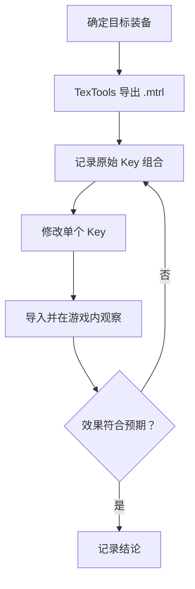

# Shader Keys

> Applies to: 7.x（Dawntrail） ｜ Last Updated: 2026-11-01

## Overview

Shader Key（着色器键）是 Material 里的「开关」。

它不提供连续数值，只回答是 / 否：

- 是否读取 Mask Map
- 是否启用染色
- 是否双面渲染
- 是否做 Alpha 裁剪
- 是否使用 FlowMap 做布料飘动

同一个 Shader Package 通过不同的 Key 组合，覆盖大量外观差异很大的装备。

!!! note "Key 与 Constant 的区别"
    Key 是开关（0 / 1），Constant 是数值（浮点、颜色、向量）。外观「有没有这个功能」看 Key，「这个功能多强」看 Constant。

## 数据结构

在 `.mtrl` 中，每个 Key 以「编号 + 取值」的形式保存：

| 字段 | 类型 | 含义 |
|---|---|---|
| KeyId | uint32 | Key 编号，由 `.shpk` 定义 |
| Value | uint32 | 取值，常见为 0 / 1，少数情况有更多状态 🟡 |

!!! warning "KeyId 不是全局通用"
    同一个编号在不同 `.shpk` 中含义不同。看到「Key 12 = 1」不能跨 Shader 套用，必须先确认 Shader Package。

## 语义从哪里来

Key 的含义来自 `.shpk` 的编译结果，不是材质文件里写好的字符串。

获取途径：

| 途径 | 说明 | 可信度 |
|---|---|---|
| 社区整理的材质表 | 把 Key 与可观察效果对应起来 | 🟡 Researching |
| 对比实验 | 改一个 Key，进游戏看差异 | ✅ Verified |
| Shader 反编译 | 直接读分支逻辑 | 🟡 Researching，门槛高 |

站内的 [着色器参考表](../appendix/materials-table.md) 整理了社区常见的 Key 说明，可配合本页阅读。

## 常见 Key 类型（按语义分类）

下面按「作用」分类，而不是按编号，因为编号随 Shader 变化。

| 语义 | 典型效果 | 备注 |
|---|---|---|
| Texture 开关 | 决定某个 Slot 是否参与计算 | 关闭后对应贴图完全无效 |
| Dye / 染色 | 是否读取 ColorSet 行做染色 | 与 ColorSet 联动 |
| Alpha 处理 | Alpha 裁剪或半透明 | 影响阴影与排序 |
| 双面渲染 | 关闭背面剔除 | 披风、裙摆常用 |
| 发光 | 是否启用 Emissive | 常配合 Effect ID |
| 布料/飘动 | FlowMap 或假风 | 与 Vertex Color 联动 |
| 眼睛/高光 | Catchlight、Eye Occlusion | 眼部专用 |

!!! note "研究方向"
    把某件装备的 Material 导出，逐个翻转 Key 并在游戏内截图对比，是最可靠的建表方式。做这类实验时请记录游戏版本与装备 ID。

## 修改流程

!!! tip "一次只改一个 Key"
    同时改多个 Key 无法判断是哪一个生效，也无法判断是否互相冲突。

## 常见问题

| 症状 | 可能原因 | 处理 |
|---|---|---|
| 改了 Key 没有任何变化 | 该 Key 被其他 Key 或 Shader 版本忽略 | 换同 Shader 的其他装备对照 |
| 模型变成透明/消失 | 打开了 Alpha 或双面相关 Key 的错误组合 | 恢复原始组合后逐项排查 |
| 染色失效 | 染色 Key 关闭或 ColorSet 索引错误 | 同时检查 Key 与 ColorSet |
| 游戏内出现异常高光 | 发光 Key 开启但 Effect ID 为 0 | 检查 Material Constant |

## 相关页面

- [MTRL 格式](mtrl-format.md)
- [Material Constants](constants.md)
- [Sampler](sampler.md)
- [Color Set](../textures/color-set.md)
- [Character Shader](../shaders/character-shaders.md)

## References

- XIV Modding Wiki — https://xivmodding.com/
- 着色器参考表（站内）：[materials-table.md](../appendix/materials-table.md)
- TexTools — https://github.com/TexTools/FFXIV_TexTools_UI
