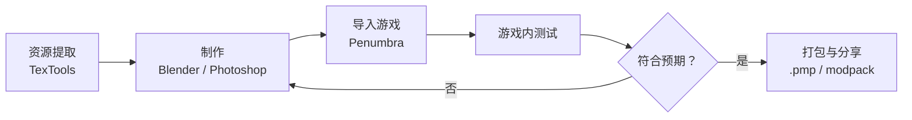

# Mod 制作

> Applies to: 7.x（Dawntrail） ｜ Last Updated: 2026-11-01

## Overview

本章介绍 FFXIV Mod 制作的完整路径：从资源提取到游戏内验证。

不追求「按钮级教程」，而是让你知道**每一步在做什么、产物是什么、失败了怎么查**。

## 制作流程

| 阶段 | 工具 | 产物 | 本站章节 |
|---|---|---|---|
| 资源提取 | TexTools | `.mdl` / `.mtrl` / `.tex` | [TexTools](../workflows/textools.md) |
| 贴图编辑 | Photoshop / GIMP | `.dds` / `.png` | [贴图概览](../textures/index.md) |
| 模型编辑 | Blender | `.fbx` / `.mdl` | [Blender](../workflows/blender.md) |
| 材质调整 | TexTools Material Editor | `.mtrl` | [Material 概览](../materials/index.md) |
| 加载测试 | Penumbra | mod 目录 | [Penumbra](../workflows/penumbra.md) |
| 打包分享 | Penumbra | `.pmp` | [Penumbra](../workflows/penumbra.md) |

## 本章导航

- :material-school-outline:

    ### [Mod 制作基础](modding-basics.md)

    需要具备哪些能力，第一个 mod 的最小路径。

- :material-toolbox-outline:

    ### [Mod 制作工具](modding-tools.md)

    按用途分类的工具表与工具链推荐。

- :material-map-marker-path:

    ### [Mod 制作教程](modding-tutorials.md)

    按目标组织的教程地图与练习项目。

- :material-link-variant:

    ### [Mod 制作资源](modding-resources.md)

    社区文档、工具仓库与素材入口。

## 三个基本原则

!!! tip "可回滚"
    永远用 Penumbra 覆盖，不要直接改游戏文件。出问题时能一键关掉。

!!! warning "一次只改一个变量"
    同时改模型、贴图、材质，出问题后无法定位。每次只改一项，进游戏确认后再继续。

!!! note "记录改动"
    记下改了哪些文件、用了什么参数。三天后你会感谢现在的自己。

## 相关章节

- [Workflow（工作流）概览](../workflows/index.md)
- [故障排除](../workflows/troubleshooting.md)
- [名词解释](../getting-started/glossary.md)

## References

- XIV Modding Wiki — https://xivmodding.com/
- TexTools — https://github.com/TexTools/FFXIV_TexTools_UI
- Penumbra — https://github.com/xivdev/Penumbra
