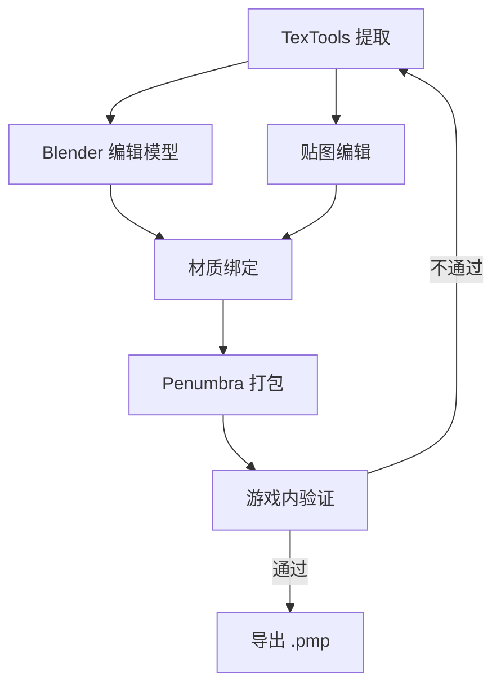

# Mod 制作工具

> Applies to: 7.x（Dawntrail） ｜ Last Updated: 2026-11-01

> 工具很多，但每一步其实只有一个主力选项。

FF14 Mod 的工具链可以按**处理阶段**划分：提取资源、编辑资源、在运行时加载。

大多数工具只覆盖其中一段，所以你需要组合使用。本页只讲「工具选什么」，具体操作见 [Workflows](../workflows/index.md) 章节。

下表的工具功能描述 ✅ Verified；「平台」与「学习成本」为经验判断 🟡 Researching。

---

## 按用途分类

### 资源提取与打包

| 工具 | 用途 | 平台 | 学习成本 | 本站对应页面 |
|---|---|---|---|---|
| TexTools | 从游戏数据中提取 / 导入模型、贴图、材质，导出 `.pmp` | Windows | 中 | [TexTools 工作流](../workflows/textools.md) |

TexTools 是资源层的核心。它同时承担「解包」和「回填」两个方向的工作；运行时替换则由 Penumbra（模组加载器）负责，见下一节。

!!! note "TexTools 与 Penumbra 的分工"

    TexTools 改动的是**文件本身**（直接写入游戏数据或导出成品）。
    Penumbra 改动的是**加载顺序**（不改游戏文件，运行时替换）。两者不要混为一谈。

### 运行时加载

| 工具 | 用途 | 平台 | 学习成本 | 本站对应页面 |
|---|---|---|---|---|
| Penumbra | 运行时替换文件，管理 `Penumbra mod（.pmp）`，调整加载优先级 | Windows | 低 | [Penumbra 工作流](../workflows/penumbra.md) |
| XIVLauncher | FF14 的第三方启动器，提供插件运行环境 | Windows | 低 | [安装环境](../getting-started/installation.md) |
| Dalamud | XIVLauncher 的插件框架，Penumbra 以插件形式运行 | Windows | 低 | [安装环境](../getting-started/installation.md) |

三者是嵌套关系：XIVLauncher → Dalamud → Penumbra。

日常使用时你只需要面对 Penumbra 的界面，前两者装好即可。

### 模型

| 工具 | 用途 | 平台 | 学习成本 | 本站对应页面 |
|---|---|---|---|---|
| Blender | 编辑 Mesh、UV、法线、顶点色、骨骼权重，导入导出 `.mdl` | Windows / macOS / Linux | 高 | [Blender 工作流](../workflows/blender.md) |

Blender 本身不认 FF14 的格式，需要社区插件做导入导出。插件由社区维护，更新节奏跟随游戏版本。

### 贴图

| 工具 | 用途 | 平台 | 学习成本 | 本站对应页面 |
|---|---|---|---|---|
| Photoshop | 编辑 Base Color、Normal、Mask，精细控制通道与图层 | Windows / macOS | 中 | [Textures](../textures/index.md) |
| GIMP | 同上，免费开源替代 | Windows / macOS / Linux | 中 | [Textures](../textures/index.md) |
| Substance 3D Painter | 直接在模型上绘制，自动输出多通道贴图 | Windows / macOS | 高 | [Textures](../textures/index.md) |

选一个顺手的即可。关键不是软件，而是你是否清楚**每个通道代表什么**。

- Base Color：见 [Base Color](../textures/base-color.md)
- Normal Map：见 [Normal Map](../textures/normal-map.md)
- Mask Map：见 [Mask Map](../textures/mask-map.md)
- Multi Map：见 [Multi Map](../textures/multi-map.md)

### 材质

| 工具 | 用途 | 平台 | 学习成本 | 本站对应页面 |
|---|---|---|---|---|
| TexTools | 图形化查看与修改 `.mtrl` 的 Shader、Key、Constant、Sampler | Windows | 中 | [`.mtrl` 格式](../materials/mtrl-format.md) |
| 文本 / 二进制编辑 | 直接读写 `.mtrl` 字节，处理 TexTools 不支持的情况 | 任意 | 高 | [`.mtrl` 格式](../materials/mtrl-format.md)、[Constants](../materials/constants.md) |

材质编辑的风险高于贴图：一个 Constant 改错，可能让模型直接消失或全黑。

!!! warning "改材质前先备份"

    `.mtrl` 是二进制结构，字段偏移一旦写错，文件就无法加载。
    动手前保留原始文件，并先读一遍 [`.mtrl` 格式](../materials/mtrl-format.md)。

### 特效

| 工具 | 用途 | 平台 | 学习成本 | 本站对应页面 |
|---|---|---|---|---|
| VFXEditor | 查看与编辑 `.avfx` 特效、部分模型与动画数据 | Windows（Dalamud 插件） | 高 | [Shader Reference](../shaders/shader-reference.md) |

特效属于进阶内容，通常在你已经能稳定产出模型与材质 Mod 之后再接触。

---

## 工具链组合推荐

### 方案 A：轻量换贴图

适合：第一次做 Mod、只想改颜色或图案。

| 阶段 | 工具 |
|---|---|
| 提取 | TexTools |
| 编辑 | Photoshop / GIMP |
| 回填 | TexTools |
| 加载 | Penumbra |
| 验证 | 游戏内 |

流程最短，几乎不涉及格式转换以外的风险。

1. 用 TexTools 导出目标贴图。
2. 在图像软件中修改，保持尺寸与通道不变。
3. 转回 `.tex` 并在 Penumbra 中挂载。
4. 进游戏确认后导出 `.pmp`。

详细步骤见 [Mod 制作基础 · 第一个 Mod 的最小路径](modding-basics.md)。

### 方案 B：完整模型改模

适合：改形状、加部件、重做 UV 与材质。

| 阶段 | 工具 |
|---|---|
| 提取 | TexTools |
| 模型编辑 | Blender + 社区导入导出插件 |
| 贴图绘制 | Substance 3D Painter 或 Photoshop |
| 材质调整 | TexTools / 二进制编辑 |
| 打包 | Penumbra（导出 `.pmp`） |
| 验证 | 游戏内 + [常见问题](../workflows/troubleshooting.md) |

这条链路的失败点更多，建议按「模型 → 贴图 → 材质」的顺序分段验证，不要一次全改完再进游戏。

!!! tip "不要同时升级所有工具"

    游戏版本更新后，插件往往需要时间跟进。
    出问题时先确认「最近改了什么」，一次只动一个变量。

---

## References

- [XIV Modding Wiki](https://xivmodding.com/)
- [TexTools](https://github.com/TexTools/FFXIV_TexTools_UI)
- [Penumbra](https://github.com/xivdev/Penumbra)
- [XIVLauncher](https://github.com/goatcorp/FFXIVQuickLauncher)
- [Blender](https://www.blender.org/)
