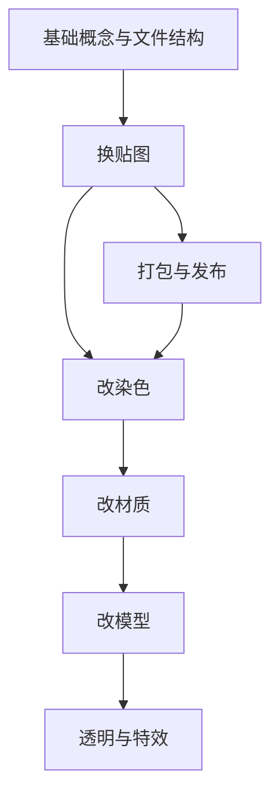

# Mod 制作教程

> Applies to: 7.x（Dawntrail） ｜ Last Updated: 2026-11-01

> 这一页不教你点按钮，而是告诉你**从目标倒推步骤**。

同一个目标可以有多种实现路径。本页把常见目标拆成步骤，并标出每一步依赖本站哪一页。

所有路径最后都会汇到同一个动作：把成果打包成 `Penumbra mod（.pmp）`，交给 Penumbra（模组加载器）。

!!! note "如何使用这一页"

    先选定目标，再按步骤走。每一步都能在本站找到对应的概念页。
    遇到需要具体软件操作的部分，标记为 🟡 的步骤表示目前依赖社区教程。

---

## 教程地图

### 目标一：换贴图

| 步骤 | 做什么 | 本站页面 |
|---|---|---|
| 1 | 定位目标装备与贴图文件 | [文件结构](../getting-started/folder-structure.md) |
| 2 | 导出 Diffuse | [TexTools 工作流](../workflows/textools.md) |
| 3 | 理解通道含义后再动笔 | [Base Color](../textures/base-color.md) |
| 4 | 回填并打包 | [Penumbra 工作流](../workflows/penumbra.md) |
| 5 | 游戏内验证 | [常见问题](../workflows/troubleshooting.md) |

### 目标二：改模型

| 步骤 | 做什么 | 本站页面 |
|---|---|---|
| 1 | 提取 `.mdl` 与配套贴图 | [TexTools 工作流](../workflows/textools.md) |
| 2 | 导入 Blender，检查 UV 与法线 | [Blender 工作流](../workflows/blender.md) |
| 3 | 编辑 Mesh / 调整 UV | [Blender 工作流](../workflows/blender.md) 🟡 |
| 4 | 导出并确认骨骼权重 | [Blender 工作流](../workflows/blender.md) 🟡 |
| 5 | 重新绑定材质 | [`.mtrl` 格式](../materials/mtrl-format.md) |
| 6 | 打包验证 | [Penumbra 工作流](../workflows/penumbra.md) |

第 3、4 步的插件操作细节更新较快，建议以社区教程为准。

### 目标三：改材质

| 步骤 | 做什么 | 本站页面 |
|---|---|---|
| 1 | 读目标材质的 Shader 包与 Key | [Shader Reference](../shaders/shader-reference.md) |
| 2 | 确认该 Shader 支持哪些参数 | [Constants](../materials/constants.md) |
| 3 | 修改 Constant / Sampler | [Sampler](../materials/sampler.md)、[`.mtrl` 格式](../materials/mtrl-format.md) |
| 4 | 检查 Shader Key 是否冲突 | [Shader Keys](../materials/shader-keys.md) |
| 5 | 游戏内对比效果 | [常见问题](../workflows/troubleshooting.md) |

### 目标四：改染色

| 步骤 | 做什么 | 本站页面 |
|---|---|---|
| 1 | 确认装备是否支持染色 | [Shader Keys](../materials/shader-keys.md) |
| 2 | 理解 Color Set 的行与通道 | [Color Set](../textures/color-set.md) |
| 3 | 编辑 Color Set 贴图 | [Textures](../textures/index.md) |
| 4 | 必要时配合 Mask | [Mask Map](../textures/mask-map.md) |
| 5 | 游戏内试染 | [Penumbra 工作流](../workflows/penumbra.md) |

染色本质是「贴图 × Color Set 值 × Shader 规则」三者共同作用，单独改一个通常不够。

### 目标五：做透明件

| 步骤 | 做什么 | 本站页面 |
|---|---|---|
| 1 | 选对 Shader | [Character Transparency Shader](../shaders/character-transparency-shader.md)、[Glass Shader](../shaders/glass-shader.md) |
| 2 | 准备 Alpha 通道 | [Base Color](../textures/base-color.md) |
| 3 | 处理 Additional Data | [Additional Data](../shaders/additional-data.md) 🟡 |
| 4 | 调整透明相关 Constant | [Constants](../materials/constants.md) |
| 5 | 检查排序与背面问题 | [常见问题](../workflows/troubleshooting.md) |

透明是最容易「看起来对了但实际不对」的方向，务必在多个角度与光照下检查。

---

## 练习项目

### 练习一：换一张贴图（易）

| 项目 | 内容 |
|---|---|
| 目标 | 把一件装备的 Base Color 换成自定义图案，形状与材质完全不变 |
| 需要改的文件类型 | `.tex` / `.dds`（Base Color） |
| 验收标准 | 游戏内图案位置正确；无拉伸与接缝错位；卸下 mod 后恢复原样 |
| 参考 | [Mod 制作基础](modding-basics.md)、[Base Color](../textures/base-color.md) |

### 练习二：改一件装备的染色表现（中）

| 项目 | 内容 |
|---|---|
| 目标 | 让同一件装备在不同染色下呈现明显不同的颜色分区 |
| 需要改的文件类型 | Color Set 贴图（`.tex`）、必要时 Mask Map |
| 验收标准 | 至少两种染色下颜色分区符合预期；未染色时颜色不异常 |
| 参考 | [Color Set](../textures/color-set.md)、[Mask Map](../textures/mask-map.md) |

### 练习三：改模型轮廓（难）

| 项目 | 内容 |
|---|---|
| 目标 | 改变一件装备的外形轮廓，并让原有贴图与材质仍能正常显示 |
| 需要改的文件类型 | `.mdl`、`.tex`（可能需要重做 UV 对应的贴图）、`.mtrl` |
| 验收标准 | 轮廓改动可见；UV 无明显错位；法线朝向正确；无穿模 |
| 参考 | [Blender 工作流](../workflows/blender.md)、[Normal Map](../textures/normal-map.md) |

---

## 学习路径

建议顺序：先打通「提取 → 编辑 → 打包 → 验证」的闭环，再扩展到其他维度。闭环里任何一环出问题，你都有对照物。

---

## 哪些步骤依赖社区教程

本站描述的是**文件与参数的含义**，不包含具体软件的操作细节。

以下方向目前主要以社区教程为准，统一标记为 🟡：

| 方向 | 依赖原因 |
|---|---|
| Blender 导入导出插件操作 | 插件接口随版本变化 |
| 骨骼权重与物理 | 与具体骨架绑定有关 |
| VFX / 特效制作 | 工具链与流程尚未稳定 |
| 高级透明与抖动组合 | 仍在社区验证阶段 |

社区教程入口见 [外部链接](other-links.md)。旧教程的界面会随版本变化，建议以本页的步骤结构为骨架，用社区教程补齐具体操作。

---

## References

- [XIV Modding Wiki](https://xivmodding.com/)
- [TexTools](https://github.com/TexTools/FFXIV_TexTools_UI)
- [Penumbra](https://github.com/xivdev/Penumbra)
- [XIVLauncher](https://github.com/goatcorp/FFXIVQuickLauncher)
- [Blender](https://www.blender.org/)
