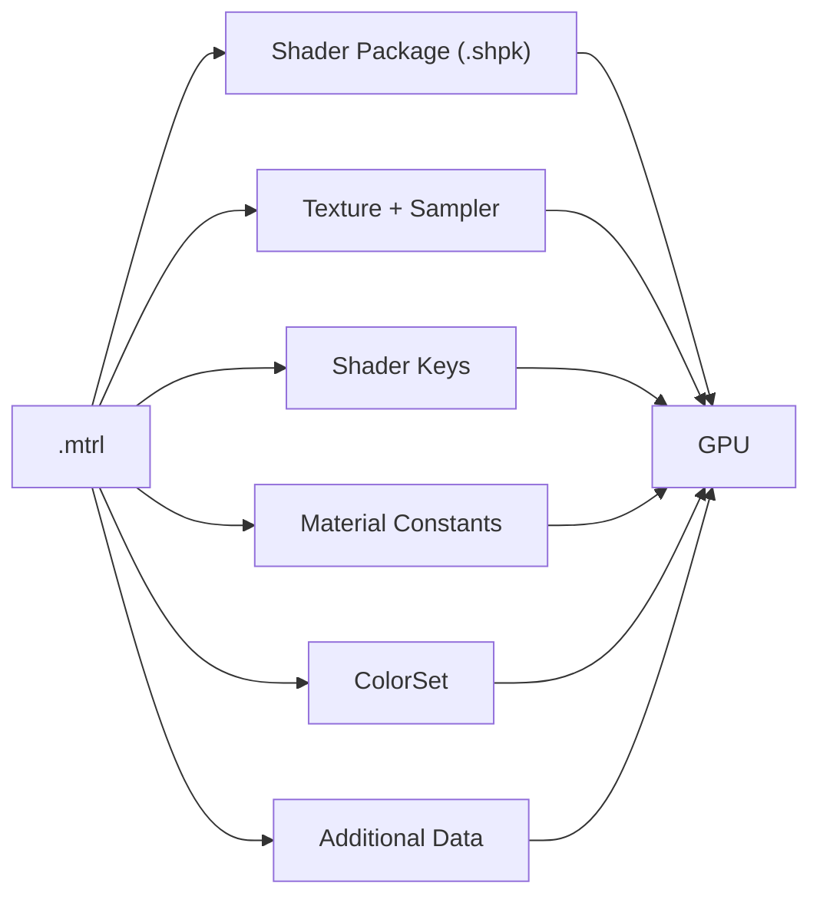

# Additional Data（附加数据）

> Applies to: 7.x（Dawntrail） ｜ Last Updated: 2026-11-01

## 概述

Additional Data（附加数据）是 `.mtrl` 文件中一小块额外的参数数据。

它按位（bit）解释，用来给材质传递少量开关状态。

它既不是贴图，也不是 Material Constant，更不是 Shader Key。

| 项目 | Additional Data | Material Constant | Shader Key |
|---|---|---|---|
| 数据类型 | 原始字节 / 位 | 浮点数 | 离散功能集合 |
| 用途 | 额外开关 | 数值调节 | 启用功能分支 |
| 编辑方式 | 按位修改 | 改数值 | 增删 Key |
| 工具支持 | 有限 🟡 | 较好 | 较好 |

它常被误认为「第二套贴图参数」或「颜色数据」。

实际上它不包含任何图像信息。

材质整体结构见 [MTRL 格式](../materials/mtrl-format.md)。

## 在文件中的位置

从概念上看，`.mtrl` 由几组并列的数据构成：

| 组成 | 作用 | 常见可见性 |
|---|---|---|
| Shader Package 引用 | 指定使用的 Shader | Material Editor 可见 |
| Texture / Sampler | 绑定贴图与采样方式 | Material Editor 可见 |
| Shader Keys | 功能开关集合 | Material Editor 可见 |
| Material Constants | 浮点参数 | Material Editor 可见 |
| ColorSet | 染色行 | Material Editor / Color Table 可见 |
| Additional Data | 额外的位开关 | 部分工具可见 🟡 |

Additional Data 通常位于材质参数区的尾部附近 🟡。

具体字节偏移会随 `.mtrl` 版本变化，因此本文不给出偏移量。

判断依据应是工具中的字段名，而不是固定位置。

## 数据结构（概念层面）

Additional Data 可以理解为一个定长的位容器。

| 属性 | 说明 | 可信度 |
|---|---|---|
| 组织方式 | 按字节存放，按位解释 | 🟡 |
| 长度 | 通常只有几个字节 | 🟡 |
| 取值 | 每位 0 或 1 | 🟡 |
| 组合 | 多位可组合成枚举 | 🟠 |
| 未使用位 | 应保持 0 | 🟠 |

它不是「数值越大效果越强」的参数。

改错一位，效果可能是完全没有，而不是变弱。

### 一个已知的例子

参考表记录了一个与透明抖动相关的位值：`00 80 00 00`。

| 字节 | 值 | 说明 | 可信度 |
|---|---|---|---|
| Byte 0 | `00` | 未使用 | 🟠 |
| Byte 1 | `80` | 与抖动 / Passthrough 相关 | 🟡 |
| Byte 2 | `00` | 未使用 | 🟠 |
| Byte 3 | `00` | 未使用 | 🟠 |

这个例子只说明「怎么读」，不代表所有 Shader 都使用同样的位。

## 常见用途

目前社区有较明确记录的用途集中在透明类 Shader。

| Shader | 用途 | 可信度 |
|---|---|---|
| Character Transparency | 控制抖动与 Passthrough 是否生效 | 🟡 |
| Character Glass | 与抖动相关的表现 | 🔴 未确认 |
| Character Shader | 是否存在附加数据用途 | 🔴 未确认 |
| Tattoo / Eye / Occlusion | 是否存在附加数据用途 | 🔴 未确认 |

对 Transparency Shader 而言，参考表明确了两个条件必须同时满足：

- Shader Key 中的抖动开关已启用。
- Additional Data 中的对应位已启用。

只开其中一个，Passthrough 效果不会出现。

这也是 Mod 作者最常遇到附加数据问题的场景。

## 编辑方式

### TexTools Material Editor

| 步骤 | 操作 | 说明 |
|---|---|---|
| 1 | 打开目标材质 | 确认 Shader 名称 |
| 2 | 找到附加数据区域 | 界面名称可能不同 🟡 |
| 3 | 记录原始值 | 先备份再修改 |
| 4 | 只改目标位 | 不要整块重写 |
| 5 | 保存并刷新 | 确认没有影响其他材质 |

不同 TexTools 版本的界面布局可能变化。

如果找不到对应字段，优先确认版本是否支持该 `.mtrl` 版本。

### Penumbra

| 做法 | 是否可行 | 说明 |
|---|---|---|
| 逐位编辑附加数据 | ❌ | Penumbra 不做逐字段材质编辑 🟡 |
| 替换整份 `.mtrl` | ✅ | 最常用方式 |
| 通过 Mod 选项切换材质 | ✅ | 需要准备多份 `.mtrl` |

所以「改一位」在实际操作中往往意味着「换一整份材质」。

### 十六进制对比法

| 步骤 | 说明 |
|---|---|
| 1 | 导出一份已知正常的材质 |
| 2 | 导出一份行为异常的材质 |
| 3 | 对比两者差异 |
| 4 | 只改动差异所在的字节 |
| 5 | 回归测试 |

这是目前最可靠的定位方法 ✅。

前提是两份材质除了目标 Shader 之外尽量一致。

## 缺失或损坏时的表现

| 现象 | 可能原因 | 处理 |
|---|---|---|
| 抖动完全不生效 | 对应位为 0 | 启用该位 |
| Passthrough 看不到 | Key 或附加数据缺一 | 两者都检查 🟡 |
| 透明材质变成完全不透明 | 附加数据缺失导致分支退化 | 使用完整材质 🟠 |
| 材质回退为默认外观 | 文件损坏或被截断 | 重新导出 🟠 |
| 出现条纹或闪烁 | 位组合错误 | 恢复原始值 🟠 |
| 改完没有变化 | 改的是未被读取的位 | 核对 Shader 与 Key 🟠 |

如果更换材质后角色直接显示异常，应先排除文件本身是否完整。

## 什么时候需要关心它

| 场景 | 是否需要关心 | 说明 |
|---|---|---|
| 复刻 7.2+ 透明装备 | ✅ 需要 | 抖动与 Passthrough 依赖它 |
| 从旧版本移植透明材质 | ✅ 需要 | 旧材质可能没有这一块 |
| 只换颜色或贴图 | ❌ 不需要 | 不影响附加数据 |
| 只改 Material Constant | ❌ 不需要 | 属于另一类参数 |
| 制作普通装备 Mod | ❌ 不需要 | 大多数 Shader 不读取它 |
| 排查「效果开了却没生效」 | ✅ 需要 | 常是最后一块拼图 |

对多数 Mod 作者来说，它只在透明类材质上才会成为问题。

平时完全不需要修改它。

## 排查清单

1. 确认当前材质的 Shader 是否真的读取 Additional Data。
2. 确认 Shader Key 是否已经启用对应功能。
3. 确认附加数据的对应位是否为 1。
4. 确认贴图通道（尤其是 Normal 的 B 通道）是否正确。
5. 刷新 Penumbra 并重新进入场景。

如果以上都正确但效果仍不出现，问题可能不在材质，而在网格或渲染顺序。

## References

| Name | Description | Link |
|---|---|---|
| XIV Modding Wiki | FFXIV Modding 资源与研究文档 | https://xivmodding.com/ |
| MTRL 格式 | Material 文件结构与字段 | [mtrl-format.md](../materials/mtrl-format.md) |
| Shader Keys | Shader Key 的作用与查看方式 | [shader-keys.md](../materials/shader-keys.md) |
| Material Constants | 浮点参数说明 | [constants.md](../materials/constants.md) |
| 着色器参考表 | 透明 Shader 与附加数据位的记录 | [materials-table.md](../appendix/materials-table.md) |
| Transparency Shader | 抖动与 Passthrough 的使用场景 | [character-transparency-shader.md](character-transparency-shader.md) |
| TexTools | 材质与贴图编辑工具 | https://github.com/TexTools/FFXIV_TexTools_UI |
| Penumbra | Mod 加载与资源替换框架 | https://github.com/xivdev/Penumbra |
