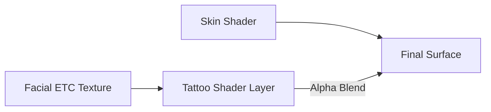

# Tattoo Shader（纹身着色器）

> Applies to: 7.x（Dawntrail） ｜ Last Updated: 2026-11-01

## Overview

Tattoo Shader（纹身着色器）负责叠加在皮肤之上的贴花层。

典型用途包括面部纹身、面妆、雀斑、鳞片与特殊标记。

它不是 Skin Shader 的一部分，而是一层独立的覆盖材质。

| 特性 | 说明 |
|---|---|
| 渲染顺序 | 叠在 Skin 之上 |
| 主要数据 | 颜色 + Alpha + 法线 |
| 是否参与皮肤光照 | 🟡 有限参与 |
| 是否可染色 | 🟡 取决于 ColorSet 与通道 |
| 常见载体 | 面部 ETC 贴图 |

面部 ETC 贴图有一个容易踩坑的地方：

同一个贴图会被多个材质引用，但每个材质使用不同的 Shader Key 与参数 ✅。

所以在改任何一张 ETC 贴图之前，必须先确认它被哪些材质共用。

## Shader File

| 项目 | 内容 | 可信度 |
|---|---|---|
| Shader 名称 | Tattoo Shader | ✅ |
| 参考表中的包名 | `CharacterTattoo.shpk` | 🟡 未逐版本核对 |
| 参考表中的别名 | Face Tattoos Shader | ✅ |
| 绑定单位 | 单个贴花材质 | 🟡 |

在 Material Editor 中看到 Shader 名包含 `Tattoo`，基本可以确认。

部分面部材质虽然不叫 Tattoo，但实际仍在用这套 Shader。

## Supported Versions

| 版本 | 情况 | 说明 |
|---|---|---|
| 7.0 – 7.x | 当前实现 | 支持 Decal UV2 模式 🟡 |
| 6.x 及更早 | 存在类似层 | 参数与 Key 不完全兼容 🟡 |
| 跨版本 Mod | 需要检查 | 通道含义可能已变 |

从旧版本带过来的面部贴花 Mod，最容易出问题的是 B 通道与 Alpha。

## Official Usage

| 用途 | 常见位置 | 说明 |
|---|---|---|
| 面部纹身 | 面颊、额头 | 最常见 |
| 面妆 / 眼影 | 眼周、唇部 | 与 Face Shader 配合 |
| 雀斑 / 痣 | 全脸 | 常与颜色影响通道联动 |
| 鳞片 / 特殊标记 | Au Ra、NPC | 🟡 部分走 Skin Shader |
| 身体贴花 | 躯干、手臂 | 🟡 视种族与装备而定 |

面部 ETC 材质的数量通常多于可见的贴花数量。

这是因为同一张贴图被拆分成了多个材质分支。

## Texture Slots

### Normal Texture

| Channel | Function | Description |
|---|---|---|
| R | Tangent Space Normal | 切线空间法线 X |
| G | Tangent Space Normal | 切线空间法线 Y |
| B | Mole or Tattoo Color Influence | 痣或纹身颜色影响 |
| A | Opacity | 不透明度 |

B 通道既是法线的 Z 分量，又被用作颜色影响。

这是这一 Shader 最反直觉的设计。

### Diffuse Texture

参考表没有列出 Diffuse 的通道语义。

| 项目 | 内容 | 可信度 |
|---|---|---|
| RGB | 推测为贴花颜色 | 🟠 |
| A | 推测为额外不透明度 | 🟠 |
| 是否必需 | 多数材质会绑定 | 🟡 |

实际操作中，颜色写在 Diffuse，透明度更多由 Normal 的 Alpha 控制。

## Vertex Colors

🔴 Unknown — 目前没有可靠结论。

参考表中该 Shader 的 Vertex Color 通道全部为 `???`。

从行为上看，顶点色更可能影响强度而不是形状。

修改顶点色前请先备份。

## UV Channels

| Channel | Function | Description |
|---|---|---|
| UV Channel 1 | Normal UV | 面部/身体主 UV ✅ |
| UV Channel 2 | Decal UV | 贴花定位层 🟡 |

参考表记录了「Decal Mode - Model UV2 Layer」这一组开关。

| 模式 | 效果 | 可信度 |
|---|---|---|
| OFF | 不使用贴花层 | ✅ |
| COLOR | 使用 UV2 放置颜色贴花 | ✅ |
| ALPHA | 使用 UV2 放置 Alpha 贴花 | ✅ |

这意味着贴花可以脱离主 UV，单独在 UV2 上定位。

UV2 需要是一条连续、方向一致的展开，否则贴花会被拉伸或错位 🟡。

## Material Constants

| 功能 | 说明 | 可信度 |
|---|---|---|
| 贴花强度 | 整体不透明度 | 🟡 |
| 颜色偏移 | 调整贴花色调 | 🟡 |
| 法线强度 | 影响表面起伏 | 🟡 |
| UV2 缩放 / 偏移 | 调整贴花位置 | 🟡 |

本文不列出具体常量名，需要精确数值时以 Material Editor 为准。

## Shader Keys

| Key 功能 | 作用 | 可信度 |
|---|---|---|
| 颜色影响模式 | 把 B 通道解释为纹身颜色影响或头发高光影响 | ✅ |
| Decal Mode | OFF / COLOR / ALPHA 三种贴花模式 | ✅ |
| 自发光 | 让贴花发光 | 🟡 |
| 法线开关 | 是否读取法线通道 | 🟡 |

「颜色影响模式」有两种解释：

- FACE：B 通道作为纹身颜色影响。
- HAIR：B 通道作为头发高光影响。

同一个 Shader 在面部与头发材质上可能被赋予不同解释 ✅。

因此复制材质时，Key 必须一起复制。

## Additional Data

🔴 Unknown — 目前没有可靠结论。

没有公开资料说明 Tattoo Shader 会读取 Additional Data。

如果贴花行为异常，优先排查通道与 Key。

## Penumbra Mapping

| 目标 | 操作 | 说明 |
|---|---|---|
| 替换贴花 | 替换对应 `.tex` | 会影响所有引用该路径的材质 🟡 |
| 独立贴花 | 新建材质并指向新路径 | 避免污染其他面部材质 🟡 |
| 修改 Decal 模式 | 替换整份 `.mtrl` | Penumbra 不逐字段编辑 |
| 调整透明度 | 改 Normal 的 Alpha | 最直接 |

共享贴图是面部 Mod 互相冲突的主要原因。

条件允许时，建议为每个贴花准备独立路径。

## TexTools Mapping

| 目标 | 位置 | 说明 |
|---|---|---|
| 查看材质分支 | Material Editor | 确认共用同一贴图的材质 |
| 查看 Shader Keys | Material Editor | 确认颜色影响模式 |
| 替换贴图 | Texture Import | 保持尺寸与格式 |
| 复制材质做独立分支 | Material Editor | 高级操作 🟡 |

导入后请刷新角色，确认没有影响其他面部区域。

## Modding Tips

- **Alpha 边缘留过渡**：硬切边在游戏分辨率下会出现明显锯齿。
- **不要乱画 B 通道**：它同时是法线 Z 分量与颜色影响，乱画会让贴花发黑或变色。
- **利用 UV2 做定位**：Decal Mode 可以让贴花不依赖主 UV，适合不对称设计。
- **对称 UV 会带来对称贴花**：想只做单侧纹身，需要不对称贴图或 UV2 定位。
- **染色效果来自 ColorSet**：颜色影响通道只让颜色参与混合，最终色调仍受 ColorSet 控制 🟡。
- **先确认贴图被谁共用**：改一张 ETC 贴图可能同时改变眼影、唇色与纹身。

## Known Issues

| 现象 | 可能原因 | 处理 |
|---|---|---|
| 纹身区域发黑 | B 通道被当作颜色影响 | 检查 B 通道与 Key |
| 边缘出现锯齿 | Alpha 过硬或分辨率不足 | 加渐变、提高分辨率 |
| 贴花完全不显示 | Decal Mode 或 Alpha 为 0 | 检查 Key 与 Alpha |
| 法线冲突 | 贴花法线与皮肤法线方向相反 | 统一法线方向 |
| 改了贴图却影响其他部位 | 材质共用同一路径 | 拆分材质路径 |
| 纹身颜色不受染色影响 | ColorSet 或颜色影响通道被关闭 | 检查 Key 🟡 |

## References

| Name | Description | Link |
|---|---|---|
| XIV Modding Wiki | FFXIV Modding 资源与研究文档 | https://xivmodding.com/ |
| 着色器参考表 | 本站对 Dawntrail Shader Reference Table 的中文整理 | [materials-table.md](../appendix/materials-table.md) |
| Skin Shader | 皮肤底层材质 | [skin-shaders.md](skin-shaders.md) |
| Face Shader | 面部材质与 UV | [face-shaders.md](face-shaders.md) |
| ColorSet | 染色数据与 Color Table | [color-set.md](../textures/color-set.md) |
| TexTools | 材质与贴图编辑工具 | https://github.com/TexTools/FFXIV_TexTools_UI |
| Penumbra | Mod 加载与资源替换框架 | https://github.com/xivdev/Penumbra |
