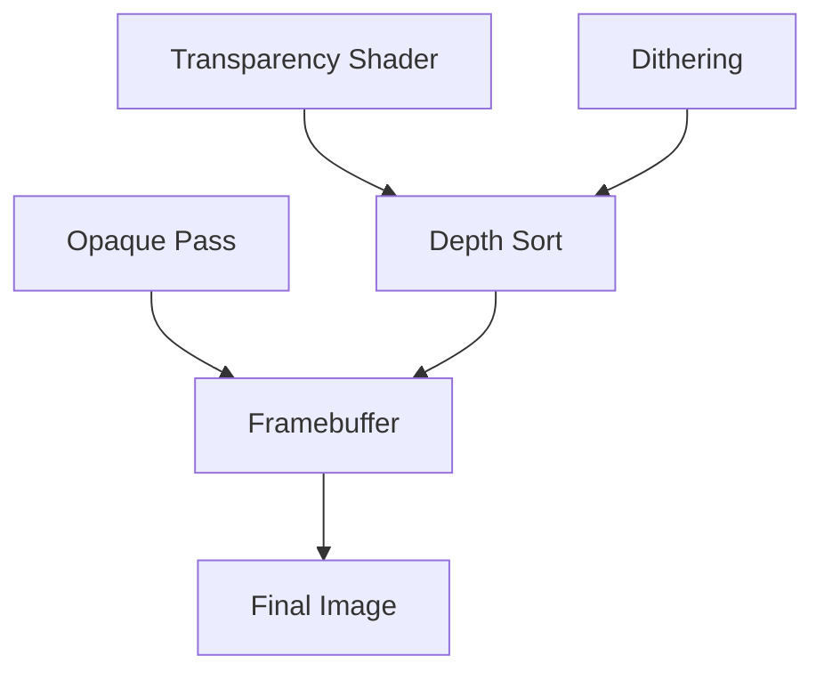

# Transparency Shader（透明着色器）

> Applies to: 7.x（Dawntrail） ｜ Last Updated: 2026-11-01

## Overview

Transparency Shader（透明着色器）用于角色的半透明部件，例如面纱、薄纱披风、蕾丝与宝石饰品。

它在 7.2 版本加入，首次出现在 Historia Chokers 上 ✅。

| 特性 | 说明 |
|---|---|
| 渲染方式 | Alpha Blend（半透明混合） |
| 是否写深度 | 通常不写，或按 Dithering 处理 🟡 |
| 是否双面 | 取决于材质与 Shader Key 🟡 |
| 与 Glass Shader 区别 | Glass 偏折射，本 Shader 偏纯透明 |

半透明最容易出问题的原因不是 Shader 写错，而是透明物体天生缺乏正确的深度顺序。

透明像素必须先决定「谁在前」，这决定了 Mod 里为什么会出现排序错误与黑边。

## Shader File

| 项目 | 内容 | 可信度 |
|---|---|---|
| Shader 名称 | Character Transparency Shader | ✅ |
| 参考表中的包名 | `CharacterTransparency.shpk` | 🟡 未逐版本核对 |
| 引入版本 | 7.2 | ✅ |
| 首个官方载体 | Historia Chokers | ✅ |

在 Material Editor 中可以通过 Shader 名确认，材质名带 `transparent` 的通常就是这一套。

## Supported Versions

| 版本 | 状态 | 说明 |
|---|---|---|
| 7.2 – 7.x | 可用 | 当前实现 ✅ |
| 7.0 – 7.1 | ❌ | 尚未引入 |
| 6.x | ❌ | 需使用 Glass 或其他透明方案 |
| 旧透明装备 | 需替换材质 | 直接套用会缺少 Key 与附加数据 |

旧 Mod 不能只换 Shader 就正常工作，7.2 之前通常使用其他透明方案。

## Official Usage

| 对象 | 用途 | 说明 |
|---|---|---|
| Historia Chokers | 颈饰 | 首个已知用例 ✅ |
| 面纱 / 薄纱 | 头部与披风 | 需要柔和 Alpha |
| 蕾丝与网纱 | 衣物 | Alpha 细节多 |
| 透明宝石 | 饰品 | 与 Sphere Map 配合 🟡 |
| 玻璃器皿 | 场景/道具 | 堆叠透明度效果 🟡 |

这一 Shader 可以实现透明宝石与玻璃器皿类效果，前提是网格本身为透明渲染而制作。

## Texture Slots

### Normal Texture

| Channel | Function | Description |
|---|---|---|
| R | Tangent Space Normal | 切线空间法线 X |
| G | Tangent Space Normal | 切线空间法线 Y |
| B | Opacity | 不透明度 |
| A | Unused | 未使用 |

Normal 的 B 通道在这里代表 Opacity，而不是常见的 AO。

### Mask Texture

| Channel | Function | Description |
|---|---|---|
| R | Specular Power | 高光强度 |
| G | Roughness | 粗糙度 |
| B | Ambient Occlusion | 环境光遮蔽 |
| A | Unused | 未使用 |

### Diffuse Texture

| Channel | Function | Description |
|---|---|---|
| R | Standard Color Data | 基础颜色 |
| G | Standard Color Data | 基础颜色 |
| B | Standard Color Data | 基础颜色 |
| A | ??? | 未确认 |

### Index Texture

| Channel | Function | Description |
|---|---|---|
| R | Colorset Pair (0-16) | ColorSet 索引对 |
| G | Colorset Even/Odd Blending | ColorSet 奇偶混合 |
| B | Unused | 未使用 |
| A | Unused | 未使用 |

Flow Texture 的通道在参考表中全部为 `???`，用途暂不明确 🔴。

## Vertex Colors

| Channel | Vertex Color 1 | Vertex Color 2 |
|---|---|---|
| R | Specular Mask | Faux-Wind Influence |
| G | Roughness | Faux-Wind Multiplier |
| B | Diffuse Mask | ??? |
| A | Opacity | ??? |

Vertex Color 1 是主要控制层，Vertex Color 2 控制假风效果（Faux-Wind）。

后者让薄纱在没有物理模拟的情况下产生飘动感。

## UV Channels

| Channel | Function | Description |
|---|---|---|
| UV Channel 1 | Normal UV | 主 UV ✅ |
| UV Channel 2 | Decal UV | 贴花层，如 FC Crests 🟡 |

UV2 的用途与 Tattoo Shader 的 Decal UV 类似，需要叠加队徽或图案时会用到。

## Material Constants

| 功能 | 说明 | 可信度 |
|---|---|---|
| 透明度阈值 | 控制 Alpha 裁剪或抖动 | 🟡 |
| 高光强度 | 调节反射亮度 | 🟡 |
| 球面贴图 ID | 选择环境反射 | 🟡 |
| 自发光颜色 | 让透明部分发光 | 🟡 |

常量不能解决排序问题，排序属于渲染顺序而不是参数。

## Shader Keys

| Key 功能 | 作用 | 可信度 |
|---|---|---|
| Dithering Toggle | 开启抖动透明 | ✅ |
| Passthrough Visibility | 让背面/内侧可见（推测） | 🟡 |
| Enable Emissive Color | 启用自发光颜色 | 🟡 |

本文不复述具体哈希值，避免版本变化后失效。

**抖动（Dithering）是这一 Shader 的核心机制**：用噪点模拟透明，从而绕开 Alpha Blend 的排序问题。

## Additional Data

这一 Shader 是目前少数确认会读取 Additional Data 的材质。

| 项目 | 内容 | 可信度 |
|---|---|---|
| 是否使用 | 是 | 🟡 社区测试 |
| 作用 | 控制抖动与 Passthrough 的启用 | 🟡 |
| 已知位值 | `00 80 00 00` | 🟡 社区测试 |

Passthrough 需要 Key 与附加数据同时启用，两者缺一都不会出现效果。

更多说明见 [Additional Data](additional-data.md)。

## Penumbra Mapping

| 目标 | 操作 | 说明 |
|---|---|---|
| 替换透明贴图 | 替换 `.tex` | 注意 Normal 的 B 通道 |
| 修改 Key | 替换整份 `.mtrl` | Penumbra 不逐字段编辑 🟡 |
| 修改附加数据 | 替换整份 `.mtrl` | 无法单改某一位 🟡 |
| 调整排序 | 修改网格或材质顺序 | 属于模型层面 |

参考表提到该 Shader 与 Penumbra 的 field 6 有关，具体含义尚未确认 🟡。

## TexTools Mapping

| 目标 | 位置 | 说明 |
|---|---|---|
| 查看 Shader 与 Keys | Material Editor | 确认抖动是否开启 |
| 查看附加数据 | Material Editor 附加数据区 | 🟡 界面位置随版本变化 |
| 替换贴图 | Texture Import | 保持通道顺序 |
| 复制现成材质 | Material Editor | 比从零新建安全 ✅ |

新建透明材质时，最稳妥的方式是复制 Historia Chokers 一类现成材质。

## Modding Tips

- **Alpha 写进 Normal 的 B 通道**：不是在 Diffuse 的 Alpha 里。
- **边缘留颜色，不要留纯透明**：半透明边缘如果 RGB 为黑，会出现明显黑边。
- **双面材质要检查法线方向**：背面朝向错误会产生黑面或闪烁。
- **抖动比 Alpha Blend 更稳**：需要柔和边缘时优先使用 Dithering。
- **透明不等于不投影**：部件仍然投影时需要在材质或网格层面处理 🟡。
- **薄的透明层不要贴太近**：两层间距过小会出现 Z-fighting。

## Known Issues

| 现象 | 可能原因 | 处理 |
|---|---|---|
| 透明处出现黑边 | 边缘 RGB 为黑或被预乘 | 填充边缘颜色 |
| 排序错误、忽隐忽现 | Alpha Blend 深度冲突 | 改用 Dithering 或调整网格 |
| 抖动完全不生效 | Key 或附加数据未启用 | 两者都要开 🟡 |
| Passthrough 无效 | 附加数据位未启用 | 检查 `00 80 00 00` 🟡 |
| 与 VFX 叠加时消失 | 与其他效果冲突 | 改用 Glass Shader 🟡 |
| 透明部分整体发灰 | 环境光或 AO 过强 | 调整 Mask 与常量 |
| 背面看不到 | 单面渲染 | 开启双面或复制网格 🟡 |

### 与 Glass Shader 的区别

| 项目 | Transparency Shader | Glass Shader |
|---|---|---|
| 引入版本 | 7.2 | 更早 |
| 主要用途 | 布料、薄纱、透明饰品 | 玻璃、宝石、折射 |
| 透明方式 | Alpha / Dithering | 折射与环境反射 |
| 与 VFX 叠加 | 可能整体隐藏 | 出现抖动 🟡 |
| 网格要求 | 需要专门的透明网格 | 同样需要专门网格 |

两者在与特定 VFX 叠加时表现不同，选择哪一个取决于你想要「透过」还是「折射」。

## References

| Name | Description | Link |
|---|---|---|
| XIV Modding Wiki | FFXIV Modding 资源与研究文档 | https://xivmodding.com/ |
| 着色器参考表 | 本站对 Dawntrail Shader Reference Table 的中文整理 | [materials-table.md](../appendix/materials-table.md) |
| Additional Data | 附加数据与抖动位 | [additional-data.md](additional-data.md) |
| Glass Shader | 玻璃与折射类材质 | [glass-shader.md](glass-shader.md) |
| ColorSet | 染色数据与 Color Table | [color-set.md](../textures/color-set.md) |
| TexTools | 材质与贴图编辑工具 | https://github.com/TexTools/FFXIV_TexTools_UI |
| Penumbra | Mod 加载与资源替换框架 | https://github.com/xivdev/Penumbra |
