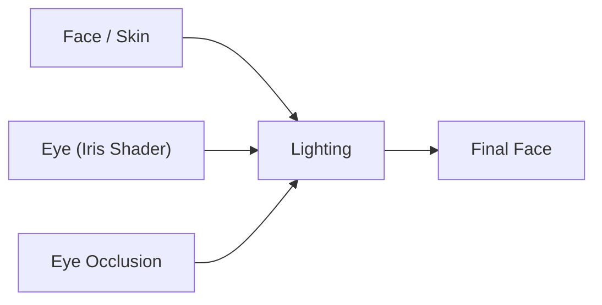

# Eye Occlusion Shader（眼睛遮挡着色器）

> Applies to: 7.x（Dawntrail） ｜ Last Updated: 2026-11-01

## Overview

Eye Occlusion Shader（眼睛遮挡着色器）负责眼周的暗部。

它覆盖眼窝、上眼睑褶、下眼睑与睫毛根部。

没有这层暗部，眼球会看起来像贴在脸上的贴纸。

它不是 Ambient Occlusion，而是一层单独的暗部覆盖。

眼周暗部有三个来源，分清它们能避免大部分翻车：

| 来源 | 位置 | 特点 |
|---|---|---|
| Face 贴图 | 皮肤贴图本身 | 固定、不随眼睛变化 |
| Shader 光照 | 眼窝几何 | 依赖光照角度 |
| Eye Occlusion | 独立材质 | 直接压暗、效果最强 |

参考表中这一 Shader 的 Texture Data 全部标为 `???`。

因此本页只描述它解决的问题与使用经验，不列通道细节。

## Shader File

| 项目 | 内容 | 可信度 |
|---|---|---|
| Shader 名称 | Eye Occlusion Shader | ✅ |
| 参考表中的包名 | `CharacterOcclusion.shpk` | 🟡 未逐版本核对 |
| 材质数量 | 通常与眼睛材质成对出现 | 🟡 |
| 是否可单独关闭 | 可以，但会改变眼部观感 | 🟡 |

在 TexTools 的 Material Editor 中可以通过 Shader 名称确认。

材质名里带 `occlusion` 的，一般就是这一层。

## Supported Versions

| 版本 | 眼部暗部来源 | 说明 |
|---|---|---|
| 7.0 – 7.x | 独立 Eye Occlusion 材质 | 当前实现 🟡 |
| 2.0 – 6.x | 主要烘焙在 Face 贴图 | 是否存在独立遮挡材质仍在确认 🟠 |

从旧版本移植的脸部 Mod 可能已经自带暗部。

再叠加 7.x 的遮挡层，就会出现双倍暗部。

## Official Usage

- 玩家眼周：几乎所有脸型都有 ✅。
- 人形 NPC：多数沿用 🟡。
- 睫毛根部：与 Hair Shader 的睫毛配合 🟡。
- 怪物眼部：可能没有独立遮挡层 🔴。

它通常不是一整块脸部材质，而是围绕眼睛的一小片区域。

修改时要注意网格边界，避免出现方形接缝。

## Texture Slots

参考表没有给出可用的通道信息，以下仅为功能层面的推断。

| 用途 | 说明 | 可信度 |
|---|---|---|
| 暗部形状 | 眼窝轮廓、睫毛根部阴影 | 🟠 |
| 强度 | 多由 Alpha 或颜色亮度控制 | 🟠 |
| 边缘过渡 | 需要柔和渐变，避免硬边 | 🟠 |
| 阴影颜色 | 通常是中性暗色，而非纯黑 | 🟠 |

| 通道 | 内容 | 可信度 |
|---|---|---|
| R | 🔴 Unknown | 🔴 |
| G | 🔴 Unknown | 🔴 |
| B | 🔴 Unknown | 🔴 |
| A | 可能为不透明度 | 🟠 |

在没有可靠资料前，不建议根据猜测去改通道。

## Vertex Colors

🔴 Unknown — 目前没有可靠结论。

参考表中该 Shader 的顶点色字段大多标记为未确认（`???`）。

如果顶点色被清零，最可能的表现是整层暗部消失或均匀变暗。

修改网格前请先备份原始顶点色。

## UV Channels

| Channel | Function | Description |
|---|---|---|
| UV Channel 1 | Normal UV | 沿用眼部/面部 UV 🟡 |
| UV Channel 2 | ???? | 未确认 🔴 |

遮挡层一般与眼睛共用同一套 UV 空间。

贴图位置必须与眼睛对齐，不能随便平移。

## Material Constants

| 功能 | 说明 | 可信度 |
|---|---|---|
| 暗部强度 | 整体加深或减淡 | 🟡 |
| 暗部颜色 | 偏暖或偏冷的阴影 | 🟡 |
| 偏移 / 缩放 | 微调遮挡层位置 | 🔴 |

具体常量名与索引尚未核对。

需要调整强度时，优先改贴图 Alpha，而不是盲改常量。

## Shader Keys

| Key 功能 | 作用 | 可信度 |
|---|---|---|
| 遮挡层开关 | 启用或禁用整层 | 🟡 |
| 混合模式 | 决定与眼睛/皮肤的叠加方式 | 🟡 |
| 睫毛联动 | 是否受睫毛 alpha 影响 | 🔴 |

Key 是功能开关，不能替代贴图，也不会改变暗部形状。

## Additional Data

🔴 Unknown — 目前没有可靠结论。

没有证据表明这一 Shader 依赖 Additional Data。

如果从其他材质克隆，建议保持原有附加数据不变。

## Penumbra Mapping

| 目标 | 操作 | 说明 |
|---|---|---|
| 减轻遮挡 | 替换遮挡贴图，降低 Alpha | 最安全 ✅ |
| 关闭遮挡 | 替换整份 `.mtrl` 或移除材质 | 需确认网格是否共用 🟡 |
| 更换暗部形状 | 只替换贴图 | 保持 UV 对齐 |
| 调整颜色 | 替换贴图，或改允许的常量 | 🟡 |

Penumbra 只能按文件替换，不能逐字段编辑。

所以「微调」通常意味着重新导出一张贴图。

## TexTools Mapping

| 目标 | 位置 | 说明 |
|---|---|---|
| 查看材质 | Material Editor | 确认 Shader 名称 |
| 查看贴图路径 | Material Editor | 记录原始路径 |
| 替换贴图 | Texture Import | 保持同名同格式 |
| 停用遮挡 | 不建议直接删材质 | 可能导致网格缺件 🟡 |

调试时建议先只替换贴图，不要动材质结构。

## Modding Tips

- **遮挡太黑，先降 Alpha**：不要用改颜色的方式硬压，否则边缘会发灰。
- **边缘要软**：眼窝与脸颊之间应自然过渡，硬边像眼影画歪。
- **关掉遮挡后眼睛发亮是正常的**：这时应回头检查 Eye Shader 的 Emissive 与高光。
- **移植旧脸部 Mod 先确认暗部来源**：Face 贴图已有暗部时再叠一层就会脏。
- **遮挡层通常不投影**：不要指望它解决睫毛或眼球的投影问题。

## Known Issues

| 现象 | 可能原因 | 处理 |
|---|---|---|
| 眼周一圈死黑 | Alpha 过高或颜色过深 | 降低 Alpha |
| 遮挡边缘出现硬边 | 贴图缺少渐变 | 重画边缘 |
| 关闭后眼睛明显发亮 | 缺少接触阴影 | 补回轻量遮挡 |
| 眼窝出现方形接缝 | 网格边界与 UV 未对齐 | 检查 UV |
| 旧 Mod 移植后眼周发脏 | 双层暗部叠加 | 去掉其中一层 |
| 遮挡盖住睫毛 | 透明度排序问题 | 调整材质顺序或 alpha |

## References

| Name | Description | Link |
|---|---|---|
| XIV Modding Wiki | FFXIV Modding 资源与研究文档 | https://xivmodding.com/ |
| 着色器参考表 | 本站对 Dawntrail Shader Reference Table 的中文整理 | [materials-table.md](../appendix/materials-table.md) |
| Eye Shader | 眼球本体与 Catchlight | [eye-shaders.md](eye-shaders.md) |
| Face Shader | 面部材质与贴图 | [face-shaders.md](face-shaders.md) |
| TexTools | 材质与贴图编辑工具 | https://github.com/TexTools/FFXIV_TexTools_UI |
| Penumbra | Mod 加载与资源替换框架 | https://github.com/xivdev/Penumbra |
