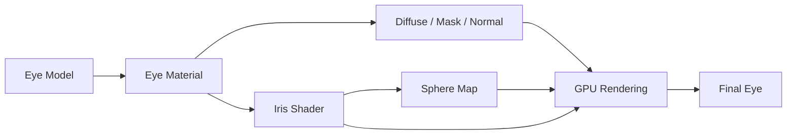

# Eye Shader（眼睛着色器）

> Applies to: 7.x（Dawntrail） ｜ Last Updated: 2026-11-01

## Overview

Eye Shader（眼睛着色器）负责眼球本体，不处理眼睑、睫毛、眼窝与眉毛。

7.x 起眼球由独立于 Face / Skin 的 Iris 材质渲染，双眼通常共用同一份材质与贴图。

| 部位 | 英文 | 负责内容 |
|---|---|---|
| 虹膜 | Iris | 颜色、纹理、瞳孔图案 |
| 瞳孔 | Pupil | 通常直接画在 Iris 贴图内 |
| 巩膜 | Sclera | 眼白、血丝、泛黄 |
| 角膜高光 | Catchlight | 球面贴图提供的反光 |
| 虹膜环 | Limbal Ring | 7.x 由 Shader 生成 |

Dawntrail 的关键变化：

- Sclera 与 Iris 合并进同一张 Diffuse。
- Catchlight 改为球面贴图，不再是可替换贴图。
- Au Ra 的虹膜环由 Shader 绘制，不再属于贴图。
- 巩膜颜色可以画进 Diffuse，也可以用常量调整。

以上四点可在着色器参考表中确认 ✅。

眼睛同时读取 Diffuse、Mask、Normal 与球面贴图，是角色部位里较少见的情况。

贴图分工见 [Eye Textures](../textures/eye-textures.md)，本页只讲 Shader 行为。

## Shader File

| 项目 | 内容 | 可信度 |
|---|---|---|
| Shader 名称 | Iris Shader（Eye Shader） | ✅ |
| 参考表中的包名 | `Iris.shpk` | 🟡 未逐版本核对路径 |
| 旧版玩家版本 | 没有 | ✅ |
| 绑定单位 | 双眼共用的眼部材质 | 🟡 |

参考表中的写法是 `Iris.shpk (Eye Shader)`；本文不复述材质路径，因为种族、脸型与版本都会改变它。

## Supported Versions

| 版本 | 眼部 Shader | 说明 |
|---|---|---|
| 7.0 – 7.x | Iris Shader | Sclera 与 Iris 共用 Diffuse |
| 2.0 – 6.x | 旧眼部 Shader | 与 Iris 不兼容 |
| 转换方式 | Eye Saver / Loose Texture Compiler | 参考表要求 ✅ |

旧眼部 Mod 必须先经过转换才能放进 7.x 客户端，这是参考表中反复强调的硬性要求。

## Official Usage

- 玩家双眼：共用眼部材质与贴图，按左右眼区分着色。
- 人形 NPC：多数沿用同一套 Shader 🟡。
- 怪物眼部：可能使用其他 Shader 🔴。
- 发型与睫毛：属于 Hair Shader，与眼睛无关。

眼睛材质与脸部材质是分开的两套资源。

只替换 Face 贴图不会影响眼睛。

## Texture Slots

### Normal Texture

| Channel | Function | Description |
|---|---|---|
| R | Tangent Space Normal | 切线空间法线 X |
| G | Tangent Space Normal | 切线空间法线 Y |
| B | Unused | 未使用 |
| A | Unused | 未使用 |

### Mask Texture

| Channel | Function | Description |
|---|---|---|
| R | Emissive Mask | 自发光遮罩 |
| G | Reflection Mask / Cubemap Intensity | 反射遮罩 / 立方体贴图强度 |
| B | Iris Mask | 虹膜遮罩 |
| A | Unused | 未使用 |

### Diffuse Texture

| Channel | Function | Description |
|---|---|---|
| R | Standard Color Data | 虹膜与巩膜颜色 |
| G | Standard Color Data | 虹膜与巩膜颜色 |
| B | Standard Color Data | 虹膜与巩膜颜色 |
| A | Unused | 未使用 |

### Catchlight

Catchlight 不是普通 Texture Slot，而是一张球面贴图（Sphere Map）。

- 不能替换，也无法自定义新的高光 ✅。
- 只能减少或切换已有瓦片，或把高光画进 Diffuse，但后者不会移动 🟡。

这是 7.x 眼睛 Mod 最大的行为变化。

## Vertex Colors

| Channel | Vertex Color 1 | Vertex Color 2 |
|---|---|---|
| R | Left Eye Color Influence（左眼颜色影响） | Unused |
| G | Right Eye Color Influence（右眼颜色影响） | Unused |
| B | Unused | Unused |
| A | Unused | Unused |

Vertex Color 1 的 R/G 分别对应左右眼，是异色瞳的基础。

具体混合权重与 ColorSet 的相互作用仍未完全确认 🟡。

## UV Channels

| Channel | Function | Description |
|---|---|---|
| UV Channel 1 | Normal UV Channel | 眼球展开 UV |
| UV Channel 2 | Unused | 未使用 |

Iris 与 Sclera 共用同一套 UV，贴图左右位置必须与 UV 对应。

## Material Constants

| 功能 | 说明 | 可信度 |
|---|---|---|
| 高光强度 / 瓦片选择 | 减弱或切换球面贴图高光 | 🟡 |
| 巩膜颜色（White Eyes Color） | 调整眼白色调 | 🟡 |
| 虹膜环开关 | 打开或关闭 Au Ra 虹膜环 | 🟡 |
| 眼球颜色叠加 | 控制 ColorSet 对 Diffuse 的影响 | 🟡 |

本文不列出具体常量名与索引，因为名称与顺序会随版本变化；需要精确信息时请对照 [着色器参考表](../appendix/materials-table.md)。

## Shader Keys

| Key 功能 | 作用 | 可信度 |
|---|---|---|
| Iris Mask | 启用 Mask 的虹膜遮罩 | 🟡 |
| Emissive | 启用自发光（发光眼） | 🟡 |
| 眼球颜色叠加 | 是否让 ColorSet 参与 Diffuse 着色 | 🟡 |
| 左右眼独立影响 | 是否读取 Vertex Color 的左右通道 | 🟡 |

关闭某个 Key 后，对应的贴图通道会直接失效，因此 Key 不能当贴图用。

## Additional Data

🔴 Unknown — 目前没有可靠结论。

实践上，直接克隆现成眼部材质通常不需要改动这一块。

## Penumbra Mapping

| 目标 | 操作 | 说明 |
|---|---|---|
| 替换 Iris / Sclera | 替换对应的 `.tex` | 路径随种族与脸型变化 🟡 |
| 替换 Normal / Mask | 同上 | 必须保持通道含义一致 |
| 修改 Shader Keys / Constants | 替换整份 `.mtrl` | Penumbra 不逐字段编辑材质 🟡 |
| 单眼异色 | 贴图左右两侧分别绘制，或调整 ColorSet | 双眼多为同一材质 🟡 |

Penumbra 按资源路径替换，同一路径被多处引用时会一起生效。

## TexTools Mapping

| 目标 | 位置 | 说明 |
|---|---|---|
| 旧眼部 Mod 转换 | Eye Saver | 参考表要求 ✅ |
| 多色眼睛转换 | Loose Texture Compiler | 参考表要求 ✅ |
| 查看 Shader 与 Keys | Material Editor | 读取当前材质 🟡 |
| 修改 ColorSet | Material Editor / Color Table | 影响眼球颜色叠加 🟡 |
| 导入贴图 | 按原路径导入 `.tex` | 覆盖前先备份 |

导入后如果眼睛显示异常，优先检查通道而不是模型。

## Modding Tips

- **换 Iris 贴图**：虹膜、瞳孔、巩膜画进同一张 Diffuse，注意 UV 方向。
- **用 ColorSet 改眼色**：ColorSet 以类似正片叠底的方式叠加，涂灰色更容易被染色。
- **伪高光只能画进 Diffuse**：不会随视角移动，强光下容易显得假。
- **Normal Map 只影响光照质感**：不改变虹膜轮廓与瞳孔形状。
- **异色瞳靠贴图与 ColorSet**：在贴图左右两侧画不同颜色，再用 ColorSet 或顶点色区分双眼。
- **保持通道语义**：Mask 的 B 通道是 Iris Mask，乱画会让虹膜被裁掉或错误发光。

## Known Issues

| 现象 | 可能原因 | 处理 |
|---|---|---|
| 旧高光 Mod 完全失效 | Catchlight 改为球面贴图 | 重画到 Diffuse ✅ |
| Au Ra 虹膜环形状改不了 | 环由 Shader 生成 | 只能开关 ✅ |
| 眼睛整体过亮 | Emissive 或高光常量过高 | 降低对应参数 |
| 虹膜被染色 | ColorSet 叠加 | 调整 ColorSet 或在 B 通道遮罩 |
| 换贴图后眼睛全黑 | Diffuse 与 Mask 通道不匹配 | 检查 Mask B 与 Alpha |
| 左右眼颜色用反 | 贴图左右方向与 UV 不对应 | 镜像贴图或交换左右内容 |

如果眼睛像贴在脸上，问题通常不在 Eye Shader，而在 Eye Occlusion Shader。

## References

| Name | Description | Link |
|---|---|---|
| XIV Modding Wiki | FFXIV Modding 资源与研究文档 | https://xivmodding.com/ |
| 着色器参考表 | 本站对 Dawntrail Shader Reference Table 的中文整理 | [materials-table.md](../appendix/materials-table.md) |
| Eye Textures | 眼睛贴图的通道与制作 | [eye-textures.md](../textures/eye-textures.md) |
| Eye Occlusion Shader | 眼窝遮挡与「浮在脸上」问题 | [eye-occlusion-shader.md](eye-occlusion-shader.md) |
| TexTools | 材质与贴图编辑工具 | https://github.com/TexTools/FFXIV_TexTools_UI |
| Penumbra | Mod 加载与资源替换框架 | https://github.com/xivdev/Penumbra |
