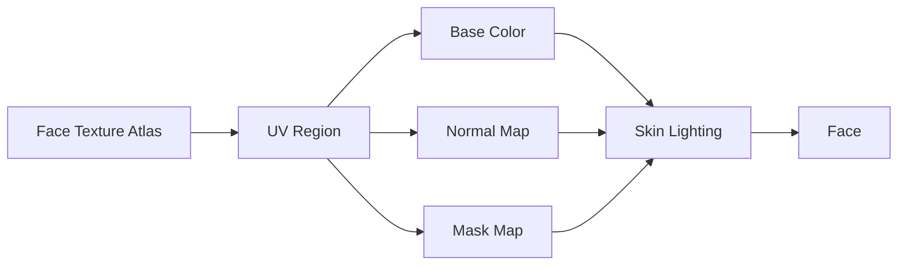

# Face Shader（面部着色器）

> Applies to: 7.x（Dawntrail） ｜ Last Updated: 2026-11-01

## Overview

Face Shader 负责角色面部，包括面部皮肤、嘴唇、眉毛与睫毛的材质。

面部在屏幕上占比不大，却是最容易被玩家盯住的部分。肤色、法线强度与接缝只要有一点偏差，就会非常明显。

面部的另一层复杂度来自 UV 图集：一张贴图里通常排着多张脸，UV 决定当前使用哪一块。

本文用 ✅ Verified、🟡 Researching、🟠 Hypothesis、🔴 Unknown 标记可信度。

## Shader File

Face Shader 由 `.mtrl` 引用，`.mtrl` 再指向对应的 Shader Package（`.shpk`）。

| 项目 | 内容 | 状态 |
|---|---|---|
| Shader 类型 | Character Face Shader | 🟡 Researching |
| Shader Package | Character 系 `.shpk`，文件名以实际资源为准 | 🟡 Researching |
| 相关分支 | 部分面部材质由 Skin Shader 承担 | 🟡 Researching |
| Material | `.mtrl`，保存 Texture、Constant 与 Key | ✅ Verified |

面部与身体不是一个 Material。改脸时不要把身体肤色的调整直接套到脸上，两者的光照与参数起点可能不同。

## Supported Versions

| 版本 | 变化 | 状态 |
|---|---|---|
| 2.0–6.x | Legacy 面部渲染，旧 Mod 使用旧通道 | ✅ Verified |
| 7.0（Dawntrail） | 面部随图形更新调整，法线与高光更细 | 🟡 Researching |
| 7.1–7.2 | 新材质继续适配，旧面部 Mod 需转换 | 🟡 Researching |
| 7.x 后续 | 高分辨率面部贴图与图集布局可能变化 | 🟡 Researching |

旧面部 Mod 直接搬进 7.x，常见结果是肤色偏灰、法线过强或睫毛边缘出现黑边。

## Official Usage

| 对象 | 说明 | 状态 |
|---|---|---|
| 玩家面部 | 所有种族与性别的脸部 | ✅ Verified |
| 人形 NPC | 与玩家共用面部渲染 | 🟡 Researching |
| 眉毛 / 睫毛 | 常使用 Alpha 裁剪，可能归入相邻分支 | 🟡 Researching |
| 妆容 / 纹身 | 通常由 Tattoo 或 Decal 分支处理 | 🟡 Researching |

妆容不等于面部底色。把妆容直接画进 Base Color 会失去独立控制，也更容易在表情变化时拉伸。

## Texture Slots

| 用途 | 常见名称 | 在面部的作用 | 状态 |
|---|---|---|---|
| 底色 | Base Color | 肤色、嘴唇、眉毛与妆容底色 | ✅ Verified |
| 法线 | Normal Map | 毛孔、皱纹、唇部起伏 | 🟡 Researching |
| 遮罩 | Mask Map | Specular、Roughness、Ambient Occlusion（AO） | 🟡 Researching |
| 颜色集 | ColorSet | 肤色与染色数据 | 🟡 Researching |
| 叠加 | Decal / Tattoo | 妆容、纹身，常走 UV2 | 🟡 Researching |

Base Color 的 Alpha 常用于睫毛、眉毛等裁剪区域。把它整张填满，Alpha Test 就失去作用。

## Vertex Colors

| 通道 | 可能作用 | 状态 |
|---|---|---|
| R | Specular Mask | 🟠 Hypothesis |
| G | Roughness | 🟠 Hypothesis |
| B | Diffuse / AO Mask | 🟠 Hypothesis |
| A | Alpha / 面部遮罩 | 🟠 Hypothesis |

面部 Vertex Color 没有逐项验证。改脸型后顶点色可能被重算，导入前应保留原始数据。

## UV Channels

| UV | 用途 | 状态 |
|---|---|---|
| UV1 | 面部图集 UV，决定使用哪一张脸 | 🟡 Researching |
| UV2 | 妆容、纹身等 Decal | 🟡 Researching |
| UV3 | 未确认 | 🔴 Unknown |

UV 图集是面部 Mod 最容易翻车的地方。贴图边缘要留出 padding，否则缩放或 mipmap 会把相邻脸的颜色吸过来。

表情主要由骨骼与形态键驱动，贴图通常不随表情切换。但 UV 区域仍要为形变留出余量。（🟡）

## Material Constants

| 功能 | 作用 | 状态 |
|---|---|---|
| 肤色 / 色调 | 与 ColorSet 共同决定脸部颜色 | 🟡 Researching |
| 唇色 / 染色 | 控制嘴唇与妆容的色调 | 🟡 Researching |
| Specular / Roughness | 控制皮肤油光与唇部高光 | 🟡 Researching |
| Alpha 阈值 | 控制睫毛、眉毛的裁剪 | 🟡 Researching |
| 法线强度 | 控制面部细节的强弱 | 🟡 Researching |

## Shader Keys

| 功能 | 作用 | 状态 |
|---|---|---|
| Alpha Test | 睫毛、眉毛的透明裁剪 | ✅ Verified |
| Decal / Tattoo | 启用妆容或纹身叠加 | 🟡 Researching |
| Dye / ColorSet | 肤色与染色 | 🟡 Researching |
| Emissive | 自发光，面部较少使用 | 🟡 Researching |

睫毛与眉毛应使用 Alpha 裁剪，而不是半透明混合。混合会让排序问题直接写在脸上。

## Additional Data

🔴 Unknown — Face Shader 的 Additional Data 没有可靠结论。

| 字段 | 说明 | 状态 |
|---|---|---|
| 附加位 | 面部上的具体含义未确认 | 🔴 Unknown |

## Penumbra Mapping

| 步骤 | 操作 | 说明 |
|---|---|---|
| 1 | 建立 Mod 目录 | 保持 `chara/...` 原始路径 |
| 2 | 替换 Base Color 与 Normal | 保持图集布局不变 |
| 3 | 需要时改 Material | 肤色、法线强度、Alpha 阈值 |
| 4 | Reload Penumbra | 重新加载并重绘角色 |
| 5 | 多表情验证 | 说话、眨眼、转头各看一次 |

高分辨率面部贴图不要改变图集分块。只放大单张脸而移动了 UV 边界，其他脸也会跟着错位。

## TexTools Mapping

| 操作 | 说明 | 状态 |
|---|---|---|
| 导入面部贴图 | 按 Face 类型导入，保留布局 | ✅ Verified |
| 编辑 Material | 可改 Shader、Key 与 Constant | 🟡 Researching |
| 检查 UV | 确认图集区域与 padding | 🟡 Researching |

## Modding Tips

| 目标 | 推荐做法 | 状态 |
|---|---|---|
| 接缝自然 | 面部与身体使用同一肤色与法线强度 | 🟡 Researching |
| 避免塑料感 | 降低法线强度，保留皮肤粗糙度 | 🟡 Researching |
| 睫毛干净 | Alpha 保持硬边，避免灰阶过渡 | 🟡 Researching |
| 妆容可控 | 用 Decal 或 Tattoo 分支，不画进底色 | 🟡 Researching |
| 图集安全 | 贴图边缘留 padding，检查 mipmap | 🟡 Researching |

面部 Mod 不要只看正面。侧脸、低头与说话时的拉伸，才是接缝和法线问题最容易暴露的地方。

## Known Issues

| 问题 | 常见原因 | 状态 |
|---|---|---|
| 面部与身体接缝 | 肤色、法线强度或高光不一致 | 🟡 Researching |
| 法线过强、像塑料 | 法线强度过高；Roughness 过低 | 🟡 Researching |
| 睫毛出现黑边或白边 | Alpha 预乘错误；mipmap 压灰 | 🟡 Researching |
| 表情拉伸 | UV 没有为形变留余量 | 🟡 Researching |
| 图集串色 | 贴图边缘没有 padding；UV 越界 | 🟡 Researching |
| 妆容被覆盖 | 妆容画进 Base Color，被其他层盖住 | 🟡 Researching |
| 远处面部模糊 | mipmap 与贴图分辨率不匹配 | 🟡 Researching |

## References

| Name | Description | Link |
|---|---|---|
| XIV Modding Wiki | FFXIV Modding 资源与研究文档 | https://xivmodding.com/ |
| 站内材质表 | 面部与 Skin 的通道记录 | [materials-table.md](../appendix/materials-table.md) |
| Character Shader | 角色 Shader 总览与通用布局 | [character-shaders.md](character-shaders.md) |
| Tattoo Shader | 妆容与纹身的独立分支 | [character-tattoo-shaders.md](character-tattoo-shaders.md) |
| TexTools | TexTools 工具仓库 | https://github.com/TexTools/FFXIV_TexTools_UI |
| Penumbra | Penumbra Mod Framework | https://github.com/xivdev/Penumbra |
