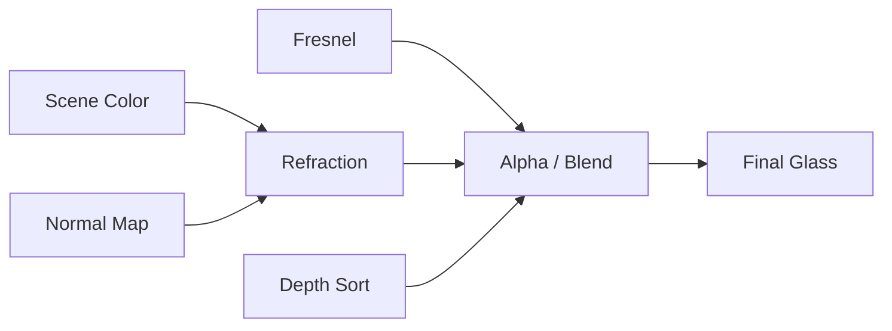

# Glass Shader（玻璃着色器）

> Applies to: 7.x（Dawntrail） ｜ Last Updated: 2026-11-01

## Overview

Glass Shader 负责透明、折射与 Fresnel 反射，常见于眼镜、面纱、水晶与部分饰品。

它和普通透明材质最大的区别是：Glass 会读取屏幕上的场景颜色，再按法线与厚度做折射。

因此 Glass 的效果依赖摄像机角度，也依赖渲染顺序。换一个视角，折射和透明度都会变。

玻璃通常只画正面：背面被剔除，镜片又常是单层几何，所以从侧面看会直接看穿。（🟡）

本文用 ✅ Verified、🟡 Researching、🟠 Hypothesis、🔴 Unknown 标记可信度。

## Shader File

Glass Shader 由 `.mtrl` 引用，`.mtrl` 再指向对应的 Shader Package（`.shpk`）。

| 项目 | 内容 | 状态 |
|---|---|---|
| Shader 类型 | Character Glass Shader | 🟡 Researching |
| 常见文件名 | `characterglass.shpk` | 🟡 社区常见名称，以实际资源为准 |
| 相关 Shader | Character Transparency Shader（7.2+） | 🟡 Researching |
| Material | `.mtrl`，保存 Texture、Constant 与 Key | ✅ Verified |

Glass 与 [Character Transparency Shader](character-transparency-shader.md) 不是同一个东西。前者偏玻璃与折射，后者偏堆叠透明与直通。

## Supported Versions

| 版本 | 变化 | 状态 |
|---|---|---|
| 2.0–6.x | 旧透明与玻璃材质，行为与现在不同 | 🟡 Researching |
| 7.0（Dawntrail） | Character Glass 随新角色管线更新 | 🟡 Researching |
| 7.1–7.2 | Character Transparency Shader 加入，提供另一种透明方案 | 🟡 Researching |
| 7.x 后续 | 与特定 VFX 叠加时可能出现抖动或消失 | 🟡 Researching |

不要把 6.x 的透明材质直接搬到 7.x。透明阈值、排序与 Additional Data 都可能已经变了。

## Official Usage

| 对象 | 说明 | 状态 |
|---|---|---|
| 眼镜 / 护目镜 | 镜片、风镜、单片眼镜 | 🟡 Researching |
| 面纱 / 薄纱 | 大面积的半透明织物 | 🟡 Researching |
| 水晶 / 宝石 | 折射加高光的透明块 | 🟡 Researching |
| 饰品 | 吊坠、耳饰上的透明部分 | 🟡 Researching |

不是所有透明装备都用 Glass。看到“能透视但不像玻璃”的材质，应先确认它是不是 Character Transparency 或其他透明分支。

## Texture Slots

| 用途 | 常见名称 | 在玻璃上的作用 | 状态 |
|---|---|---|---|
| 底色 | Base Color | 玻璃颜色与污渍；Alpha 控制透明度 | ✅ Verified |
| 法线 | Normal Map | 折射方向与表面凹凸 | 🟡 Researching |
| 遮罩 | Mask Map | Specular、Roughness、Ambient Occlusion（AO） | 🟡 Researching |
| 颜色集 | ColorSet | 染色与色调偏移 | 🟡 Researching |

Base Color 的 Alpha 决定“看得见多少”，法线决定“看到的背景歪多少”。两者要一起调；折射读取屏幕空间 Scene Color，不占用额外 Texture Slot。

## Vertex Colors

| 通道 | 可能作用 | 状态 |
|---|---|---|
| R | Specular Mask | 🟠 Hypothesis |
| G | Roughness | 🟠 Hypothesis |
| B | Alpha / 折射遮罩 | 🟠 Hypothesis |
| A | Alpha / Fresnel 遮罩 | 🟠 Hypothesis |

Glass 的 Vertex Color 没有逐项验证。透明物体改顶点色时，优先确认它是否被 Shader 读取。

## UV Channels

| UV | 用途 | 状态 |
|---|---|---|
| UV1 | 主 UV | ✅ Verified |
| UV2 | 未确认，可能用于 Decal 或第二层细节 | 🔴 Unknown |
| UV3 | 未确认 | 🔴 Unknown |

做镜片时，UV 接缝不要放在视线正中央。折射会把接缝放大成一条明显的折线。

## Material Constants

| 功能 | 作用 | 状态 |
|---|---|---|
| 透明度 / Alpha 阈值 | 控制整体透明程度 | 🟡 Researching |
| Fresnel 强度 / 偏置 | 控制边缘变亮、变不透明的范围 | 🟡 Researching |
| 折射强度 | 控制背景偏移量 | 🟡 Researching |
| IOR / 折射率 | 控制折射的物理感 | 🟡 Researching |
| 色调 / 染色 | 玻璃颜色与染色叠加 | 🟡 Researching |

折射强度不要拉满。数值过大时，镜片边缘会把背景拉成明显的彩色条纹。

## Shader Keys

| 功能 | 作用 | 状态 |
|---|---|---|
| Transparency | 启用透明混合 | 🟡 Researching |
| Refraction | 启用屏幕空间折射 | 🟡 Researching |
| Backface / Cull | 控制是否绘制背面 | 🟡 Researching |
| Depth Write | 透明物体是否写深度 | 🟡 Researching |
| Dither | 用抖动替代平滑透明 | 🟡 Researching |

Depth Write 与 Transparency 的组合决定排序。透明物体通常不写深度，这也是玻璃互相穿插时排序出错的原因。

## Additional Data

🔴 Unknown — Glass Shader 的 Additional Data 没有可靠结论。

| 字段 | 说明 | 状态 |
|---|---|---|
| 附加位 | Glass 上的含义未确认 | 🔴 Unknown |
| 抖动 / 直通位 | 属于 Character Transparency Shader 的社区记录，不要直接套用 | 🟡 Researching |

站内材质表记录过 Passthrough 的附加位条件，但那是 Character Transparency 的，不是 Glass 的通用写法。

## Penumbra Mapping

| 步骤 | 操作 | 说明 |
|---|---|---|
| 1 | 建立 Mod 目录 | 保持 `chara/...` 原始路径 |
| 2 | 替换 Base Color 与 Normal | Alpha 与法线要匹配 |
| 3 | 修改 Material | 透明、Fresnel、折射参数 |
| 4 | Reload Penumbra | 重新加载并重绘角色 |
| 5 | 多角度验证 | 正面、侧面、逆光各看一次 |

Penumbra 的 Material 编辑适合试参数。最终发布时把 `.mtrl` 一起打包，避免用户端使用默认值。

## TexTools Mapping

| 操作 | 说明 | 状态 |
|---|---|---|
| 导入贴图 | 按 Base Color、Normal、Mask 类型导入 | ✅ Verified |
| 编辑 Material | 可改 Shader、Key 与 Constant | 🟡 Researching |
| 保存 `.mtrl` | 确认路径与游戏资源一致 | ✅ Verified |

## Modding Tips

| 目标 | 推荐做法 | 状态 |
|---|---|---|
| 眼镜 | 镜片做薄，前后各一层或使用双面 | 🟡 Researching |
| 面纱 | 大面积 Alpha 渐变加 Fresnel | 🟡 Researching |
| 水晶 | 不透明内核加透明外壳 | 🟡 Researching |
| 堆叠透明 | 减少层数，优先用抖动 | 🟡 Researching |

透明物体通常不写深度，也不参与常规阴影。需要投影时，另做一张不透明的阴影代理网格。描边系统也可能仍按不透明网格处理，导致轮廓错误。（🟡）

## Known Issues

| 问题 | 常见原因 | 状态 |
|---|---|---|
| 看不到玻璃背面 | 背面被剔除；只有单层几何 | 🟡 Researching |
| 与 VFX 叠加时抖动 | Glass 与特定特效的排序冲突 | 🟡 Researching |
| 玻璃后面的物体消失 | 透明排序错误；Depth Write 设置不当 | 🟡 Researching |
| 描边异常 | 透明物体被描边系统当成不透明 | 🟡 Researching |
| 没有投影 | 透明材质不写入阴影 | 🟡 Researching |
| 折射边缘拉伸 | 折射强度过高；法线过陡 | 🟡 Researching |

## References

| Name | Description | Link |
|---|---|---|
| XIV Modding Wiki | FFXIV Modding 资源与研究文档 | https://xivmodding.com/ |
| 站内材质表 | Glass 与 Transparency 的社区记录 | [materials-table.md](../appendix/materials-table.md) |
| Character Shader | 角色 Shader 总览与通用布局 | [character-shaders.md](character-shaders.md) |
| TexTools | TexTools 工具仓库 | https://github.com/TexTools/FFXIV_TexTools_UI |
| Penumbra | Penumbra Mod Framework | https://github.com/xivdev/Penumbra |
