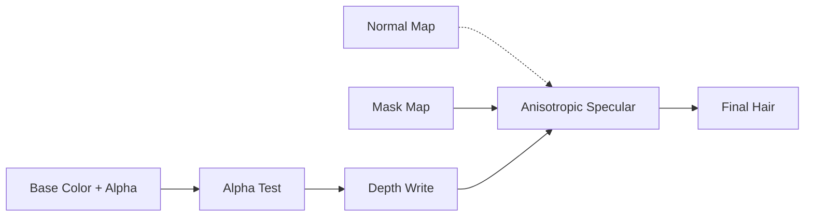

# Hair Shader（头发着色器）

> Applies to: 7.x（Dawntrail） ｜ Last Updated: 2026-11-01

## Overview

Hair Shader 负责头发与 Miqo'te 尾巴，也可能覆盖部分睫毛与眉毛材质（🟡）。本文用 ✅ Verified、🟡 Researching、🟠 Hypothesis、🔴 Unknown 标记可信度。

它的三个核心是各向异性高光（Anisotropic Specular）、Alpha 裁剪与深度写入。

Dawntrail 之后，Hair Shader 没有 Legacy 版本。旧头发 Mod 必须转换到新通道，不能直接沿用。

## Shader File

Hair Shader 由 `.mtrl` 引用，`.mtrl` 再指向对应的 Shader Package（`.shpk`）。

| 项目 | 内容 | 状态 |
|---|---|---|
| Shader 类型 | Character Hair Shader | ✅ Verified |
| Shader Package | Character 系 `.shpk`，文件名以实际资源为准 | 🟡 Researching |
| Legacy 版本 | 无；旧头发 Mod 必须转换 | 🟡 Researching |
| Material | `.mtrl`，保存 Texture、Constant 与 Key | ✅ Verified |

## Supported Versions

| 版本 | 变化 | 状态 |
|---|---|---|
| 2.0–6.x | 旧 Hair Shader，旧 Mod 使用旧通道 | ✅ Verified |
| 7.0（Dawntrail） | 新 Hair Shader，无 Legacy 版本 | 🟡 Researching |
| 7.1–7.2 | 通道与参数继续调整，旧 Mod 需转换 | 🟡 Researching |
| 7.x 后续 | 外观插件的“发光头发”参数可能不响应 | 🟡 Researching |

## Official Usage

| 对象 | 说明 | 状态 |
|---|---|---|
| 玩家头发 | 所有发型的基础渲染 | ✅ Verified |
| Miqo'te 尾巴 | 与头发共用 Hair Shader | ✅ Verified |
| 睫毛 / 眉毛 | 可能使用 Hair 或相邻分支 | 🟡 Researching |
| 人形 NPC | 与玩家共用同一套头发渲染 | 🟡 Researching |

头发以外，任何“片状毛发”都可能被归到 Hair Shader。看到发光、透明或发丝高光异常时，先确认它到底用了哪个 Shader。

## Texture Slots

| 用途 | 常见名称 | 在头发上的作用 | 状态 |
|---|---|---|---|
| 底色 | Base Color | 发色底图；Alpha 决定发丝裁剪 | ✅ Verified |
| 法线 | Normal Map | 发丝细节；常被高光掩盖或未采样 | 🟡 Researching |
| 遮罩 | Mask Map | Specular、Roughness、Ambient Occlusion（AO） | 🟡 Researching |
| 颜色集 | ColorSet | 发色与染色的主来源 | 🟡 Researching |

Base Color 的 Alpha 不是“可选的透明”。它是发丝形状的一部分，导出时被填满就会变成一块实心片。

## Vertex Colors

Hair 可能沿用 Character 系的 Vertex Color 布局，但目前没有逐项验证。

| 通道 | 可能作用 | 状态 |
|---|---|---|
| R | Specular Mask | 🟠 Hypothesis |
| G | Roughness | 🟠 Hypothesis |
| B | Diffuse / AO Mask | 🟠 Hypothesis |
| A | Alpha / 发丝遮罩 | 🟠 Hypothesis |

发色主来源是 ColorSet，Vertex Color 更多负责发根到发梢的明暗。发根偏暗、发梢偏亮通常来自这两者的叠加，而不是 Base Color 本身。（🟡）

## UV Channels

| UV | 用途 | 状态 |
|---|---|---|
| UV1 | 发丝主 UV，沿发丝方向排布 | ✅ Verified |
| UV2 | 未确认，可能用于 Flow 或滚动类效果 | 🔴 Unknown |
| UV3 | 未确认 | 🔴 Unknown |

## Material Constants

| 功能 | 作用 | 状态 |
|---|---|---|
| 高光强度 | 控制各向异性高光的亮度 | 🟡 Researching |
| 高光锐度 / 宽度 | 控制发丝高光的宽度 | 🟡 Researching |
| 发色 / 染色 | 与 ColorSet 叠加 | 🟡 Researching |
| Alpha 阈值 | 控制发丝裁剪位置 | 🟡 Researching |
| 湿润 / 光泽 | Shader ID 10 在社区记录中对应 Wet Look | 🟡 Researching |

## Shader Keys

| 功能 | 作用 | 状态 |
|---|---|---|
| Alpha Test | 发丝裁剪，决定边缘形状 | ✅ Verified |
| Depth Write | 让透明头发正确遮挡 | 🟡 Researching |
| Two-Sided | 双面发片 | 🟡 Researching |
| Dye / ColorSet | 发色染色 | 🟡 Researching |
| Emissive / Glow | 发光头发；新 Shader 下可能失效 | 🟡 Researching |

Key 的组合比单个 Key 更重要。Alpha Test 与 Depth Write 不匹配时，发梢会消失或整片发黑。

## Additional Data

🔴 Unknown — 目前没有可靠结论。

| 字段 | 说明 | 状态 |
|---|---|---|
| 附加位 | 头发上的含义未确认 | 🔴 Unknown |

## Penumbra Mapping

| 步骤 | 操作 | 说明 |
|---|---|---|
| 1 | 替换 Base Color | 保留 Alpha，不要填满 |
| 2 | 替换 Normal / Mask | 先确认 Shader 是否读取 |
| 3 | 修改 Material | 发色、高光、Alpha 阈值 |
| 4 | Reload Penumbra | 重新加载并重绘角色 |
| 5 | 多角度检查 | 发梢、背面、强光下各看一次 |

## TexTools Mapping

| 操作 | 说明 | 状态 |
|---|---|---|
| 导入 Base Color | 保留 Alpha 通道 | ✅ Verified |
| 导入 Normal | 保持切线空间一致 | 🟡 Researching |
| 编辑 Material | 可改 Shader、Key 与 Constant | 🟡 Researching |

## Modding Tips

| 目标 | 推荐做法 | 状态 |
|---|---|---|
| 清晰发梢 | Alpha 尽量保持 0 或 1，减少灰边 | 🟡 Researching |
| 发丝高光 | UV 与高光方向沿发丝 | 🟡 Researching |
| 染色 | 优先调 ColorSet，贴图只做明暗 | 🟡 Researching |
| 双面发片 | 检查法线朝向与背面高光 | 🟡 Researching |
| 发光头发 | 先确认当前 Shader 是否还响应 | 🟡 Researching |

法线不要指望改变头发轮廓。轮廓由 Alpha 与几何决定，Normal 只影响表面细节。

## Known Issues

### 为什么头发法线无效？

原页列出的四条原因仍然成立，下面逐条展开。

| # | 原因 | 展开 |
|---|---|---|
| 1 | Hair Shader 未读取 Normal | 高光由发丝切线主导，Normal 对轮廓和高光的贡献被压低；部分分支根本不采样 Normal |
| 2 | Alpha Channel 被覆盖 | 导出时 A 被填满或压成灰阶，Alpha Test 失效，Normal 混合也被连带覆盖 |
| 3 | Mask 覆盖 Specular | Mask 的 R/G 直接改写 Specular 与 Roughness，Normal 带来的细微明暗被盖掉 |
| 4 | 面朝向错误 | 发片是双面几何，法线或切线翻转后光照方向相反；Blender 导出切线空间不一致也会这样 |

排查顺序：先看材质是否读取 Normal，再看 Alpha 是否完整，最后检查双面法线与切线。

### 其他常见问题

| 问题 | 常见原因 | 状态 |
|---|---|---|
| 发梢黑边或白边 | Alpha 预乘错误；mipmap 把边缘压灰 | 🟡 Researching |
| 发丝排序错误 | Depth Write 关闭；多层透明叠加 | 🟡 Researching |
| 头发发光失效 | 新 Shader 不响应旧发光参数 | 🟡 Researching |
| 染色后发灰 | ColorSet 与 Base Color 同时作用 | 🟡 Researching |
| 自阴影斑驳 | 法线朝向错误；忽略自身阴影 Key 未开 | 🟡 Researching |
| 远处发丝消失 | LOD 或 mipmap 裁剪过激 | 🟡 Researching |

## References

| Name | Description | Link |
|---|---|---|
| XIV Modding Wiki | FFXIV Modding 资源与研究文档 | https://xivmodding.com/ |
| 站内材质表 | Hair Shader 通道与 Shader ID 记录 | [materials-table.md](../appendix/materials-table.md) |
| Character Shader | 角色 Shader 总览与通用布局 | [character-shaders.md](character-shaders.md) |
| TexTools | TexTools 工具仓库 | https://github.com/TexTools/FFXIV_TexTools_UI |
| Penumbra | Penumbra Mod Framework | https://github.com/xivdev/Penumbra |
