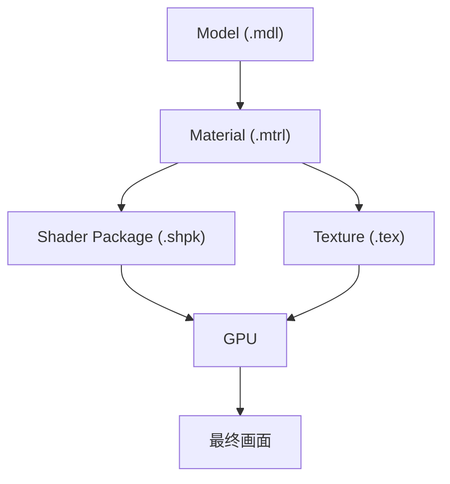

# Shader（着色器）概览

> Applies to: 7.x（Dawntrail） ｜ Last Updated: 2026-11-01

## Overview

Shader（着色器）是运行在 GPU 上的渲染程序。

它决定一个模型「看起来是什么材质」，而不是「长什么形状」。

FFXIV 把 Shader 编译进 `.shpk`（Shader Package），Material 通过 CRC32 引用其中一个包。

!!! note "本章的组织方式"
    先读 [Shader Reference](shader-reference.md) 建立整体概念，再按「你要改什么」跳到对应页面。

## Shader 在渲染中的位置

| 文件 | 负责 | 不负责 |
|---|---|---|
| `.mdl` | 几何、UV、顶点数据 | 颜色与材质 |
| `.mtrl` | 参数、贴图绑定、开关 | 渲染算法 |
| `.shpk` | 渲染算法与分支 | 具体取值 |
| `.tex` | 图像数据 | 如何采样 |

## 常见 Shader 分类

| 分类 | 典型对象 | 本站页面 |
|---|---|---|
| Character Shader | 装备、坐骑、大部分可改模型 | [Character Shader](character-shaders.md) |
| CharacterLegacy Shader | 尚未更新的旧资产 | [CharacterLegacy Shader](character-legacy-shader.md) |
| Skin Shader | 身体皮肤、面部、带毛发的种族 | [Skin Shader](skin-shaders.md) |
| Face Shader | 面部 | [Face Shader](face-shaders.md) |
| Hair Shader | 头发 | [Hair Shader](hair-shaders.md) |
| Eye Shader | 眼睛 | [Eye Shader](eye-shaders.md) |
| Eye Occlusion Shader | 眼窝与睫毛根部遮挡 | [Eye Occlusion Shader](eye-occlusion-shader.md) |
| Glass Shader | 眼镜、面纱、水晶 | [Glass Shader](glass-shader.md) |
| Stocking Shader | 丝袜、半透明织物 | [Stocking Shader](stocking-shader.md) |
| Tattoo Shader | 纹身、贴花 | [Tattoo Shader](character-tattoo-shaders.md) |
| Transparency Shader | 半透明角色部件 | [Transparency Shader](character-transparency-shader.md) |
| Additional Data | 材质附加参数 | [Additional Data](additional-data.md) |

## 按目标选择页面

| 你想做的事 | 建议阅读 |
|---|---|
| 给装备换颜色 | [Color Set](../textures/color-set.md) + [Character Shader](character-shaders.md) |
| 改发光/全息效果 | [Material Constants](../materials/constants.md) + [Character Shader](character-shaders.md) |
| 做半透明裙摆 | [Transparency Shader](character-transparency-shader.md) |
| 做玻璃/水晶配件 | [Glass Shader](glass-shader.md) |
| 改肤色或身体 | [Skin Shader](skin-shaders.md) |
| 改脸 | [Face Shader](face-shaders.md) |
| 改眼睛 | [Eye Shader](eye-shaders.md) + [Eye Textures](../textures/eye-textures.md) |
| 头发法线没效果 | [Hair Shader](hair-shaders.md) |

## 页面模板说明

本站的 Shader 页面统一采用以下小节，便于横向对比：

- Overview / Shader File / Supported Versions / Official Usage
- Texture Slots / Vertex Colors / UV Channels
- Material Constants / Shader Keys / Additional Data
- Penumbra Mapping / TexTools Mapping
- Modding Tips / Known Issues / References

某一节没有可靠资料时，会明确写 🟡 Researching 或 🔴 Unknown，而不是给出猜测的数值。

## 研究状态

| 状态 | 含义 |
|---|---|
| ✅ Verified（已验证） | 实际修改并在游戏内确认 |
| 🟡 Researching（研究中） | 有实验，结论仍在完善 |
| 🟠 Hypothesis（推测） | 社区说法，尚未验证 |
| 🔴 Unknown（未知） | 暂无可靠结论 |

## References

- XIV Modding Wiki — https://xivmodding.com/
- 着色器参考表（站内）：[materials-table.md](../appendix/materials-table.md)
- TexTools — https://github.com/TexTools/FFXIV_TexTools_UI
