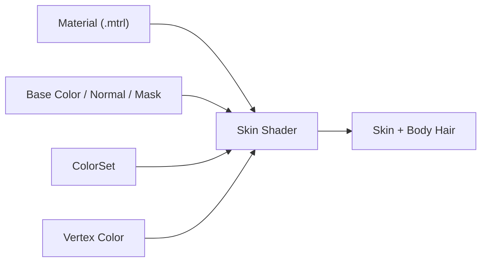

# Skin Shader（皮肤着色器）

> Applies to: 7.x（Dawntrail） ｜ Last Updated: 2026-11-01

## Overview

Skin Shader 负责角色身体皮肤，也覆盖部分面部材质与带毛发的种族（Hrothgar）。本文用 ✅ Verified、🟡 Researching、🟠 Hypothesis、🔴 Unknown 标记可信度。

它处理的不只是肤色，还包括皮肤高光、次表面感（Subsurface）、体毛（Body Hair）与发色的联动。

对 Mod 作者来说，最容易出错的是通道耦合。蓝色通道、Alpha 与体毛 Key 会互相影响。

## Shader File

Skin Shader 由 `.mtrl` 引用，`.mtrl` 再指向对应的 Shader Package（`.shpk`）。

| 项目 | 内容 | 状态 |
|---|---|---|
| Shader 类型 | Character Skin Shader | ✅ Verified |
| Shader Package | Character 系 `.shpk`，文件名以实际资源为准 | 🟡 Researching |
| Material | `.mtrl`，保存 Texture、Constant 与 Key | ✅ Verified |
| 主要使用者 | 身体皮肤、部分面部、Hrothgar 体毛 | 🟡 Researching |

## Supported Versions

| 版本 | 变化 | 状态 |
|---|---|---|
| 2.0–6.x | 皮肤由 Legacy Character Shader 承担 | ✅ Verified |
| 7.0（Dawntrail） | 图形更新，皮肤通道与参数重新组织 | 🟡 Researching |
| 7.1–7.2 | 新 Shader 继续适配装备，Skin 本身未见明确大改 | 🟡 Researching |

6.x 与 7.x 的皮肤 Material 不能直接互换。旧 Mod 搬进 7.x 时，至少应重新检查 Normal、Mask 与 Shader Key。

## Official Usage

| 对象 | 说明 | 状态 |
|---|---|---|
| 玩家身体 | 所有种族的基础皮肤 | ✅ Verified |
| 面部皮肤 | 面部材质的一部分，细节另见 [Face Shader](face-shaders.md) | 🟡 Researching |
| Hrothgar | 体毛与发色联动，使用皮肤上的体毛 Key | 🟡 Researching |
| 身体 Mod | TBSE 类男性身体常用 Hrothgar Key，让体毛跟随发色 | 🟡 Researching |

“毛发影响”和“皮肤影响”同时存在时，社区记录显示皮肤影响优先。制作体毛时应把两者当成一组参数处理。

## Texture Slots

这里按用途描述，不按 Slot 编号。编号会随 Shader 与版本变化。

| 用途 | 常见名称 | 在皮肤上的作用 | 状态 |
|---|---|---|---|
| 底色 | Base Color（Diffuse） | 肤色、毛孔、体毛颜色；Alpha 可参与透明 | ✅ Verified |
| 法线 | Normal Map | R/G 提供法线，B 通道参与次表面、体毛或金属度 | 🟡 Researching |
| 遮罩 | Mask Map | R 高光、G 粗糙度、B 次表面或金属度 | 🟡 Researching |
| 颜色集 | ColorSet | 肤色与染色的数据来源 | 🟡 Researching |

### 蓝色通道与 Alpha 的耦合

站内 [材质表](../appendix/materials-table.md) 记录了一套社区常用的判断方式：

| 蓝色通道 | Alpha | 结果 | 状态 |
|---|---|---|---|
| 非纯白 | 黑 | 肤色被脱色 | 🟡 Researching |
| 非纯白 | 白 | 受发色影响，产生体毛色 | 🟡 Researching |
| 纯白 | 任意 | 保持原肤色 | 🟠 Hypothesis |

不能把蓝色通道当成普通 AO 或法线强度来画。只改 B 不改 Alpha，最常见的结果就是一块灰斑或黑块。

## Vertex Colors

Skin Shader 很可能沿用 Character 系的 Vertex Color 布局，但目前没有逐项验证。

| 通道 | 社区记录的作用 | 状态 |
|---|---|---|
| R | Specular Mask | 🟠 Hypothesis |
| G | Roughness | 🟠 Hypothesis |
| B | Diffuse / 肤色遮罩 | 🟠 Hypothesis |
| A | Alpha / 透明 | 🟠 Hypothesis |

修改前先备份。身体 Mod 的顶点色经常被 Blender 导出流程重算，导入后可能与原模型不同。

## UV Channels

| UV | 用途 | 状态 |
|---|---|---|
| UV1 | 身体或面部主 UV | ✅ Verified |
| UV2 | Decal、纹身类叠加 | 🟠 Hypothesis |
| UV3 | 未确认；Stocking Shader 用 UV3 放置皮肤 | 🟡 Researching |

## Material Constants

皮肤的关键参数大多以功能形式存在，不同版本的名字可能不同。

| 功能 | 说明 | 状态 |
|---|---|---|
| Alpha 阈值 | 控制皮肤透明的裁剪位置，社区记录 0.5 附近较稳 | 🟡 Researching |
| 次表面强度 | 控制皮肤透光与柔和感 | 🟡 Researching |
| Specular / Roughness 倍率 | 控制湿润感与高光范围 | 🟡 Researching |
| Tile / 湿润 | 材质表记录默认瓦片 63 为湿润效果 | 🟡 Researching |
| Shader ID | 非标准 ID 可切换金属度等行为 | 🟡 Researching |

!!! warning "不要勾选 Enable Transparency"
    站内材质表记录：在 Material 中启用透明度可能导致游戏崩溃。皮肤透明应通过 Base Color 的 Alpha 加 Alpha 阈值实现，并保持 Hide Backfaces 未勾选。

## Shader Keys

| 功能 | 作用 | 状态 |
|---|---|---|
| 体毛 / 毛发影响 | 启用 Hrothgar 体毛，让发色影响皮肤 | 🟡 Researching |
| Emissive | 自发光；与体毛 Key 处于同一层级 | 🟡 Researching |
| Transparency | 透明相关；皮肤上不推荐 | 🟡 Researching |

原版 Shader 下 Emissive 与可染色体毛不能同时启用。做发光皮肤前，先确认是否愿意放弃体毛。

## Additional Data

🔴 Unknown — 目前没有可靠结论。

| 字段 | 说明 | 状态 |
|---|---|---|
| Shader ID | 可能通过 Material 或 Additional Data 设置 | 🟡 Researching |
| 附加位 | 皮肤上的具体含义未确认 | 🔴 Unknown |

## Penumbra Mapping

| 步骤 | 操作 | 说明 |
|---|---|---|
| 1 | 建立 Mod 目录 | 保持 `chara/...` 原始路径 |
| 2 | 替换 Base Color、Normal、Mask | 分辨率与通道含义要一致 |
| 3 | 需要时修改 Material | Shader ID、Constant、Key |
| 4 | Reload Penumbra | 重新加载并重绘角色 |
| 5 | 进游戏验证 | 强光、阴影、不同发型各看一次 |

## TexTools Mapping

| 操作 | 说明 | 状态 |
|---|---|---|
| 导入贴图 | 按 Base Color、Normal、Mask 类型导入 | ✅ Verified |
| 编辑 Material | 可改 Shader、Key 与 Constant | 🟡 Researching |
| 保存 `.mtrl` | 确认路径与游戏资源一致 | ✅ Verified |

## Modding Tips

| 目标 | 推荐做法 | 状态 |
|---|---|---|
| 普通肤色 | 先定 Base Color，再微调 Mask 的 G | 🟡 Researching |
| 体毛 | 同时处理蓝色通道与 Alpha | 🟡 Researching |
| 金属皮肤 | 优先使用 Shader ID 10 | 🟡 Researching |
| 皮肤透明 | Base Color Alpha 加 Alpha 阈值 | 🟡 Researching |
| 男性身体 Mod | TBSE 常用 Hrothgar Key | 🟡 Researching |

## Known Issues

| 问题 | 常见原因 | 状态 |
|---|---|---|
| 肤色偏灰 | 蓝色通道被当成体毛或金属度；Alpha 与 B 不匹配 | 🟡 Researching |
| 毛发区域出现黑色块 | Alpha 为黑但 B 非纯白；Normal B 写入错误 | 🟡 Researching |
| 体毛不随发色变化 | 未启用 Hrothgar Key；Emissive 与体毛 Key 冲突 | 🟡 Researching |
| 皮肤透明导致崩溃 | 勾选 Enable Transparency；Alpha 阈值过低 | 🟡 Researching |
| 修改后没有效果 | Material 未重载；路径或 Sampler 不对 | ✅ Verified |

## References

| Name | Description | Link |
|---|---|---|
| XIV Modding Wiki | FFXIV Modding 资源与研究文档 | https://xivmodding.com/ |
| 站内材质表 | Skin Shader 通道、Shader ID 与体毛记录 | [materials-table.md](../appendix/materials-table.md) |
| Character Shader | 角色 Shader 总览与通用布局 | [character-shaders.md](character-shaders.md) |
| TexTools | TexTools 工具仓库 | https://github.com/TexTools/FFXIV_TexTools_UI |
| Penumbra | Penumbra Mod Framework | https://github.com/xivdev/Penumbra |
