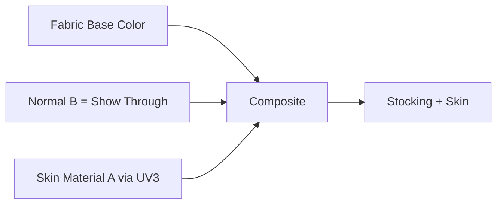

# Stocking Shader（丝袜着色器）

> Applies to: 7.x（Dawntrail） ｜ Last Updated: 2026-11-01

## Overview

Stocking Shader 用于丝袜、连裤袜与半透明织物。它的特点不是“画一层透明布”，而是在同一个网格里同时表现布料和布料下面的皮肤。

自 7.1 起，这个 Shader 开始用于玩家装备，社区才有机会系统研究它。

它的行为接近 Character 装备 Shader，但多了 UV3 皮肤层、法线 B 通道的透出控制，以及对皮肤材质 A 的硬编码。

本文用 ✅ Verified、🟡 Researching、🟠 Hypothesis、🔴 Unknown 标记可信度。

## Shader File

Stocking Shader 由 `.mtrl` 引用，`.mtrl` 再指向对应的 Shader Package（`.shpk`）。

| 项目 | 内容 | 状态 |
|---|---|---|
| Shader 类型 | Character Stocking Shader | 🟡 Researching |
| Shader Package | Character 系 `.shpk`，文件名以实际资源为准 | 🟡 Researching |
| 基础行为 | 接近 Character 装备 Shader，但有额外例外 | 🟡 Researching |
| Material | `.mtrl`，保存 Texture、Constant 与 Key | ✅ Verified |

## Supported Versions

| 版本 | 变化 | 状态 |
|---|---|---|
| 7.0 及更早 | 主要出现在特定装备与 NPC 服装上 | 🟡 Researching |
| 7.1 | 开始适配玩家装备，研究资料增多 | 🟡 Researching |
| 7.x | 与皮肤材质 A 绑定，UV3 决定皮肤层 | 🟡 Researching |
| Penumbra 1.5.1.0 | 支持 `skin_suffix=bibo` 或 `skin_suffix=b` | 🟡 Researching |

## Official Usage

| 对象 | 说明 | 状态 |
|---|---|---|
| 连裤袜 / 丝袜 | 最常见的用法，腿部大面积透明 | 🟡 Researching |
| 半透明袖子 | 薄纱、网纱类装备 | 🟡 Researching |
| 紧身裤 / Leggings | 需要透出皮肤纹理的紧身织物 | 🟡 Researching |
| NPC 服装 | 部分 NPC 使用同一 Shader | 🟡 Researching |

## Texture Slots

| 用途 | 常见名称 | 在丝袜上的作用 | 状态 |
|---|---|---|---|
| 底色 | Base Color | 布料颜色与图案；Alpha 参与透明度 | 🟡 Researching |
| 法线 | Normal Map | R/G 提供法线，B 通道控制皮肤透出 | 🟡 Researching |
| 遮罩 | Mask Map | Specular、Roughness、光泽 | 🟡 Researching |
| 颜色集 | ColorSet | 染色与色调 | 🟡 Researching |
| 皮肤层 | Skin Material A | 通过 UV3 采样的底层皮肤 | 🟡 Researching |

### 法线 B 通道不是整体透明度

站内 [材质表](../appendix/materials-table.md) 记录：在 Stocking Shader 中，Normal Map 蓝色通道不再表示整体 Alpha，而是决定“皮肤在何处、透出多少”。

这意味着：

- 把 B 画黑，布料更不透明，皮肤几乎不透出。
- 把 B 画白，皮肤透出更多，接近裸腿效果。
- 整体透明度仍由 Base Color 的 Alpha 与材质参数控制。

把 B 当成普通 Opacity 来画，常见结果是腿部一块透明、一块实心。

## Vertex Colors

| 通道 | 可能作用 | 状态 |
|---|---|---|
| R | Specular Mask | 🟠 Hypothesis |
| G | Roughness | 🟠 Hypothesis |
| B | 皮肤透出 / 布料遮罩 | 🟠 Hypothesis |
| A | Alpha / 边缘衰减 | 🟠 Hypothesis |

Stocking 的 Vertex Color 没有逐项验证。紧身网格的顶点色容易被 Blender 重算，导入后应重新检查。

## UV Channels

| UV | 用途 | 状态 |
|---|---|---|
| UV1 | 布料主 UV | ✅ Verified |
| UV2 | 未确认 | 🔴 Unknown |
| UV3 | 皮肤层 UV，必须匹配皮肤材质的 UV | 🟡 Researching |

UV3 是 Stocking 的关键。它让一个网格同时拥有“布料表面”和“布料下面的皮肤”，不需要双层网格。

UV3 没有对齐皮肤 UV 时，透出的皮肤会拉伸、错位，甚至出现另一条腿的纹理。

## Material Constants

| 功能 | 作用 | 状态 |
|---|---|---|
| Alpha / 透明阈值 | 控制布料整体透明程度 | 🟡 Researching |
| 光泽 / Gloss | 负值可做出袜套质感 | 🟡 Researching |
| Tile / 尼龙 | 材质表记录尼龙效果使用瓦片 43 | 🟡 Researching |
| 皮肤材质选择 | 默认硬编码为材质 A | 🟡 Researching |
| SphereMap | 对 Stocking 禁用，全息效果无效 | 🟡 Researching |

!!! warning "不要启用 Transparency"
    站内材质表记录：在 Stocking Shader 的 Material Flag 中启用透明度会导致游戏崩溃。透明效果应通过 Alpha 与 UV3 皮肤层实现。

## Shader Keys

| 功能 | 作用 | 状态 |
|---|---|---|
| Transparency | 不推荐；可能直接崩溃 | 🟡 Researching |
| Dye / ColorSet | 布料染色 | 🟡 Researching |
| SphereMap | 全息类效果，Stocking 上不可用 | 🟡 Researching |
| Skin Suffix | Penumbra 侧属性，不是 Shader Key | 🟡 Researching |

`skin_suffix` 写在网格属性上，不是 Material Constant，也不是 Shader Key。三者不要混用。

## Additional Data

🔴 Unknown — Stocking Shader 的 Additional Data 没有可靠结论。

| 字段 | 说明 | 状态 |
|---|---|---|
| 附加位 | 布料、透出或染色的具体含义未确认 | 🔴 Unknown |

## Penumbra Mapping

| 步骤 | 操作 | 说明 |
|---|---|---|
| 1 | 建立 Mod 目录 | 保持 `chara/...` 原始路径 |
| 2 | 替换 Base Color 与 Normal | 重点检查 Normal 的 B 通道 |
| 3 | 设置 UV3 | 必须匹配目标皮肤的 UV |
| 4 | 需要时加 `skin_suffix` | `bibo` 或 `b`，写在网格属性上 |
| 5 | Reload Penumbra | 重新加载并检查不同皮肤 Mod |

使用 `skin_suffix` 需要 Penumbra 1.5.1.0 或更新版本。旧版本会忽略该属性，继续使用材质 A。

## TexTools Mapping

| 操作 | 说明 | 状态 |
|---|---|---|
| 导入贴图 | 按 Base Color、Normal、Mask 类型导入 | ✅ Verified |
| 编辑 Material | 可改 Shader、Key 与 Constant | 🟡 Researching |
| 检查 UV3 | 在 Blender 或材质工具中确认 | 🟡 Researching |

## Modding Tips

| 目标 | 推荐做法 | 状态 |
|---|---|---|
| 皮肤透出 | 画 Normal 的 B 通道，不要画 Alpha | 🟡 Researching |
| 袜套质感 | 使用负 Gloss 与尼龙瓦片 43 | 🟡 Researching |
| 兼容皮肤 Mod | 设置 `skin_suffix` 并匹配 UV3 | 🟡 Researching |
| 避免崩溃 | 不要启用 Transparency | 🟡 Researching |
| 双腿对称 | 接受材质 A 的限制，或换 Shader | 🟡 Researching |

Stocking 默认硬编码为皮肤材质 A，因此透出的皮肤始终是对称的。需要左右不同皮肤时，只能改用其他方案。全腿均匀半透明会像塑料膜，边缘保留一点 Alpha 衰减更自然。

## Known Issues

| 问题 | 常见原因 | 状态 |
|---|---|---|
| 游戏崩溃 | Material Flag 中启用了 Transparency | 🟡 Researching |
| 皮肤透出位置错误 | Normal 的 B 通道画错；UV3 未对齐 | 🟡 Researching |
| 双腿皮肤不对称 | 默认材质 A 的硬编码限制 | 🟡 Researching |
| 全息 / 球面效果无效 | Stocking 禁用了 SphereMap | 🟡 Researching |
| 与皮肤 Mod 冲突 | 材质 A 被其他 Mod 覆盖 | 🟡 Researching |
| 布料边缘发灰 | Alpha 渐变过软；mipmap 压灰 | 🟡 Researching |

## References

| Name | Description | Link |
|---|---|---|
| XIV Modding Wiki | FFXIV Modding 资源与研究文档 | https://xivmodding.com/ |
| 站内材质表 | Stocking 的 UV3、B 通道与 Penumbra 记录 | [materials-table.md](../appendix/materials-table.md) |
| Character Shader | 角色 Shader 总览与通用布局 | [character-shaders.md](character-shaders.md) |
| TexTools | TexTools 工具仓库 | https://github.com/TexTools/FFXIV_TexTools_UI |
| Penumbra | Penumbra Mod Framework | https://github.com/xivdev/Penumbra |
