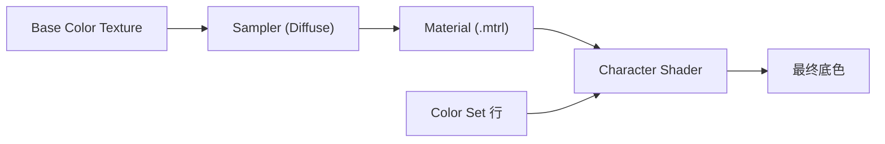

# Base Color（底色贴图）

> Applies to: 7.x（Dawntrail） ｜ Last Updated: 2026-11-01

Base Color 是 Shader 的主要颜色来源，社区也常称 Diffuse 或 Albedo。

它只回答一个问题：这个表面本身是什么颜色。

光照、高光、凹凸、透明都不由它决定，那些属于 Shader、Normal Map 与 Mask Map 的职责。

| 名称 | 使用场合 |
|---|---|
| Base Color | 现代 PBR 语境、本 Wiki 统一写法 |
| Diffuse | Texture Slot 名称、文件名后缀、旧文档 |
| Albedo | 部分外部工具与教程 |

!!! note "术语"
    本文统一写作 Base Color。你在 Material 与文件名里看到的通常是 `Diffuse`，两者指同一类数据。

---

## 用途

Base Color 决定材质在没有光照时的固有色。

- 皮肤的基础肤色谱
- 装备、武器、饰品的布料与金属颜色
- 头发的根部到发梢渐变色
- 眼睛的巩膜与虹膜颜色
- 面部妆容、纹身的可见图案

它不决定凹凸（→ [Normal Map](normal-map.md)）、高光强度与粗糙度（→ [Mask Map](mask-map.md)）、染色后的最终颜色（→ [Color Set](color-set.md)）。

---

## 通道用法

| 通道 | 内容 | 可信度 |
|---|---|---|
| R | 红色分量 | ✅ Verified |
| G | 绿色分量 | ✅ Verified |
| B | 蓝色分量 | ✅ Verified |
| A | 视 Shader 而定：透明度、遮罩、湿润度 | 🟡 Researching |

RGB 组合成颜色这一点在所有 Shader 上都成立，Alpha 则是变量最大的一环。

同一张 Diffuse 的 Alpha：在部分 Shader 上作为整体透明度；在皮肤类 Shader 上可能被当作遮罩；在不需要透明的 Shader 上可能完全不读。

!!! warning "Alpha 不要默认填满或清零"
    如果 Shader 把 Alpha 当透明度读，全部填 0 会让物体直接消失，全部填 255 也可能让该透明的部分变得不透明。先确认 Shader 行为，再决定 Alpha。

---

## sRGB 与线性空间 🟡

这是颜色「看起来偏暗」最常见的原因。

- Base Color 属于**颜色数据**，通常按 sRGB 存储。
- Normal Map、Mask Map、Multi Map 属于**数据**，必须按线性存储。
- 把数据当颜色处理（或反之），亮度、对比与遮罩强度会整体偏移。

| 操作 | 常见结果 |
|---|---|
| 颜色图被当线性图导入 | 整体偏亮、发灰 |
| 数据图被当 sRGB 导入 | 通道值被重映射，遮罩失效 |
| 导出时二次做 gamma 校正 | 偏暗、对比过强 |

!!! tip "验证方法"
    如果一张 Mask 在图片查看器里看起来「正常灰度」，进游戏后数值却不对，优先怀疑色彩空间而不是数值本身。

具体到每个 Slot 的色彩空间处理标 🟡，以实际导出与游戏内对比为准。

---

## 不同对象的差异

| 对象 | 特点 | 常见注意点 |
|---|---|---|
| 皮肤 | 低对比，次表面散射明显 | 不要画死阴影，Shader 会自己加 |
| 装备 | 颜色受 Color Set 与 Dye 影响 | 底色过饱和会让染色失控 |
| 头发 | 常从根到梢渐变 | 渐变方向与 UV 方向要一致 |
| 眼睛 | 虹膜与巩膜可能在同一张图 | 高光位置不在这张图上 |
| 面部妆容 | 依赖第二套 UV | 容易与主 UV 错位 |

眼睛部分单独成页，见 [Eye Textures](eye-textures.md)。

---

## 在 Character Shader 中如何被读取

Base Color 不是被 Shader 按路径读到的，它由 Material 绑定到 Diffuse 这个 Texture Slot。



- 改贴图不生效，先查 Material 的 Slot 路径，而不是继续改图。
- 同一张 Base Color 在不同 Shader 下表现不同，因为后续参与的运算不同。
- Color Set 会对底色做相乘或替换，最终颜色不等于贴图颜色。

Character Shader 的完整通道说明见 [Character Shader](../shaders/character-shaders.md)。

---

## 路径与命名（示例）

FFXIV 的贴图放在角色资源目录下，通过 Material 引用。

下面只是**格式示例**，编号与名称都不代表任何真实资源：

```text
chara/accessory/.../v01_xxxx_d.tex    # 示例：饰品的 Diffuse
chara/equipment/.../v01_xxxx_d.tex    # 示例：装备的 Diffuse
chara/human/.../face/..._d.tex        # 示例：面部的 Diffuse
```

社区常见的后缀约定 🟡：

| 后缀 | 推测含义 |
|---|---|
| `_d` | Diffuse / Base Color |
| `_n` | Normal Map |
| `_m` | Mask Map |
| `_s` | Specular 相关 |

后缀不是格式规范，只是社区习惯。判断一张贴图是什么，看它在 Material 里绑到哪个 Slot 更可靠。

!!! warning "不要照抄示例路径"
    上面的 `...` 与 `xxxx` 只是示意。真实路径必须从你要修改的 Material 中取得。

---

## 常见错误

| 现象 | 原因 | 处理 |
|---|---|---|
| 整体偏暗 | 色彩空间被重复校正 | 检查导出与导入的 sRGB 设置 |
| 整体偏亮发灰 | 颜色图被当线性数据 | 关闭线性导入 |
| 物体消失 | Alpha 被当作透明度且值为 0 | 填满 Alpha 或确认 Shader 行为 |
| 局部透明 | Alpha 通道带了不需要的数据 | 分离 Alpha 后重填 |
| 贴图模糊 | 分辨率不足或被过度压缩 | 提高分辨率，改用无损压缩 |
| 图案被拉伸 | UV 比例不均或接缝处理错误 | 在 UV 编辑器中检查比例 |
| 改了没用 | Slot 路径不对或缓存未刷新 | 核对 Material，重载 Penumbra |

### 颜色偏暗

先区分是「贴图本身暗」还是「渲染后暗」。贴图暗就查色彩空间；只有游戏内暗，那是光照与 Shader 造成的，不要靠提亮贴图去补偿。

### Alpha 误用

把 Alpha 当调色板用是很常见的坏习惯。Alpha 往往直接参与透明判定，改动风险远高于改动 RGB。

### 分辨率与 UV 拉伸

分辨率应匹配 UV 的实际像素密度，而不是越大越好。同一张贴图覆盖多个部件时，按占用面积最大的部件决定分辨率。接缝处的像素需要跨缝绘制，否则会出现明显硬边。

---

## 检查清单

- [ ] 这是颜色数据，不是控制数据
- [ ] sRGB 设置与用途一致
- [ ] Alpha 通道符合当前 Shader 预期
- [ ] 分辨率与 UV 密度匹配
- [ ] Material 的 Diffuse Slot 指向我改的文件
- [ ] 染色后颜色仍然可接受

---

## References

| 名称 | 说明 | 链接 |
|---|---|---|
| XIV Modding Wiki | FFXIV Mod 资源与研究报告 | https://xivmodding.com/ |
| Dawntrail Shader Reference Table | 通道与参数参考表 | https://xivmodding.com/books/ff14-asset-reference-document/page/dawntrail-shader-reference-table |
| Penumbra | Mod 加载框架 | https://github.com/xivdev/Penumbra |
| TexTools | 贴图与模型编辑工具 | https://github.com/TexTools/FFXIV_TexTools_UI |
| Blender Manual | UV 与贴图编辑参考 | https://docs.blender.org/manual/en/latest/ |
| Microsoft DDS Programming Guide | DDS 格式参考 | https://learn.microsoft.com/en-us/windows/win32/direct3ddds/dx-graphics-dds-pguide |

Alpha 通道的具体用途与色彩空间处理仍在研究中，标 🟡 的内容会随验证更新。
