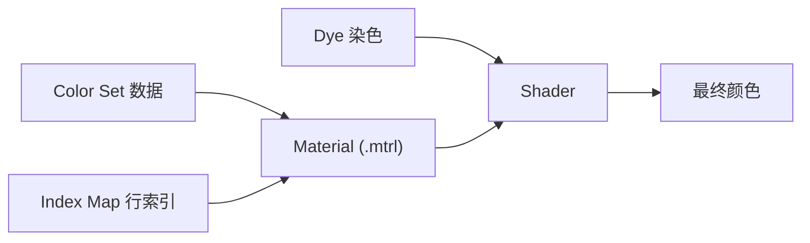

# Color Set（调色表）

> Applies to: 7.x（Dawntrail） ｜ Last Updated: 2026-11-01

Color Set 是「每个材质一组调色行」的数据结构。

它决定 Diffuse、Specular、Emissive 这些「行」分别使用什么颜色，以及染色（Dye）如何被应用。

!!! note "核心概念"
    Base Color 告诉 Shader「表面画了什么」，Color Set 告诉 Shader「这些颜色要乘上什么、替换成什么」。

---

## 在链路中的位置

Color Set 不是一张普通贴图，它是 Material 附带的一组数据行。

- 一个 Material 对应一组 Color Set 行，行与行之间并列。
- Index Map 决定模型的哪个区域使用哪一行。
- Dye 只改变被标记为可染色的行，不会重写整组数据。

---

## 行的含义 🟡

Color Set 按用途分行，常见的有：

| 行类型 | 影响内容 | 可信度 |
|---|---|---|
| Diffuse 行 | 底色相乘或替换 | 🟡 Researching |
| Specular 行 | 高光颜色与强度 | 🟡 Researching |
| Emissive 行 | 自发光颜色 | 🟡 Researching |
| AO 相关行 | 环境光遮蔽 | 🟠 Hypothesis |

每个行内部通常是若干组 RGB 值，部分行还带额外的标量。

!!! warning "不要记行号，要记含义"
    不同 Shader、不同版本的行数与排列都不一样。写死「第 3 行是 Diffuse」的做法在换 Shader 后必然失效。

**具体行含义以材质表为准**，见 [材质表](../appendix/materials-table.md)。

TexTools 与 Penumbra 对同一字段的显示名称也可能不同，对照时以数值位置为准。

---

## 染色（Dye）如何映射到 Color Set

染色的本质是：Dye 提供一个颜色，Shader 把它应用到某个 Color Set 行上。

| 环节 | 作用 |
|---|---|
| Dye 数据 | 提供玩家选择的颜色 |
| Material 标记 | 决定该材质是否接受染色 |
| Color Set 行 | 决定染色影响 Diffuse 还是 Specular |
| Shader | 执行实际的混合运算 |

推论：

- Color Set 行接近纯白时，染色结果接近 Dye 的原始颜色。
- Color Set 行自带色调时，染色结果会被这个色调偏移。
- 材质不接受染色时，改 Color Set 也不会让它变得可染。

!!! note "可染色性来自 Material"
    Color Set 决定「染成什么效果」，Material 决定「能不能染」。两者不要混淆。

---

## 与 `.atex` 的关系 🟡

Dawntrail 之后，Color Set 的存储方式发生了变化。

- 旧结构：行数据直接存放在 Material 内部。
- 新结构：部分材质把行数据外置到贴图资源，由 Index Map 提供索引。

社区把这类外置资源与 `.atex` 扩展名关联起来，但具体命名与内部布局标 🟠。

| 项目 | 旧方式 | 新方式 | 可信度 |
|---|---|---|---|
| 行数据位置 | Material 内部 | 外置贴图 | 🟡 Researching |
| 区域选择 | Material 内索引 | Index Map 贴图 | 🟡 Researching |
| 编辑方式 | ColorSet 编辑器 | 贴图编辑 + 索引 | 🟠 Hypothesis |
| 格式细节 | 已知结构 | 未完全公开 | 🔴 Unknown |

!!! warning "格式细节不要照抄教程"
    外置方案在版本之间仍在调整。网上教程里的格式、通道打包方式、文件命名都可能已经过期，以你实际导出的资源为准。

在新结构下，单纯改 Material 的 Color Set 可能看不到效果，因为真正被读取的是外置贴图。

---

## Mod 作者怎么改

### TexTools ColorSet 编辑器

- 直接读取并编辑 Material 的 Color Set 行。
- 适合微调颜色、批量替换行数据。
- 对旧结构资源最直接；对外置结构的资源，可能只能看到索引。

### Penumbra 覆盖

- 通过松散文件覆盖 Material 或相关贴图，不改动原始游戏文件。
- 适合做多套配色方案，切换方便。
- 需要正确设置文件路径与优先级。

### Photoshop / 图像工具

- 外置 Color Set 贴图可以直接当图像编辑。
- 编辑时保持通道语义不变。
- 改完确认 Index Map 仍然指向正确的行。

!!! tip "先做最小改动"
    只改一行、只改一个颜色，先确认能看到变化，再扩大范围。Color Set 的问题往往不是「改错了」，而是「改的地方根本没被读」。

---

## 常见错误

| 现象 | 原因 | 处理 |
|---|---|---|
| 染色后颜色错乱 | 复制了别的装备的 Color Set | 使用目标装备自己的数据作基准 |
| 部分区域不染色 | 行数与 Index Map 不匹配 | 核对行索引范围 |
| 改了完全没效果 | Shader 不读该行，或数据已外置 | 确认读取路径 |
| 颜色过饱和 | 底色与 Color Set 叠加过度 | 降低其中一方的强度 |
| 金属部位变彩色 | Specular 行被误改 | 单独检查 Specular 行 |
| Emissive 全亮 | Emissive 行被填满 | 检查该行是否为纯白 |

### 复制 Color Set 导致染色错乱

不同装备的行数、排列、语义都可能不同，直接复制会把整套映射关系带过来。

正确做法是以目标装备的原始 Color Set 为基准，只改需要改的数值。

### 行数不匹配

Index Map 里的索引如果超出实际行数，通常会取到错误的值或回退到默认。修改行数时必须同步检查索引范围。

### 改了却没有反应

三种可能：当前 Shader 不使用该行；数据已外置到贴图；Mod 覆盖的文件不是实际加载的那一份。

排查顺序：先确认 Shader，再确认数据位置，最后确认文件优先级。

---

## 与 Dye 的兼容性

制作可染色装备时，Color Set 的设计要留出余地。

- Diffuse 行保持中性色，让 Dye 颜色能够主导。
- 需要固定不变的细节，放到不受 Dye 影响的行或直接画进 Base Color。
- 高光与金属部分单独用 Specular 行控制，避免被 Dye 冲淡。

!!! warning "染色不是调色板"
    Dye 只提供有限的颜色集合。Color Set 能做的是让这些颜色落在合适的位置，而不是凭空生成任意颜色。

---

## 检查清单

- [ ] 使用目标装备自身的 Color Set 作为基准
- [ ] 行数与 Index Map 索引范围匹配
- [ ] 确认数据在 Material 内还是外置贴图
- [ ] 确认当前 Shader 读取该行
- [ ] Diffuse / Specular / Emissive 分开验证
- [ ] 测试至少两种 Dye 颜色

---

## References

| 名称 | 说明 | 链接 |
|---|---|---|
| XIV Modding Wiki | FFXIV Mod 资源与研究报告 | https://xivmodding.com/ |
| Dawntrail Shader Reference Table | Color Set 与 Shader 参数参考 | https://xivmodding.com/books/ff14-asset-reference-document/page/dawntrail-shader-reference-table |
| Penumbra | Mod 加载框架与材质覆盖 | https://github.com/xivdev/Penumbra |
| TexTools | ColorSet 编辑器与资源工具 | https://github.com/TexTools/FFXIV_TexTools_UI |
| Microsoft DDS Programming Guide | DDS 格式参考 | https://learn.microsoft.com/en-us/windows/win32/direct3ddds/dx-graphics-dds-pguide |

Dawntrail 之后的 Color Set 外置方案仍在研究中，标 🟡 / 🟠 / 🔴 的内容会随验证更新。
