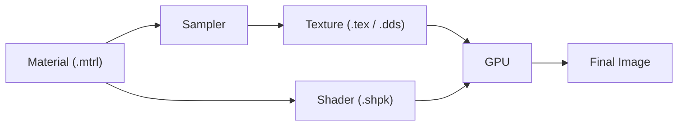

# Texture 贴图

> Applies to: 7.x（Dawntrail） ｜ Last Updated: 2026-11-01

Texture 是 FFXIV 渲染管线里的**数据来源**，本身不包含算法。

Shader 决定「怎么解释数据」，Material 决定「绑定哪一张」，Texture 决定「数据长什么样」。

---

## 研究可信度标注

| 标记 | 含义 | 使用建议 |
|---|---|---|
| ✅ Verified | 多来源或实际测试确认 | 可以直接依赖 |
| 🟡 Researching | 社区有共识，缺少系统验证 | 可以用，建议自行复核 |
| 🟠 Hypothesis | 基于观察的推测 | 只当作方向，不要当结论 |
| 🔴 Unknown | 暂无可靠信息 | 不要基于它做决定 |

!!! warning "先看 Material，再看 Texture"
    同一张 Normal Map 在不同 Shader 下可能被完全不同的方式解读。判断一张贴图怎么用之前，先确认 Material 绑定的 Shader。

---

## Texture 在渲染中的角色

Texture 不会自己走到 GPU 上，它由 Material 通过 Sampler 绑定到 Texture Slot。

链路里任何一环断开，表现都是「改了贴图但没有变化」。

| 环节 | 常见断点 | 现象 |
|---|---|---|
| Mesh | UV 缺失或 UV 通道不对 | 贴图错位、拉伸 |
| Material | Texture Slot 指向别的路径 | 改动完全无效 |
| Sampler | 采样设置不匹配 | 颜色偏移、透明异常 |
| Shader | 当前 Shader 不读该 Slot | 改动完全无效 |
| 缓存 | Penumbra / 游戏未重载 | 需要重进区域 |

---

## 常见贴图类型

贴图按「承载什么数据」分类，而不是按文件名分类。

| 类型 | 常见 Slot | 承载数据 | 典型用途 | 可信度 |
|---|---|---|---|---|
| Base Color（底色） | Diffuse | RGB + Alpha | 肤色、装备、虹膜 | ✅ Verified |
| Normal Map（法线贴图） | Normal | 切线空间向量 | 表面凹凸 | ✅ Verified |
| Mask Map（遮罩贴图） | Mask | 最多 4 个标量 | Specular、Roughness、AO | 🟡 Researching |
| Multi Map（多用途贴图） | Multi | 4 个灰度控制图 | 混合权重、磨损 | 🟡 Researching |
| Color Set（调色表） | ColorSet | 调色行数据 | 染色、Emissive | 🟡 Researching |
| Index Map（索引贴图） | Index | 行索引 | 选择 Color Set 行 | 🟡 Researching |
| Eye Texture（眼睛贴图） | Diffuse / Catchlight | 虹膜、眼白、高光 | 眼睛外观 | 🟡 Researching |
| FlowMap（流动贴图） | Flow | 二维方向向量 | 水面、布料流动 | 🟠 Hypothesis |

!!! note "打包是常态"
    FFXIV 很少让一张贴图只放一个灰度值。Mask Map 与 Multi Map 都是「一图多标量」，区别在用途。

---

## 子页面

- :material-palette:

    ### Base Color

    [:material-arrow-right: 颜色与 Alpha](base-color.md)

- :material-vector-square:

    ### Normal Map

    [:material-arrow-right: 切线空间与凹凸](normal-map.md)

- :material-checkbox-multiple-blank:

    ### Mask Map

    [:material-arrow-right: 通道打包概念](mask-map.md)

- :material-layers-triple:

    ### Multi Map

    [:material-arrow-right: 灰度控制图叠加](multi-map.md)

- :material-format-color-fill:

    ### Color Set

    [:material-arrow-right: 调色行与染色](color-set.md)

- :material-eye:

    ### Eye Textures

    [:material-arrow-right: 虹膜、高光与遮挡](eye-textures.md)

---

## `.tex`、`.dds` 与 TexTools 🟡

- `.tex` 是 FFXIV 的容器格式，内部承载压缩后的图像数据。
- TexTools 负责 `.tex` 与 `.dds` 之间的导入导出，是大多数 Mod 作者的实际工作路径。
- 直接把 `.dds` 改名为 `.tex` 不会得到有效文件，容器结构并不相同。
- Penumbra 支持以松散文件方式覆盖贴图，具体接受的格式以当前版本为准。

!!! warning "不要手改扩展名"
    扩展名不是格式。需要转换时使用 TexTools，或按 Penumbra 的松散文件规则放置。

颜色贴图可以接受有损压缩，法线与 Mask 通常不能。具体到某个 Slot 使用哪种压缩格式，标 🟡，以实际导出与游戏内表现为准。

---

## 按场景选择阅读顺序

| 我想做的事 | 先读 | 再读 |
|---|---|---|
| 改肤色、改装备颜色 | [Base Color](base-color.md) | [Color Set](color-set.md) |
| 增加表面凹凸、布料褶皱 | [Normal Map](normal-map.md) | [Mask Map](mask-map.md) |
| 调整高光与粗糙度 | [Mask Map](mask-map.md) | [Normal Map](normal-map.md) |
| 做磨损、污渍、细节叠加 | [Multi Map](multi-map.md) | [Mask Map](mask-map.md) |
| 让装备可以正确染色 | [Color Set](color-set.md) | [Mask Map](mask-map.md) |
| 换眼睛、做异色瞳 | [Eye Textures](eye-textures.md) | [Eye Shader](../shaders/eye-shaders.md) |
| 改了贴图完全没反应 | [Sampler](../materials/sampler.md) | [故障排除](../workflows/troubleshooting.md) |

入门推荐顺序：

1. Base Color：先理解「颜色从哪来」。
2. Normal Map：再理解「凹凸怎么表达」。
3. Mask Map：理解通道打包，这是 FFXIV 贴图的关键概念。
4. Color Set：理解染色，这一步最容易翻车。
5. Multi Map 与 Eye Textures：按需深入。

---

## 通用检查清单

- [ ] Material 的 Texture Slot 指向我改的文件
- [ ] 颜色贴图与数据贴图没有混用
- [ ] 通道没有被其他数据占用
- [ ] Penumbra 已重载，或 TexTools 已重新导入
- [ ] 当前 Shader 确实读取这个 Slot
- [ ] Mipmap 与压缩设置符合该 Slot 的要求

---

## References

| 名称 | 说明 | 链接 |
|---|---|---|
| XIV Modding Wiki | FFXIV Mod 资源与研究报告 | https://xivmodding.com/ |
| Dawntrail Shader Reference Table | 通道与参数参考表 | https://xivmodding.com/books/ff14-asset-reference-document/page/dawntrail-shader-reference-table |
| Penumbra | Mod 加载框架 | https://github.com/xivdev/Penumbra |
| TexTools | 贴图与模型编辑工具 | https://github.com/TexTools/FFXIV_TexTools_UI |
| Microsoft DDS Programming Guide | DDS 格式参考 | https://learn.microsoft.com/en-us/windows/win32/direct3ddds/dx-graphics-dds-pguide |
| Blender Manual | 建模与烘焙参考 | https://docs.blender.org/manual/en/latest/ |

部分通道含义与打包方式仍在研究中，标 🟡 / 🟠 的内容会随社区验证持续更新。
