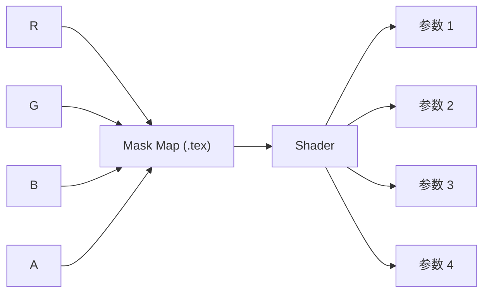

# Mask Map（遮罩贴图）

> Applies to: 7.x（Dawntrail） ｜ Last Updated: 2026-11-01

Mask Map 的本质是**用通道承载多个标量的打包贴图**，而不是一张「遮罩图」。

它不表达颜色，也不表达形状，只表达一组让 Shader 做判断的数值。

!!! warning "核心概念"
    同一张 Mask Map 的 R 通道，在 A Shader 上可能是 Specular，在 B Shader 上可能是金属度，在 C Shader 上可能完全不被读取。

    **通道含义随 Shader 而变**，这是理解 Mask Map 的唯一入口。

---

## 为什么需要打包

一张 RGBA 贴图有四个通道，每个通道都是一个独立的标量。

如果 Shader 只需要 Roughness 一个值，灰度图就够了。但游戏更倾向于：

- 减少贴图数量，降低显存与采样开销
- 让相关参数在美术制作时同步调整

于是多个互不冲突的标量被塞进同一张图的不同通道。

打包的前提是这些标量在语义上互不干扰。所以打包方案由 Shader 定义，不由贴图定义。

---

## 通道含义随 Shader 变化

同一个像素值，在不同 Shader 下意义完全不同。

| 通道 | Character Shader | Skin Shader | Hair Shader | 可信度 |
|---|---|---|---|---|
| R | Specular（高光强度） | 与皮肤参数相关 | Specular 相关 | 🟡 Researching |
| G | Roughness（粗糙度） | Roughness | Roughness | 🟡 Researching |
| B | Ambient Occlusion（AO） | 次表面 / 毛发 / 金属度，随 Shader ID 变化 | AO 相关 | 🟡 Researching |
| A | 通常未使用 | 可能承载遮罩 | 可能承载遮罩 | 🟠 Hypothesis |

!!! note "表格只作方向参考"
    上表来自社区整理，不同版本、不同 Shader Key 下都会变化。**做具体资产时以材质表为准**，见 [材质表](../appendix/materials-table.md)。

Skin Shader 的 B 通道尤其典型：它会随着 Shader ID 的取值在「次表面散射」「毛发」与「金属度」之间切换，同一个通道承载三种语义。

这说明「Mask Map 的 B 通道是 AO」这类说法只在特定前提下成立。

---

## 常见用法

| 参数 | 作用 | 典型表现 |
|---|---|---|
| Specular | 高光强度 | 越亮越高光 |
| Roughness | 粗糙度 | 越亮越哑光 |
| Metalness | 金属度 | 影响反射着色 |
| Ambient Occlusion（AO） | 环境光遮蔽 | 越暗越暗部 |
| Opacity Mask | 透明区域控制 | 决定哪里被裁掉 |

参数之间是否互相影响由 Shader 决定。在部分 Shader 上，Roughness 与 Specular 会互相牵制，单独拉高一个不一定得到预期效果。

---

## 制作方法

### Photoshop 通道拼接

最常见的做法是把几张灰度图分别放进 R、G、B、A。

1. 为每个参数单独绘制一张灰度图。
2. 在「通道」面板中新建 Alpha 通道并粘贴。
3. 用「应用图像」把灰度图合成到 R / G / B。
4. 合并为 RGB，另存为支持通道的格式。

注意事项：通道顺序必须严格对应 Shader；合成时使用「正常」混合模式；最终只看单通道，不要被 RGB 合成后的彩色外观误导。

### Substance 导出

| 项目 | 说明 |
|---|---|
| Export Preset | 确认为目标引擎的预设 |
| Packing | 确认每个通道绑定到哪个输出 |
| Output Format | 选择支持 Alpha 的格式 |
| Color Space | 数据贴图必须为线性 |

自定义预设比改默认预设更安全，避免下次导出时被覆盖。

### 灰度图拼通道

- 每张灰度图分辨率与最终贴图一致。
- 灰度值直接对应参数值，不需要额外 gamma 处理。
- 拼接后逐个通道单独检查，确认没有串位。

---

## 常见错误

| 现象 | 原因 | 处理 |
|---|---|---|
| 高光完全失控 | R 与 G 通道顺序弄反 | 核对 Shader 的通道定义 |
| 整体像塑料或全哑光 | Roughness 通道被填成常量 | 检查该通道是否真的写入数据 |
| 遮罩规律性错位 | 通道被 sRGB 处理过 | 改用线性导入 |
| 某通道完全没反应 | 贴图格式丢弃了 Alpha | 换用支持 Alpha 的格式 |
| 阴影处过黑 | AO 通道过强 | 降低 AO 对比度 |
| 透明区域异常 | Alpha 被别的数据占用 | 分离 Alpha 后重填 |

### 通道顺序弄反

症状很有辨识度：高光出现在本该粗糙的地方，或者金属部分看起来像布料。

处理方式是把贴图拆开，逐通道与材质表对照，而不是整体重画。

### 把 sRGB 贴图当线性数据

Mask Map 是数据，不是颜色。被当作 sRGB 处理时，通道值会被重映射，原本 0.5 的中性值可能变成别的东西。

!!! warning "数据贴图必须走线性"
    在 Substance 与 Blender 中需要显式设置为 Non-Color / Linear 数据。这一步漏掉，后面所有调整都建立在一个错误的数值基础上。

### 通道被 Alpha 覆盖

部分导出流程会用 Alpha 覆盖已有的 A 通道，或把 A 预乘到 RGB 上。表现是遮罩突然消失，或颜色整体变暗。

处理：导出前临时填充 Alpha，或使用不处理 Alpha 的格式。

---

## 调试流程

1. Shader 是否读取这个 Slot —— 否则改什么都没用。
2. 通道顺序是否正确 —— 对照材质表逐通道核对。
3. 色彩空间是否为线性 —— 数据贴图不能走 sRGB。
4. 数值范围是否合理 —— 先看单通道的灰度分布。
5. 资源是否重载 —— Penumbra 与游戏缓存。

单通道查看是最有效的调试手段：在 Photoshop 中按住单通道，或在 Substance 中单独预览，可以直接看出数据是否符合预期。

---

## 与其他贴图的关系

| 贴图 | 关系 |
|---|---|
| [Base Color](base-color.md) | 提供颜色，Mask 提供参数，两者独立 |
| [Normal Map](normal-map.md) | 部分 Shader 会把额外数据写进 Normal 的 B / A |
| [Multi Map](multi-map.md) | 同样是打包思路，但偏控制权重 |
| [Color Set](color-set.md) | Color Set 决定颜色，Mask 决定强度 |

!!! note "不要把 Mask 当颜色用"
    Mask Map 的 RGB 合成结果没有视觉意义。它看起来像彩色噪点是正常的，不要为了「好看」去调它。

---

## 检查清单

- [ ] 已确认当前 Shader 的通道定义
- [ ] 通道顺序与材质表一致
- [ ] 使用线性 / Non-Color 导入
- [ ] Alpha 通道没有被意外覆盖
- [ ] 每个参数单独验证过
- [ ] Material 的 Mask Slot 指向正确

---

## References

| 名称 | 说明 | 链接 |
|---|---|---|
| XIV Modding Wiki | FFXIV Mod 资源与研究报告 | https://xivmodding.com/ |
| Dawntrail Shader Reference Table | 各 Shader 的通道参考 | https://xivmodding.com/books/ff14-asset-reference-document/page/dawntrail-shader-reference-table |
| Penumbra | Mod 加载框架 | https://github.com/xivdev/Penumbra |
| TexTools | 贴图与模型编辑工具 | https://github.com/TexTools/FFXIV_TexTools_UI |
| Microsoft DDS Programming Guide | DDS 格式与压缩参考 | https://learn.microsoft.com/en-us/windows/win32/direct3ddds/dx-graphics-dds-pguide |
| Blender Manual | 色彩空间与贴图节点 | https://docs.blender.org/manual/en/latest/ |

通道定义随 Shader 与版本变化，标 🟡 / 🟠 的内容会随社区验证持续更新。
