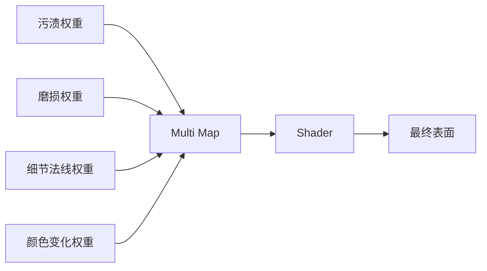

# Multi Map（多用途贴图）

> Applies to: 7.x（Dawntrail） ｜ Last Updated: 2026-11-01

Multi Map 是把多张灰度控制图打包进一张 RGBA 贴图的思路。

它和 Mask Map 用的是同一种技术手段，但承担的责任不同。

!!! note "一句话区分"
    Mask Map 描述「这个表面是什么材质」，Multi Map 描述「这个表面要叠加什么效果」。

---

## 打包的本质

一张 RGBA 贴图等于四张同分辨率的灰度图。

Multi Map 不需要额外格式，也不需要特殊压缩，只是把四个互不干扰的标量分别写进四个通道。

和 Mask Map 一样，**每个通道的含义由 Shader 决定**，不由贴图决定。

---

## 与 Mask Map 的区别 🟡

两者在文件层面没有区别，都是四通道数据贴图。区别在语义层级。

| 维度 | Mask Map | Multi Map |
|---|---|---|
| 主要职责 | 定义材质属性 | 控制效果叠加 |
| 典型内容 | Specular、Roughness、AO | 污渍、磨损、细节权重 |
| 数值变化 | 相对平缓 | 常有强烈对比与图案 |
| 与 UV 细节的关系 | 较少 | 较多 |
| 与 Color Set 的关系 | 间接 | 可能直接参与颜色混合 |
| 可信度 | 🟡 Researching | 🟡 Researching |

!!! note "区分只是习惯"
    在实际资源中，「哪张是 Mask、哪张是 Multi」取决于 Material 把它绑到哪个 Slot。Slot 名称为 Multi 时，内容更偏向混合权重。

这条区分是社区约定，不是硬规范。判断依据应该是 Shader 对该 Slot 的处理方式，标 🟡。

---

## 典型用途

| 用途 | 承载内容 | 常见表现 |
|---|---|---|
| 污渍 | 污渍出现的区域权重 | 边缘、褶皱处堆积 |
| 磨损 | 边缘磨损程度 | 棱角处露底 |
| 细节法线权重 | 是否叠加第二套法线 | 远看平滑、近看有细节 |
| 颜色变化 | 颜色偏移的强度 | 局部色相或明度变化 |
| 混合遮罩 | 两个材质之间的过渡 | 布料与皮革交界 |

这些效果的共同点是**有图案、有分布**，而不是一个均匀的材质参数。

这也是它和 Mask Map 最直观的差异：Mask Map 通常看起来像渐变的灰块，Multi Map 通常能看出花纹。

---

## 通道拆解与调试

Multi Map 最大的问题是「看不出来哪一层在起作用」。

| 工具 | 操作 |
|---|---|
| Photoshop | 在「通道」面板单独显示某个通道 |
| Substance | 在 2D 视图中单独预览某个通道 |
| Blender | 用 Separate Color 节点拆出单通道接到 Emission 预览 |

调试顺序：

1. 先看单通道，确认图案分布符合预期。
2. 再看通道叠加后的效果，确认没有互相干扰。
3. 最后进游戏确认，因为 Shader 可能对通道做额外运算。

!!! tip "把单通道导出成灰度图"
    如果游戏内表现和预期差很多，把每个通道单独导出成灰度图，逐个替换测试。这比反复猜测哪个通道出错要快得多。

---

## 与 Color Set 的关系

Color Set 提供颜色，Multi Map 提供「这个颜色在哪里、以多强的方式生效」。

| 组合方式 | 效果 |
|---|---|
| Color Set 提供基色 + Multi 提供权重 | 局部染色、渐变染色 |
| Color Set 提供 Emissive 颜色 + Multi 提供遮罩 | 局部发光 |
| Color Set 完全控制 + Multi 不参与 | 无额外叠加 |

Color Set 的细节见 [Color Set](color-set.md)。

!!! warning "不要用 Multi 硬编码颜色"
    Multi Map 存的是标量权重，不是颜色。把颜色画进 Multi Map 通常不会得到预期结果，因为 Shader 只会读它的某一个通道当作强度。

---

## 与 Vertex Color 的关系

Vertex Color 是另一套控制通道，位于 Mesh 顶点上而不是贴图上。

| 控制源 | 分辨率 | 修改成本 | 适合控制 |
|---|---|---|---|
| Multi Map | 高，跟贴图走 | 需要重画贴图 | 细节图案、局部效果 |
| Vertex Color | 低，跟顶点密度走 | 需要改模型 | 大范围分区、整体权重 |

模型面数不足时，Vertex Color 无法表达精细图案，这时应把控制转移到 Multi Map。

如果只是整体分区（例如手臂与躯干使用不同参数），Vertex Color 更省资源。

Vertex Color 的通道定义见 [Character Shader](../shaders/character-shaders.md)。

---

## 制作要点

- 每个通道单独绘制，不要在一张彩色图上「顺便」分出四个通道。
- 保持分辨率一致，避免某个通道被拉伸。
- 数据贴图使用线性 / Non-Color 导入。
- 图案边缘过渡要足够宽，否则低 Mip 级别会闪烁。
- 通道之间尽量避免强相关，否则调整一个会影响另一个。

!!! warning "Mipmap 与细节权重"
    高频细节在小 Mip 级别会迅速衰减。如果 Multi Map 控制的是细节法线权重，远处可能出现细节突然消失的跳变，需要降低对比度或加宽过渡。

---

## 常见错误

| 现象 | 原因 | 处理 |
|---|---|---|
| 效果完全不出现 | Slot 未绑定或 Shader 不读 | 核对 Material |
| 效果出现在错误区域 | 通道顺序错 | 按材质表单通道核对 |
| 图案像被压扁 | UV 比例不均 | 检查 UV 密度 |
| 远处效果闪烁 | 高频细节 + Mipmap | 降低对比、加宽过渡 |
| 颜色异常 | 把颜色画进了权重通道 | 只保留灰度数据 |
| 与 Mask 效果冲突 | 两个 Slot 被填入相同内容 | 确认各 Slot 职责 |

---

## 检查清单

- [ ] 已确认 Slot 名称与 Shader 的读取方式
- [ ] 四个通道各自独立、语义清晰
- [ ] 使用线性 / Non-Color 导入
- [ ] 单通道逐个验证过
- [ ] 与 Vertex Color 的分工合理
- [ ] 与 Color Set 的组合符合预期

---

## References

| 名称 | 说明 | 链接 |
|---|---|---|
| XIV Modding Wiki | FFXIV Mod 资源与研究报告 | https://xivmodding.com/ |
| Dawntrail Shader Reference Table | Slot 与通道参考 | https://xivmodding.com/books/ff14-asset-reference-document/page/dawntrail-shader-reference-table |
| Penumbra | Mod 加载框架 | https://github.com/xivdev/Penumbra |
| TexTools | 贴图与模型编辑工具 | https://github.com/TexTools/FFXIV_TexTools_UI |
| Blender Manual | 顶点色与贴图节点 | https://docs.blender.org/manual/en/latest/ |

Multi Map 与 Mask Map 的语义边界仍在研究中，标 🟡 的内容会随验证更新。
