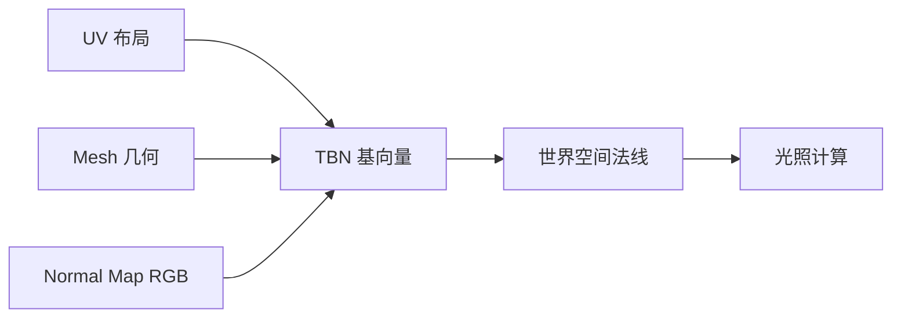

# Normal Map（法线贴图）

> Applies to: 7.x（Dawntrail） ｜ Last Updated: 2026-11-01

Normal Map 用图像数据表达表面朝向，让低面数模型呈现出高面数的光照细节。

它不改变几何形状，只改变光照计算时使用的法线方向。

!!! note "一句话理解"
    Base Color 决定「是什么颜色」，Normal Map 决定「光看起来从哪里被反射」。

---

## 切线空间

法线是三维向量，但贴图只有两个维度加一个通道，所以必须约定一套局部坐标系。

| 向量 | 含义 | 来源 |
|---|---|---|
| T（Tangent） | 表面 U 方向 | 由 UV 与几何推导 |
| B（Bitangent） | 表面 V 方向 | 由 T 与 N 推导 |
| N（Normal） | 表面法线 | 由顶点法线插值 |

三者合称 TBN 矩阵，Shader 用它把贴图里的向量转换到世界空间。

关键推论：**Normal Map 的正确性依赖 UV。** UV 变了，切线空间就变了，法线也就错了。

---

## RGB 到 XYZ 的映射

贴图存的是单位向量，需要从 0～255 的无符号范围映射到 -1～1。

| 通道 | 对应轴 | 解码方式 |
|---|---|---|
| R | X（切线方向） | R × 2 - 1 |
| G | Y（副切线方向） | G × 2 - 1 |
| B | Z（法线方向） | B × 2 - 1 |

由于法线基本指向表面外侧，Z 通常为正，B 通道长期处在高位，所以整张图偏紫蓝色。

| 像素值 | 含义 |
|---|---|
| (128, 128, 255) | 完全平坦，法线朝向正上方 |
| (255, 128, 128) | 法线明显偏向 +X |
| (128, 128, 128) | Z = 0，理论上不可能的朝向 |

!!! warning "中性值不是 128,128,128"
    8 位精度下中性值是 (128, 128, 255)。把 B 通道填成 128 会得到一个几乎平行于表面的法线，表现为极端错误的光照。

---

## DirectX 与 OpenGL 的 Green 通道差异

这是跨工具协作时最常见的错误来源。

| 约定 | G 通道方向 | 常见来源 |
|---|---|---|
| DirectX | Y 向下（Green down） | 游戏引擎、DirectX 工具链 |
| OpenGL | Y 向上（Green up） | Blender 默认、部分渲染器 |

同一个模型，两种约定下的 G 通道互为反相。用错了会出现「凹变凸、凸变凹」。

FFXIV 通常按 DirectX 约定处理，标 🟡。

!!! tip "如何验证"
    在模型上做一条明确的脊线，导出后进游戏看光照明暗。凸起看起来是凹陷，就把 G 通道反相再试。这比查文档可靠。

    也可以在 Blender 中用同一张图切换两种法线节点对比，先确认差异方向，再决定是否反相。

---

## 为什么它是紫色的

因为 Z 分量几乎总是正的，B 通道长期接近最大值，RGB 合成后就是紫蓝色。这是正常现象，不是错误。

强度越低，整张图越接近均匀的紫蓝色；强度越高的图，红绿变化越明显。只有在看到彩色斑块或明显条带时，才需要怀疑 G / R 通道被写入异常数据，或压缩过度。

---

## FFXIV 的通道占用

标准 Normal Map 只用 RGB，A 通常闲置。

但 FFXIV 的部分 Shader 会把额外数据塞进 Normal Map 的通道，尤其是 B 与 A。

| 通道 | 通用含义 | FFXIV 中的额外用途 | 可信度 |
|---|---|---|---|
| R | X | 一般为法线 | ✅ Verified |
| G | Y | 一般为法线 | ✅ Verified |
| B | Z | 可能被用作 Opacity 或 AO | 🟡 Researching |
| A | 未使用 | 可能被用作其他遮罩 | 🟠 Hypothesis |

!!! warning "不要整体重绘 B 通道"
    把 B 通道替换成自定义数据，法线方向会同时被破坏。改 B 之前先确认当前 Shader 是否把 B 当法线使用。

具体通道占用以材质表为准，见 [材质表](../appendix/materials-table.md) 与 [Character Shader](../shaders/character-shaders.md)。

---

## 强度控制

| 路径 | 做法 | 适用场景 |
|---|---|---|
| 贴图侧 | 降低法线 XY 分量，向中性值靠拢 | 一次调整，长期生效 |
| Shader 侧 | 通过 Material Constant 缩放 | 需要运行时调整 |

贴图侧常见的做法：降低 Height 强度后重新烘焙，或使用 Normal Map 节点的 Strength 参数做非破坏性调整。

!!! tip "先贴图，后参数"
    先把贴图本身调到合理区间，再用 Shader 参数微调。反过来做，一旦换 Shader 就会全部失效。

强度过高是最常见的翻车原因：细节看起来像塑料浮雕，或者出现明显的白边与噪点。

---

## UV 接缝与镜像

| 问题 | 原因 | 表现 |
|---|---|---|
| 接缝处出现硬线 | 两侧法线不连续 | 一条明显的亮线或暗线 |
| 镜像 UV 反光错误 | 切线方向被镜像 | 对称部位光照不一致 |
| 拉伸区域法线失真 | UV 比例严重不均 | 细节被拉长、方向错乱 |

处理方式：

- 接缝处的像素要跨缝绘制，不能各自独立。
- 使用镜像 UV 的模型，需要确认 Shader 是否处理了切线翻转。
- UV 接缝尽量放在视觉不敏感的位置，例如布料内侧、头发根部。

---

## 导出设置（Blender / Substance）

| 设置项 | 建议 | 说明 |
|---|---|---|
| Tangent Space | 切线空间，非物体空间 | 游戏几乎都要求切线空间 |
| Y 方向 | 按目标引擎约定 | FFXIV 按 DirectX，标 🟡 |
| 位深 | 8 位足够，高精度需求用 16 位 | 精度不足会产生条带 |
| 压缩 | 避免有损压缩 | 法线对压缩非常敏感 |
| Mipmap | 保留 | 缺失会导致远处细节闪烁 |

!!! note "Blender 导出注意"
    Blender 的法线节点默认按 OpenGL 约定（Green up）处理。导出到 FFXIV 前先确认是否需要翻转 G 通道，否则凹凸方向会反。

---

## 常见问题对照表

| 问题 | 原因 | 处理 |
|---|---|---|
| 看起来是紫色，以为出错 | 这是正常外观 | 无需处理 |
| 凹凸方向相反 | G 通道约定不匹配 | 反相 G 通道 |
| 全图几乎纯色 | 强度过低或烘焙失败 | 检查 Height 与强度参数 |
| 光照明显错乱 | 使用了物体空间法线 | 重新按切线空间烘焙 |
| 出现方格噪点 | 有损压缩 | 改用质量更高的压缩方式 |
| 接缝有亮线 | UV 不连续 | 跨缝绘制，或调整 UV 布局 |
| 左右两边亮度不同 | 镜像 UV 未处理 | 检查切线翻转 |
| 改了贴图无变化 | Slot 未指向该文件 | 核对 Material |

---

## 检查清单

- [ ] 切线空间，不是物体空间
- [ ] G 通道约定与 FFXIV 一致
- [ ] B 通道没有被非法线数据覆盖
- [ ] 强度在合理区间
- [ ] 接缝处连续性正常
- [ ] 未使用有损压缩
- [ ] Material 的 Normal Slot 指向正确

---

## References

| 名称 | 说明 | 链接 |
|---|---|---|
| XIV Modding Wiki | FFXIV Mod 资源与研究报告 | https://xivmodding.com/ |
| Dawntrail Shader Reference Table | 通道与参数参考表 | https://xivmodding.com/books/ff14-asset-reference-document/page/dawntrail-shader-reference-table |
| Penumbra | Mod 加载框架 | https://github.com/xivdev/Penumbra |
| TexTools | 贴图与模型编辑工具 | https://github.com/TexTools/FFXIV_TexTools_UI |
| Blender Manual | 法线节点与烘焙参考 | https://docs.blender.org/manual/en/latest/ |
| Microsoft DDS Programming Guide | DDS 格式参考 | https://learn.microsoft.com/en-us/windows/win32/direct3ddds/dx-graphics-dds-pguide |

DirectX / OpenGL 约定与 B 通道的额外用途仍在研究中，标 🟡 / 🟠 的内容会随验证更新。
