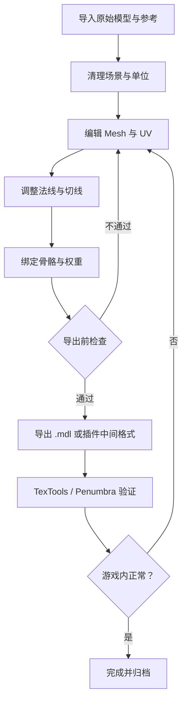

# Blender 工作流

> Applies to: 7.x（Dawntrail） ｜ Last Updated: 2026-11-01

Blender（三维建模软件）负责 FFXIV Mod 中最容易出错的部分：Mesh、UV、法线、骨骼权重与导出。

它不负责最终打包，也不直接决定游戏内材质是否生效。Blender 的输出必须经过 TexTools（资源工具）或 Penumbra（模组加载器）验证。

---

## 推荐版本

| 版本 | 建议 | 说明 |
|---|---|---|
| Blender 4.2 LTS | 首选 🟡 | 长期支持，插件兼容性通常更稳 |
| Blender 4.5 LTS | 可选 🟡 | 较新的 LTS，仍需确认插件支持范围 |
| Blender 5.x | 谨慎 🟡 | 新特性多，但 FFXIV 相关插件未必同步 |

版本选择的第一原则不是「越新越好」，而是「导入导出插件支持」。

!!! warning "不要用最新版试生产"
    如果插件仓库没有明确标注支持某个 Blender 版本，先用 4.2 LTS 完成一次完整导出与游戏内验证，再考虑升级。

---

## 插件生态

FFXIV 相关插件更新频繁，具体名称与支持版本以插件仓库为准。这里只描述需要的能力。

| 能力 | 作用 | 检查点 |
|---|---|---|
| FFXIV 模型导入 / 导出 🟡 | 读取 `.mdl`，写出游戏可读的 Mesh 与骨骼 | 支持当前游戏版本；导出后有日志 |
| 骨骼与权重工具 🟡 | 匹配骨骼名、复制或限制权重 | 骨骼命名与原始模型一致 |
| 材质 / Shader 辅助 🟡 | 预览 Material Slot、贴图与 Shader 参数 | 不覆盖原始 `.mtrl` 的未知字段 |
| UV / 贴图检查 🟡 | 检查重叠、接缝、贴图通道 | 只用于检查，不替代最终游戏测试 |

!!! note "插件不是流程核心"
    插件只解决格式转换。Mesh 是否干净、权重是否合理、UV 是否可读，仍取决于建模习惯。

---

## 导入前的准备

备份原始资源，确认目标模型与 LOD，并统一单位与缩放。只导入要修改的 Mesh，保留一个未修改的参考模型。

---

## 导出前检查清单

| 检查项 | 通过标准 | 常见错误 |
|---|---|---|
| UV | 所有面都有 UV；接缝在隐蔽处；没有意外重叠 | 贴图错位、接缝明显 |
| 法线 | 法线朝外；自定义法线与平滑设置一致 | 黑面、透明、光照异常 |
| 切线 | 需要时导出切线；与 Normal Map 约定一致 | 凹凸方向错误 |
| Vertex Color | 所需颜色通道与 Alpha 存在，数值范围合理 | 染色异常、透明失效 |
| 骨骼权重 | 每个顶点有权重；归一化；骨骼名匹配 | 模型撕裂、局部不动 |
| 三角面 | 导出前三角化；没有 n-gon | 破面、法线错误 |
| 镜像 | Mirror 已应用；Scale 为正；没有负缩放 | 法线翻转、左右错位 |
| 单位与缩放 | 与原始包围盒一致；Apply Scale / Rotation | 模型过大、过小、偏移 |
| Material Slot | 槽位数量、顺序、贴图路径正确 | 发紫、全黑、贴图错位 |
| LOD | 命名、数量、层级与原始模型一致 | 远处消失、穿模 |

!!! tip "先三角化，再检查法线"
    n-gon 在导出后会被自动拆分，拆分方式可能与 Blender 视口不同。先三角化，再确认法线和 UV 没有被破坏。

---

## 法线与切线导出设置

- 使用切线空间 Normal Map，不要导出 object-space Normal Map。
- 导出切线（Tangents），否则游戏可能无法正确计算凹凸。
- 不要在导出后重新计算法线，除非你确认插件的处理顺序。
- 负缩放、镜像和旋转会改变法线方向，导出前统一 Apply。
- Normal Map 的绿色通道约定可能是 DirectX 或 OpenGL 🟡。如果 Blender 内正常、游戏内凹凸相反，先检查绿色通道，不要同时翻转模型法线和贴图。
- Blender 4.1 之后平滑着色与自定义法线的行为有变化 🟡，导出前在插件面板中确认实际选项。

Normal Map 的通道含义见 [Normal Map](../textures/normal-map.md)。

---

## 从模型到游戏内验证

TexTools 的导入与预览步骤见 [TexTools 使用](textools.md)。

---

## 常见问题

### 模型透明或出现黑面

- 先检查法线是否朝外。负缩放和 Mirror 很容易造成翻转。
- 检查材质是否使用了错误的 Shader 或 Alpha 模式。
- 检查 Vertex Color 的 Alpha 是否为 0。
- 检查模型是否只建了单面，而游戏按背面剔除渲染。

### 法线翻转

- 应用 Scale 与 Rotation，确认没有负值。
- 在编辑模式中 Recalculate Outside，再检查自定义法线。
- 确认导出时没有重复翻转绿色通道。
- 如果只有 Normal Map 的凹凸方向相反，优先检查贴图约定，而不是重做 Mesh。

### 权重丢失

- 确认 Armature Modifier 存在，且绑定的是正确骨架。
- 检查顶点组名称是否与骨骼名完全一致。
- 导出时只选 Mesh 而漏选 Armature，可能导致权重信息不完整。
- 检查是否有顶点完全没有权重；这些顶点会被固定在原点或跟随错误骨骼。
- 合并、镜像或重新拓扑后，重新检查权重，不要假设 Blender 会自动保留。

### UV 接缝明显

- 把接缝放在不易观察的位置，并留出足够的贴图 padding。
- 检查 UV 是否超出 0–1 范围后被错误平铺。
- 检查 Mipmap 是否把相邻区域的颜色带入接缝。
- 不要把 UV 接缝与法线接缝混为一谈；两者需要分别检查。

### 模型大小或位置不对

- Apply Scale、Rotation 与 Location。
- 检查原点是否与原始模型一致。
- 检查骨架缩放和父级变换。
- 用原始模型的包围盒做对比，不要只凭视口感觉。

更多症状见 [故障排除](troubleshooting.md)。

---

## 导出后的最低验证

1. 在 TexTools 中预览模型，确认没有明显破面。
2. 检查 Material Slot 与贴图路径是否完整。
3. 在 Penumbra 中只启用该 mod，进入游戏观察。
4. 检查近距离、远距离、不同光照与动作状态。
5. 记录使用的 Blender 版本、插件版本与导出设置。

---

## References

- Blender：https://www.blender.org/
- Blender Manual：https://docs.blender.org/manual/en/latest/
- Penumbra：https://github.com/xivdev/Penumbra
- TexTools：https://github.com/TexTools/FFXIV_TexTools_UI
- XIV Modding Wiki：https://xivmodding.com/
