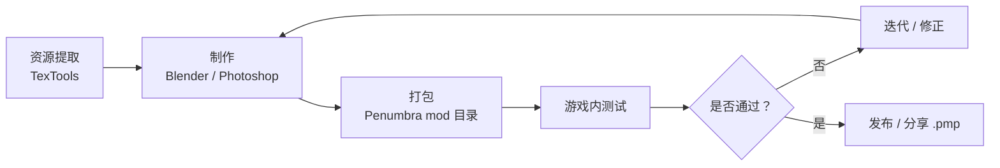

# 工作流总览

> Applies to: 7.x（Dawntrail） ｜ Last Updated: 2026-11-01

典型组合是 TexTools（资源提取与打包工具）、Blender（三维建模软件）、图像编辑软件与 Penumbra（模组加载器）。

每个阶段都有明确的输入、产出和检查点。出问题时，先判断故障属于哪一段，再缩小范围。

---

## 总览流程

---

## 阶段、工具与产出

| 阶段 | 主要工具 | 输入 | 产出 | 检查点 |
|---|---|---|---|---|
| 资源提取 | TexTools | 游戏内原始资源路径 | `.mdl`、`.tex`、`.mtrl` 副本 | 能预览，路径记录完整 |
| 制作 | Blender / Photoshop / GIMP | 原始模型与贴图 | 修改后的 Mesh、UV、贴图 | 法线、Vertex Color、权重正确 |
| 材质 | TexTools / 文本或二进制编辑 | 原 `.mtrl` 与贴图 | 可用的 `.mtrl`、`.tex` | Shader、Sampler、Texture Slot 匹配 |
| 打包 | Penumbra | 游戏路径对应的资源 | mod 目录或 `.pmp` | 路径大小写、分组、默认项正确 |
| 测试 | XIVLauncher / Dalamud | 已启用的 mod | 截图、日志、问题记录 | 可稳定复现，可回退 |
| 迭代 | Blender / TexTools / Penumbra | 测试记录与问题 | 修正后的资源与版本 | 一次只改一个变量，保留可回退版本 |

!!! note "关于版本"
    工具界面与支持的游戏版本会变化。菜单名称、按钮位置以当前版本实际界面为准。

---

## 1. 资源提取

先从游戏内确认目标物件，而不是凭文件名猜。

- 记录装备、种族、性别、部位与模型路径。
- 导出 `.mdl`、相关 `.tex`、`.mtrl`，保留原始副本。
- 在 TexTools 中先预览模型和材质，确认导出成功。
- 将原始资源与工作文件分开存放，避免覆盖后无法回退。

模型路径通常能决定替换是否生效。路径错一位，游戏就会继续加载原模型。

---

## 2. 制作

模型与贴图可以并行处理，但最后必须一起验证。

- Blender 负责 Mesh、UV、法线、骨骼权重与导出检查。
- Photoshop 或 GIMP 负责 Base Color、Normal Map、Mask Map 与 Alpha。
- 材质优先复用原始 `.mtrl`，只改必要的 Texture Slot 与参数。
- 不要同时改模型、UV、材质和贴图；一次只改一类变量。

具体的导出检查见 [Blender 工作流](blender.md)。

---

## 3. 打包

Penumbra 使用「按游戏路径覆盖」的方式加载资源。

- mod 目录内部保持与游戏资源一致的相对路径。
- 用 Group 与 Option 管理互斥变体，例如体型、贴图精度、是否戴帽子。
- 打包前在干净配置中只启用该 mod 测试一次。
- 分享时导出 `.pmp`，不要直接压缩整个工作目录。

目录与分组细节见 [Penumbra 使用](penumbra.md)。

---

## 4. 游戏内测试

测试要回答三个问题：是否加载、是否显示正确、是否与其他 mod 冲突。

1. 只启用目标 mod，确认它能独立工作。
2. 再启用常用 mod，观察是否被覆盖。
3. 检查不同光照、不同距离与不同 LOD。
4. 记录复现步骤，不要只保留一张截图。

如果出现异常，先查 [故障排除](troubleshooting.md) 的症状表。

---

## 工具导航

- :material-package-variant-closed:

    ### TexTools

    解包、预览、导入导出贴图与模型，生成 `.mtrl` / `.tex`。

    [:material-arrow-right: 打开 TexTools 工作流](textools.md)

- :material-cube-outline:

    ### Blender

    Mesh、UV、法线、骨骼权重与导出前检查。

    [:material-arrow-right: 打开 Blender 工作流](blender.md)

- :material-layers-triple:

    ### Penumbra

    运行时覆盖、分组选项、优先级与 `.pmp` 分享。

    [:material-arrow-right: 打开 Penumbra 工作流](penumbra.md)

- :material-stethoscope:

    ### 故障排除

    从症状出发，按加载、路径、资源、材质逐层排查。

    [:material-arrow-right: 打开故障排除](troubleshooting.md)

---

## 为什么推荐 Penumbra 而不是直接改游戏文件

直接替换游戏 DAT 也能看到效果，但代价很高。

| 维度 | 直接修改游戏文件 | 使用 Penumbra |
|---|---|---|
| 可逆性 | 需要手动备份，容易漏文件 | 禁用 mod 即恢复 |
| 切换 | 每次替换都要重启或重进 | 可快速启用、禁用、换选项 |
| 分享 | 需要分发文件并指导覆盖 | 导出 `.pmp` 即可分发 |
| 更新 | 游戏补丁可能直接覆盖 | 资源更新后仍可重新启用 |
| 冲突排查 | 难以判断改了哪些文件 | 可按 mod、分组、优先级定位 |

!!! warning "保留原始资源"
    无论使用哪种方式，都不要把唯一的原始 `.mdl`、`.tex`、`.mtrl` 覆盖掉。至少保留一份只读备份。

Penumbra 的核心价值是「运行时覆盖」。它不修改原始 DAT，因此可以随时回退，也更容易与其他人共享同一套资源。

---

## References

- Penumbra：https://github.com/xivdev/Penumbra
- TexTools：https://github.com/TexTools/FFXIV_TexTools_UI
- TexTools Wiki：https://github.com/TexTools/FFXIV_TexTools_UI/wiki
- Blender：https://www.blender.org/
- XIV Modding Wiki：https://xivmodding.com/
- Dalamud：https://github.com/goatcorp/Dalamud
