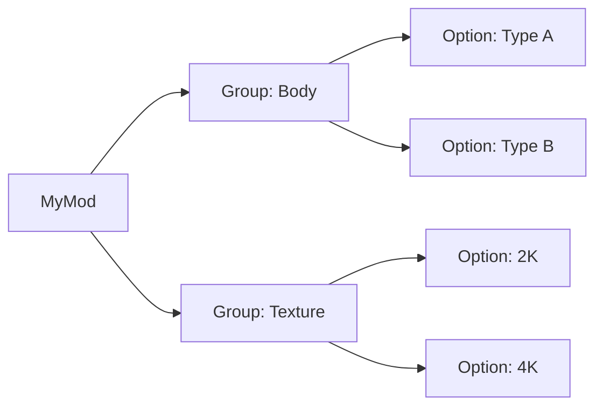

# Penumbra 使用

> Applies to: 7.x（Dawntrail） ｜ Last Updated: 2026-11-01

Penumbra（模组加载器）是 Dalamud（插件框架）生态中最常用的 Mod 管理与加载工具。

它在游戏运行时按路径覆盖资源，不修改原始 DAT。禁用 mod 后，游戏会回到原始状态；具体按钮与字段以当前版本实际界面为准。

---

## 它是什么

| 能力 | 说明 |
|---|---|
| 运行时覆盖 | 游戏读取资源时，用 mod 文件替换原始文件 |
| 不修改 DAT | 原始游戏文件保持不变，可随时回退 |
| 分组与选项 | 同一个 mod 内提供不同变体，可在游戏内切换 |
| 优先级 | 多个 mod 修改同一路径时决定谁生效 |

!!! note "它不是建模工具"
    Penumbra 不创建 Mesh、UV 或贴图。它只负责加载已制作好的资源，并管理替换关系。

---

## 目录结构

下面只是通用示意，不是实际玩家路径。mod 根目录的位置由你在 Penumbra 设置中指定。

```text
<Penumbra mod 根目录>/
└── MyMod/
    ├── meta.json                 # 名称、作者、版本等元数据
    ├── default_mod.json          # 默认文件替换与路径映射
    ├── group_001_Body.json       # 分组与选项（文件名示意）
    └── chara/                    # 按游戏内路径存放的资源
        └── ...
```

!!! warning "字段以实际导出为准"
    `meta.json`、`default_mod.json` 与 `group_*.json` 的具体字段会随版本变化 🟡。不要照抄旧模板，优先让 Penumbra 生成后再改必要字段。文件层级必须与游戏资源路径一致。

---

## Group 与 Option

Group 是一组相关变体，Option 是其中一个具体选择。

| 概念 | 作用 | 示例 |
|---|---|---|
| Group | 把互斥或相关的变体放在一起 | 体型、贴图精度、是否戴帽子 |
| Option | Group 中的一个可选项 | 体型 A / 体型 B；2K / 4K |



!!! tip "一个 Group 只解决一类选择"
    不要把体型、发型和贴图精度塞进同一个 Group。选项越多，冲突与误选越难排查。

---

## 组织一个 Mod

1. 新建 mod，填写元数据。
2. 放入默认资源并确认游戏内正常。
3. 为每个变体建立 Group 与 Option，设置默认项。
4. 在干净配置中逐个切换，确认不会互相污染。

体型、配色、贴图精度通常各自独立成 Group。可选配件可以是独立开关，修复补丁则应合并进主文件，避免用户漏装。

---

## 优先级与冲突排查

Penumbra 按资源路径覆盖。两个 mod 提供同一个路径时，必然有一个生效。

优先级用于决定胜负。不同版本对数字方向的说明可能不同，以当前界面提示为准 🟡。

1. 只启用可疑 mod，再逐个加入其他 mod。
2. 交换优先级，确认结果是否改变。
3. 检查路径、Group 与 Option 是否重叠。

| 现象 | 更可能的原因 | 处理 |
|---|---|---|
| 模型正常，贴图不对 | 贴图路径或 Texture Slot 不一致 | 检查 `.tex` 路径与材质引用 |
| 只有部分部件被替换 | 只覆盖了部分路径 | 补全路径，或确认 LOD |
| 完全没变化 | 未启用、选项未选、路径错误 | 先做单独启用测试 |
| 时好时坏 | 多个 mod 竞争同一路径 | 固定优先级，减少重叠 |

!!! warning "不要用优先级掩盖路径错误"
    路径写错时，调优先级不会让文件出现。先确认文件被识别，再处理冲突。

---

## 打包与分享

Penumbra 使用 `.pmp` 作为可分发的 Mod 包。

- 从界面导出 `.pmp`，不要压缩文件夹后改后缀。
- 导出前清理临时文件与个人信息，确认授权与版本。
- 在干净环境测试默认项与所有 Group。

| 格式 | 用途 | 注意 |
|---|---|---|
| mod 目录 | 本地开发与迭代 | 不要直接分享整个工作目录 |
| `.pmp` | Penumbra 分发 | 导入后仍需检查路径与选项 |
| `.ttmp2` | TexTools（资源工具）传统 modpack | 与 `.pmp` 不是同一种结构 |

TexTools modpack 与 Penumbra 的差异见 [TexTools 使用](textools.md)。

!!! note "转换后要复验"
    旧 `.ttmp2` 即使能导入 Penumbra，也可能丢失分组、选项或路径信息 🟡。导入后逐项检查，不要直接发布。

---

## 常见问题

### Mod 不生效

- 确认 mod 已启用，且当前 Collection 包含它。
- 确认至少选择了一个有效 Option，而不是空选项。
- 检查 mod 目录、路径、文件名与大小写。
- 完全重启游戏，或按当前版本支持的方式重新加载。

### 被其他 Mod 覆盖

- 找到修改同一路径的 mod，先禁用其中一个。
- 调整优先级，或删除重复文件。
- 检查两个 mod 是否都提供了同一 Group 的默认项。
- 不要把「后安装」误认为「一定生效」。

### 贴图路径大小写

Windows 通常不区分大小写，但游戏资源路径应按原始形式精确匹配。

- 统一使用游戏内路径的小写形式，并检查空格、下划线与目录层级。
- 重命名后重新导入，不要只改压缩包内的显示名。

### 游戏更新后失效

- 确认 Penumbra 与 Dalamud 已支持当前游戏版本。
- 检查 `.mtrl` 是否因 Shader 或格式变化而失效。
- 从当前版本重新导出原始资源，再迁移修改。

---

## References

- Penumbra：https://github.com/xivdev/Penumbra
- Penumbra Mod Load Order 讨论：https://github.com/xivdev/Penumbra/discussions/190
- TexTools：https://github.com/TexTools/FFXIV_TexTools_UI
- Dalamud：https://github.com/goatcorp/Dalamud
- XIVLauncher：https://github.com/goatcorp/XIVLauncher.Core
- XIV Modding Wiki：https://xivmodding.com/
