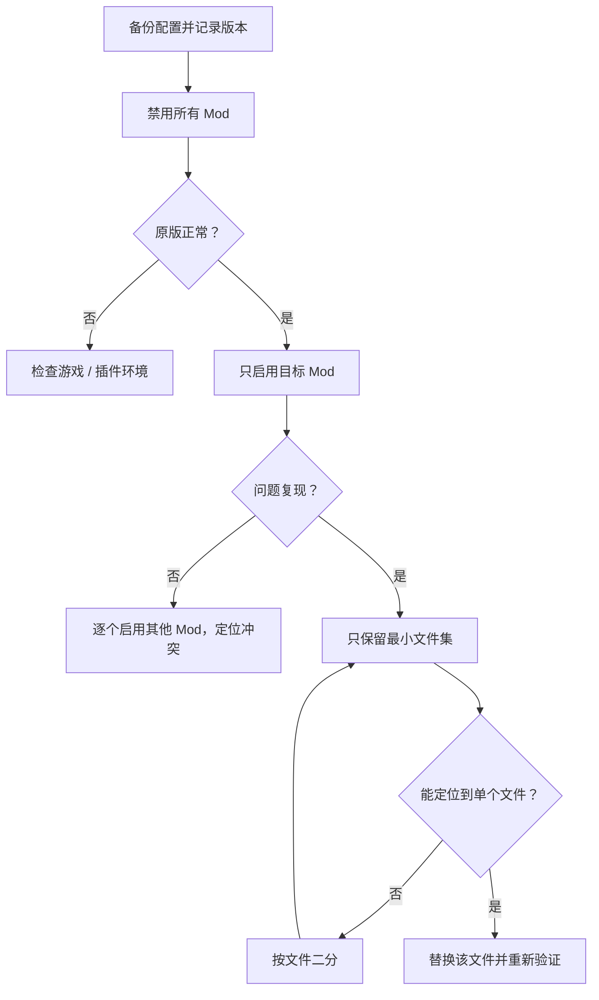

# 故障排除

> Applies to: 7.x（Dawntrail） ｜ Last Updated: 2026-11-01

排查顺序是：加载层 → 路径层 → 资源层 → 材质层 → 场景层。先确认哪一层坏了，再动文件。本文涉及 TexTools（资源工具）、Blender（三维建模软件）与 Penumbra（模组加载器）。

---

## 症状速查表

| 症状 | 可能原因 | 第一步 |
|---|---|---|
| 模型消失 | 路径错误、mod 未启用、`.mdl` 损坏、LOD 缺失 | 只启用该 mod，检查路径与预览 |
| 模型全黑 | 法线翻转、贴图缺失、材质参数错误 | 换回原材质，检查法线与贴图 |
| 全白 / 过曝 | Base Color 过亮、Emissive 过强、色彩空间错误 | 检查贴图与 Emissive |
| 材质发紫 | 贴图缺失、路径错误、Sampler 不匹配 | 检查 `.tex` 引用与路径 |
| 贴图错位 | UV 错误、Texture Slot 错误、Atlas 不对 | 用棋盘格贴图定位 |
| 法线反了 | 负缩放、镜像未应用、绿色通道约定 | 检查 Scale 与 Normal Map |
| Alpha 失效 | Alpha 丢失、Shader 不支持、通道错误 | 检查 DDS Alpha 与材质 |
| 染色不生效 | ColorSet / Index 缺失、Shader 不支持 | 恢复原贴图对比 |
| 游戏崩溃 / 卡 loading | 损坏模型、超大贴图、mod 冲突 | 禁用全部 mod，二分排查 |
| Penumbra 红色错误 | JSON 损坏、文件缺失、`.pmp` 不完整 | 读错误文本，回到上一版 |
| mtrl 版本不兼容 | 游戏更新、旧 modpack、字段变化 | 重新导出当前版本 `.mtrl` |
| 贴图模糊 | 分辨率低、压缩过度、Mipmap 错误 | 对比原图与导出设置 |
| 模型穿模 | 权重错误、比例不符、骨骼位置不对 | 检查权重与原始包围盒 |

---

## 模型消失

先区分「TexTools 也看不到」和「只有游戏里看不到」。

- TexTools 能看到、游戏内没有：优先查路径、大小写、LOD 与 mod 加载。
- TexTools 也看不到：优先查 `.mdl` 是否损坏、导出是否中断。
- 检查模型包围盒、原点与缩放，排除「模型在镜头外」。
- 检查 LOD：近距离正常、远距离消失，通常是 LOD 缺失。

---

## 颜色异常：全黑、全白与发紫

| 现象 | 优先检查 | 常见误判 |
|---|---|---|
| 全黑 | 法线、贴图引用、Material Constant | 以为游戏光照坏了 |
| 全白 / 过曝 | Base Color、Emissive、色彩空间 | 以为贴图丢了 |
| 发紫 | 缺失贴图、路径、Sampler | 以为 Shader 颜色错了 |

- 先换回原始材质或原始贴图，确认问题是否消失。
- 检查 Base Color 是否使用 sRGB，Normal / Mask 是否被当成颜色贴图，以及 Emissive、Specular、Roughness 是否被误改。
- 材质发紫时，优先当作「贴图加载失败」处理，而不是调颜色。

材质结构见 [MTRL 格式](../materials/mtrl-format.md)，贴图类型见 [Base Color](../textures/base-color.md)。

---

## 贴图错位与 UV 接缝

- 确认使用的是 Base Color、Normal、Mask 还是 Multi Map。
- 用棋盘格贴图替换目标贴图，快速判断 UV 是否对齐。
- 检查 UV 是否被镜像、旋转或超出 0–1 范围，以及 Atlas UV 区域与接缝 padding。

UV 编辑与导出检查见 [Blender 工作流](blender.md)。

---

## 法线反了与黑面

- 检查 Scale 是否为负值，Mirror 是否已经应用，并重新计算外侧法线与自定义法线。
- 确认导出时没有重复翻转绿色通道，切线是否导出。
- 如果 Blender 内正常、游戏内凹凸相反，先检查绿色通道约定 🟡。
- 不要同时翻转模型法线和贴图；一次只改一个变量。

---

## Alpha 失效

- 检查 DDS 是否保留 Alpha，以及导入 `.tex` 时是否选择了会丢弃 Alpha 的压缩格式。
- 检查材质是否使用支持透明的 Shader，以及 Alpha 模式是否正确。
- 检查 Vertex Color 的 Alpha 是否为 0，以及与透明相关的 Mask 通道。

---

## 染色不生效

FFXIV 的染色通常依赖 ColorSet、Index Texture、Shader Key 与材质参数。

- 先恢复原始贴图与材质，确认原版染色正常。
- 检查 Shader 是否支持染色，以及装备本身是否有可染色区域。
- 检查自定义贴图是否保留 Index / ColorSet 通道；只有部分区域不染色时，优先查 Index 贴图与 UV 区域。

ColorSet 的说明见 [Color Set](../textures/color-set.md)。

---

## 启动与加载故障

### 游戏崩溃 / 卡 Loading

- 禁用所有 mod，确认原版能进入游戏。
- 只启用目标 mod，再逐个加入其他 mod；检查异常大的贴图、损坏的 `.mdl` 与版本不匹配的插件。

### Penumbra 红色错误

- 先读错误文本，确认是 JSON、路径还是缺少文件。
- 检查 `meta.json`、`default_mod.json` 与 `.pmp` 是否完整，回到最近一次可用版本，不要用「全部重装」代替定位。

### mtrl 版本不兼容

- 游戏更新后旧 `.mtrl` 可能不再匹配；从当前版本重新导出，只迁移必要修改。
- 不要手改未知版本字段，也不要用来源不明的旧材质覆盖。

---

## 贴图模糊

- 确认源图分辨率足够，不要用 1K 放大到 4K 期待细节。
- 检查 DDS 压缩、Mipmap、游戏内纹理质量，以及是否把 Normal / Mask 当成 Base Color 导入。
- 对比原版贴图；如果原版也糊，问题可能不在 mod。

---

## 模型穿模

- 检查模型比例与原始包围盒，以及关节、腋下、裙摆与大腿附近的权重。
- 检查动作状态与 LOD，不要只看 T-pose 和近距离。
- 不要用整体缩小模型来掩盖权重问题。

---

## 最小复现法

目标不是「修好一个文件」，而是找到「哪一个变量导致问题」。

执行时遵守三条：一次只改一个变量；记录游戏、插件与工具的版本；修复后回归所有 Group 与 Option。

---

## References

- Penumbra：https://github.com/xivdev/Penumbra
- TexTools：https://github.com/TexTools/FFXIV_TexTools_UI
- TexTools Wiki：https://github.com/TexTools/FFXIV_TexTools_UI/wiki
- Blender：https://www.blender.org/
- XIV Modding Wiki：https://xivmodding.com/
- Dalamud：https://github.com/goatcorp/Dalamud
